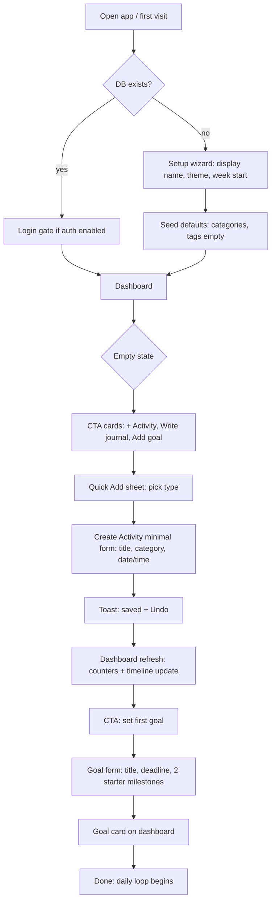
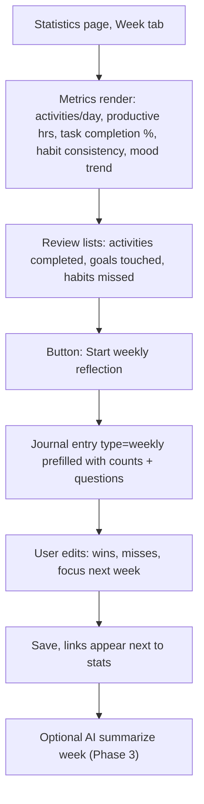
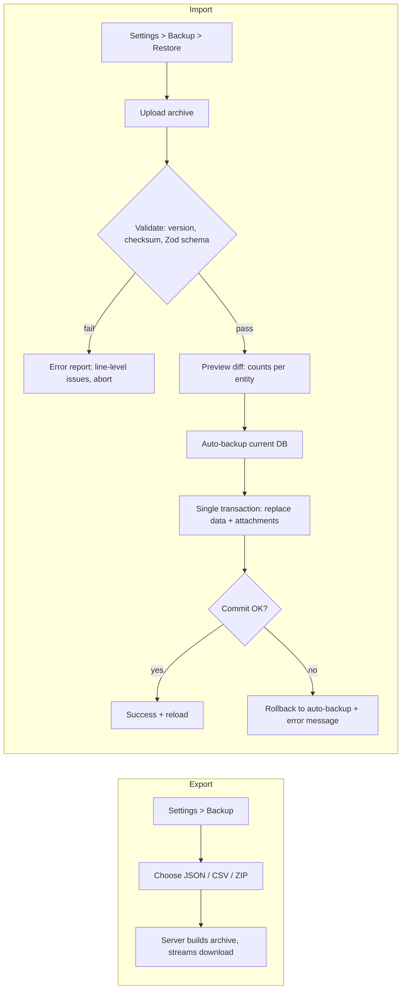
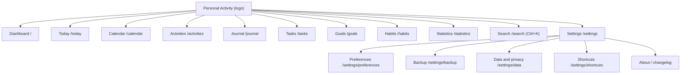

# Chunk 03 — User Flows, Feature Specification, Information Architecture

## 1. User Flows (spec §47)

### 1.1 First-time user (onboarding)



Rules:
- No account creation step in Phase 1 (assumption A1/A2). Setup wizard writes `preferences` row only.
- Seeding is idempotent, runs inside first-connection migration hook.
- Skip-setup link always available; defaults: theme=system, week start=Sunday.

### 1.2 Daily usage loop

```mermaid
flowchart LR
    A["Morning: open Dashboard"] --> B["Review today tasks + habits"]
    B --> C["Work block"]
    C --> D["Quick Add: log activity (Ctrl+N or FAB)"]
    D --> E{"Activity type"}
    E -- planned earlier --> F["Mark planned Done"]
    E -- ad hoc --> G["Create + auto-fill start = last end"]
    F --> H["Afternoon: check habits on Today page"]
    G --> H
    H --> I["Evening: open Journal (Ctrl+J)"]
    I --> J["Answer prompts, pick mood"]
    J --> K{"Streak-worthy?"}
    K -- yes --> H
    K -- no --> L["Autosave, done"]
    L --> M["Optional: AI day summary (Phase 3, local only)"]
```



### 1.3 Weekly review flow



Monthly reflection reuses same flow with `type=monthly` and month range.

### 1.4 Backup / restore flow



### 1.5 Attachment upload flow (data flow)

```mermaid
sequenceDiagram
    participant U as Client (dropzone)
    participant A as Route POST /api/attachments
    participant V as validation layer
    participant S as LocalStorageProvider
    participant DB as SQLite
    U->>A: FormData(file, entityType, entityId?)
    A->>V: size cap, magic bytes, MIME allowlist, name sanitize
    V-->>A: OK / 415 / 413 / 422
    A->>DB: INSERT attachment row (status=pending if entityId null)
    A->>S: put(key=uuid.ext under entityType/yyyy/mm)
    S-->>A: storagePath
    A->>DB: UPDATE row status=ready
    A-->>U: {id, url}
    Note over U,A: GET /api/files/:id streams with CSP + nosniff; unbound drafts GC after 72 h
```

## 2. Information Architecture & navigation (spec §23–24)

### 2.1 Desktop IA



Sidebar: collapsible (icon rail ↔ 240 px), state in `localStorage`; sections divided visually: main nav / Search / Settings+Backup (spec §23 dividers). "＋ Add" primary button top-left opens Quick Add sheet.

### 2.2 Mobile IA

- Bottom nav 5 slots: **Home(/) · Today · [+ FAB] · Calendar · More**
- FAB → Quick Add sheet (Activity, Task, Journal, Habit check, Goal)
- More → sheet listing Activities, Journal(all), Tasks, Goals, Habits, Statistics, Search, Settings
- Long-press FAB (Phase 2) → "last used type" shortcut

### 2.3 URL state contract

| Page | URL params owned | Notes |
|------|------------------|-------|
| /activities | `?range=&category=&tags=&status=&sort=&page=&q=` | Server-parsed, Zod schema, shareable/bookmarkable |
| /journal | `?view=month&date=YYYY-MM-DD` | Deep link to entry = `/journal/[date]` |
| /calendar | `?view=month&cursor=YYYY-MM&types=a,t,g,h,j` | `types` = entity filter set |
| /tasks | `?list=today\|week\|overdue\|done&goal=&category=` | |
| /goals | `?status=active\|all\|archived` | |
| /habits | `?view=grid\|heatmap&month=` | |
| /statistics | `?period=day\|week\|month&from=` | |
| /search | `?q=&types=&from=&to=` | |

Rule: **filters that survive reload go in the URL**; ephemeral UI state (dialog open, row hover, draft text) never does.

## 3. Page inventory & routing (spec §48)

Routes under `app/(shell)` group (all share sidebar/bottom-nav layout). Per-page Purpose = chunk 10 sections; Layout/Components = chunk 04 + §2 above; Data = primary query below; Actions = chunk 07 §3; States = chunk 11 §4.

| Route | RSC/client split | Data (primary query) | User actions | Empty/Loading/Error (states convention) | Responsive |
|-------|------------------|----------------------|--------------|------------------------------------------|------------|
| `/` dashboard | RSC + island (QuickAdd) | `getDashboardSnapshot(today)` | quick add, toggles | wizard if no prefs; zero-data CTA cards; skeletons; toast+retry | 2-col → 1-col stack |
| `/today` | RSC | day slice union | check habits, add prefilled | day-empty prompt | mobile-first page |
| `/activities` | RSC list + client filters | paginated join tags/category | CRUD, dup, filter | EmptyState+CTA, skeleton rows, per-segment error | table→stacked cards; filter→sheet |
| `/activities/new` | — dialog via `@modal` | — | create | — | dialog→drawer |
| `/activities/[id]` | RSC + edit dialog | activity + attachments + related | edit/dup/delete | 404 → not-found | drawer mobile |
| `/journal` | RSC month grid | entries for month | open/create day entry | months w/o entries dimmed | grid compresses |
| `/journal/[date]` | RSC shell + TipTap client | entry by date (or template) — canonical journal URL is date; `/journal/[id]` alias redirect | write, autosave, mood, attach, finalize | fresh template shown | 720 px reading, full-bleed mobile |
| `/tasks` | RSC + optimistic rows | grouped lists | add/toggle/reorder | "No tasks for today. Add one with Ctrl+T." | lanes stack |
| `/goals` · `/goals/[id]` | RSC + progress island | goals / goal+milestones+linked | CRUD, milestones, links | cards grid; archived tab | grid→1-col |
| `/habits` | RSC + check islands | habits + logs window | CRUD, check, backfill | add-first-habit CTA | strips scroll-x |
| `/calendar` | client-heavy view | `getEventsForRange(from,to)` | navigate, filter, click-create | day cells blank, peek popover | swipe month |
| `/statistics` | RSC aggregates + Recharts islands | precomputed buckets | period switch, review CTA | all-zero empty state | charts ≤ 5 series |
| `/search` | RSC | FTS5 query | drill by type | "no matches" + suggestions | palette mirrors |
| `/settings/{,backup,preferences,data,shortcuts}` | RSC + forms | prefs, storage size, backup history | save, export/restore | backup-history empty | stacked |
| `/lock` (Phase 2) | client | — | unlock | — | — |

Parallel routes: `@modal` slot hosts create/edit dialogs so deep links open dialog over list.

## 4. Feature specification summary

Full per-feature detail + acceptance criteria: **chunk 10**. Boundary rules that apply across features:

1. **Dates**: all calendar-day logic uses *local* dates stored as `TEXT 'YYYY-MM-DD'`; timed events store `startTime/endTime` as local `HH:mm` TEXT + `start_epoch INTEGER` companion for ordering. No timezone math in DB beyond date bucketing.
2. **Ids**: UUIDv7 string, generated in service layer (time-ordered → index-friendly).
3. **Soft delete** on `activities`, `journals`, `goals` (`deleted_at`); hard delete only via explicit "delete forever" or cascade. Others hard-delete with confirm.
4. **Optimistic UI**: toggles (task done, habit check, milestone) mutate immediately, roll back on action error + toast.
5. **Undo**: create/complete actions expose Undo in toast for 8 s (client-side compensating action, not DB transaction).
6. **Derived fields** (duration, progress, streak, completion-rate) computed in pure `lib/domain/*` — single source of truth in base rows; duration column is a documented snapshot exception (§06 §6).
7. **Empty state = design feature**: every list defines a calm empty state with the one next action (chunk 04 §9).
