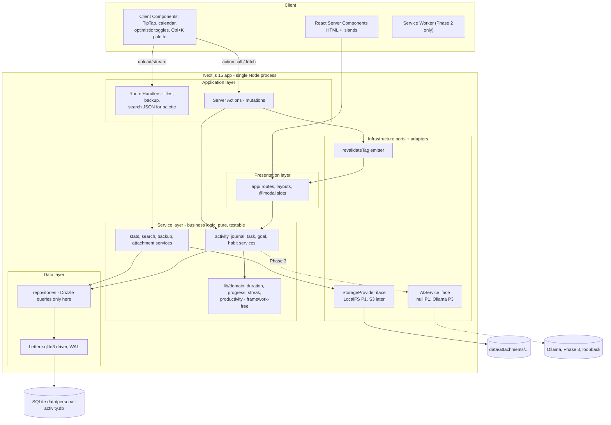

# Chunk 05 — System Architecture, Technology Stack, Decision Matrix

> **As built:** deviations for this area are recorded in [16-implementation-notes.md](16-implementation-notes.md).

## 1. Architecture constraints (spec §51)

Driving constraints, in priority order:

1. **Local-first & private** — runs offline from one machine; no mandatory external service.
2. **Single-owner simplicity** — one developer + AI agents must hold the whole design in their head.
3. **Data ownership** — entire state under one `DATA_DIR`; portable by file copy.
4. **Modular monolith** — strict internal layering, single deployable; seams named but not activated.
5. **Type-safe end-to-end** — schema (Drizzle) → validation (Zod) → service → action → component.
6. **Reversible choices** — storage/auth/AI/db behind interfaces so swaps don't touch business logic.

Rejected outright for MVP: microservices, k8s, message brokers, GraphQL, separate API server, Redis cache, CDN dependency, ORM-with-runtime-codegen-daemon complexity, event sourcing.

## 2. System architecture (spec §6)



**Layering rules (enforced by eslint boundaries + code review):**

| Layer | May import | May never import |
|-------|-----------|------------------|
| `app/` | features/components, services (read), schemas | repositories, driver, fs |
| Server Actions | services, schemas | drizzle/sql directly |
| Services | repositories, `lib/domain`, ports (StorageProvider) | React, next/server |
| Repositories | `db/schema`, `db/client` | business rules, other repos' concerns |
| `lib/domain` | nothing app-specific (pure TS) | db, react, fs |

```mermaid
sequenceDiagram
    participant C as Client
    participant A as Server Action (features/activities/actions.ts)
    participant Z as activityInputSchema.parse
    participant S as ActivityService
    participant R as ActivityRepository
    participant D as SQLite (WAL txn)
    C->>A: formData / typed input
    A->>Z: validate (server-side Zod)
    Z-->>A: typed dto (or throws fieldErrors)
    A->>S: createActivity(dto)
    S->>S: uuid v7, derive duration, default status, sanitize
    S->>R: insert + tags upsert + FTS trigger
    R->>D: BEGIN; INSERT activity, activity_tags; COMMIT
    D-->>R: ok
    R-->>S: row
    S->>S: revalidateTag('activities'), 'dashboard'
    S-->>A: Activity
    A-->>C: ok + data - toast + router refresh / optimistic reconcile
```

## 3. Technology stack & decision matrix (spec §3, §50)

| Area | Options | Recommendation | Reason (project-specific, not popularity) |
|------|---------|----------------|-------------------------------------------|
| Framework | Next.js / Remix / Vite+SPA / SvelteKit | **Next.js 15 (App Router) + React 19 + TypeScript 5.7 strict** | Spec preference; RSC minimizes client JS for data-heavy personal app; Server Actions kill boilerplate for local CRUD; deploy story for self-host. Remix viable but loses action/form integration + ecosystem of chosen libs |
| Language | TS / JS | **TS strict, `noUncheckedIndexedAccess`, path alias `@/*`** | 10-year data + single maintainer → types are the memory |
| DB | A SQLite+Drizzle / B SQLite+Prisma / C Postgres+Drizzle / D PGlite / E IndexedDB | **Option A: SQLite + Drizzle** (details chunk 06) | Single-file ownership, zero server, WAL perf fits 1 user, backup=copy, FTS5 built in. Prisma: heavier engines, binary bloat, weaker migration control in local-first. Postgres: server process = deployment friction for MVP. PGlite: wasm, immature durability story on Node long-run, no better-sqlite3 perf. IndexedDB: browser-scoped (fails "copy folder" ownership), per-origin data loss risk |
| ORM | Drizzle / Prisma / Kysely / raw | **Drizzle ORM + better-sqlite3** | SQL-first, types from schema, zero codegen step, migrations as inspectable SQL files, tiny runtime. Kysely close second; Prisma rejected above |
| Migrations | drizzle-kit | **drizzle-kit generate + `migrations/` committed, `_journal` + app `schema_version`** | Human-readable SQL diffs; auditable = ownership |
| UI | Tailwind / vanilla-extract / CSS Modules | **Tailwind CSS v4** (CSS-first config) | Spec; tokens as CSS vars; team+AI agent familiarity |
| Components | shadcn/ui / MUI / Radix raw / Chakra | **shadcn/ui (copied source)** | Spec; ownership of component code matches data-ownership ethos; theming via tokens; a11y from Radix |
| Icons | Lucide | **Lucide** | Spec; consistent stroke set |
| Fonts | Inter / Geist / Plus Jakarta | **Inter** (chunk 04 §3) | tabular numerals for stats, variable font |
| Validation | Zod / Valibot / Yup | **Zod v4** | Spec-friendly, one schema drives forms+server+DB dto; bundle cost irrelevant (server-side primary, shared but tree-shaken client). Valibot faster+smaller but ecosystem adapters (react-hook-form/shadcn Form, drizzle-zod) all speak Zod today — DX beats 2 KB |
| State | Zustand / Context / TanStack Query / none | **Mostly none: RSC + Server Actions + URL.** TanStack Query only for the 2 genuinely client-paginated/infinite flows; Zustand limited to `ShortcutProvider` + UI-only stores; Context for theme/session prefs | Don't build a cache we don't need — server has the data; "global state" is the DB |
| Data fetching | Server Components / TanStack Query / SWR | **RSC reads, Server Actions writes**; Query islands where refetch-on-focus/optimistic pagination matters (activities infinite list) | Local loopback fetch latency ~0 — the usual "server cache" pain is absent; cache invalidation via `revalidateTag` |
| Forms | react-hook-form + Zod resolver | **RHF only where dynamic (journal multi-field, goal editor); native `<form action>` + server validation elsewhere** | Progressive enhancement, fewer client JS |
| Editor | TipTap / Lexical / CodeMirror+Markdown | **TipTap** (comparison chunk 10 §3) | Structured JSON persistence matches DB storage + FTS plaintext extraction; prompt-section extensions fit journal; lower lift than Lexical custom pipeline; Markdown textarea viable fallback but weaker mobile + structured export |
| Dates | date-fns v4 / Day.js / Temporal | **date-fns** (+ `Intl` formatting) | Tree-shakeable, tz helpers for streak logic; Temporal still staging |
| Charts | Recharts / Chart.js / visx | **Recharts** (eval chunk 11 §3) | Declarative React composition w/ theme tokens, SSR-safe wrapper; Chart.js canvas = theme/a11y friction |
| Upload | Uppy / plain fetch | **plain fetch + FormData → route handler** | One entity, one flow — library overkill |
| Testing | Vitest / Jest; Playwright; Testing Library | **Vitest + Playwright + TL/react + axe-core** | Spec; Vitest = ESM speed, shares TS config; Jest no advantage (chunk 13 §1) |
| E2E | Playwright / Cypress | **Playwright** | Spec; better multi-context, mobile emulation |
| Lint/format | ESLint 9 flat + Prettier + typescript-eslint + eslint-plugin-boundaries + tailwind plugin + jsx-a11y | ✅ | Boundaries plugin enforces §2 layer table mechanically |
| PWA | @serwist/next or none | **Deferred Phase 2, then @serwist/next** | App-shell offline ≠ data offline for SQLite server; honest scope first (chunk 12 §1) |
| Auth | none / Auth.js / Better Auth / custom | **none in MVP; Better-Auth behind flag Phase 2** (chunk 09) | Local-only assumption; Auth.js = heavier + provider focus we don't need |
| Logging | pino / consola | **pino** (prod structured) + thin `logger` façade | Spec §46 |
| Zip | fflate | **fflate** | pure JS, streams, small, no native build |
| IDs | uuid v7 | **uuid (v7)** | time-sortable PKs → locality → index efficiency |
| Package mgr | pnpm / npm | **pnpm** | disk-efficient monorepo-ready, spec lists first |
| Runtime/Node | Node 22 LTS | ✅ | Next 15 requires ≥ 18.18; 22 LTS = current stable recommendation |
| Deploy | Vercel / Docker / bare | **Docker (node:22-slim) for self-host; bare `pnpm start` fine; Vercel explicitly discouraged** | FS attachments + SQLite need persistent disk (chunk 09 §5) |

## 4. Folder structure (spec §40)

```text
personal-activity/
├── data/                          # gitignored — THE user's folder (DATA_DIR)
│   ├── personal-activity.db(+ -wal/-shm)
│   ├── attachments/{activities|journals|tasks|goals}/{yyyy}/{mm}/{uuid}.jpg
│   └── backups/{auto/,manual/}
├── drizzle/                       # generated SQL migrations (committed)
├── drizzle.config.ts
├── playwright.config.ts · vitest.config.ts · next.config.ts
├── public/                        # static, manifest icons, offline shell
├── src/
│   ├── app/                       # ROUTING ONLY — thin: layouts, pages, route handlers
│   │   ├── (auth)/lock/           # Phase 2
│   │   ├── (shell)/               # authed app group w/ sidebar layout
│   │   │   ├── page.tsx           # dashboard
│   │   │   ├── today/ activities/ activities/@modal/… journal/ tasks/
│   │   │   ├── goals/ habits/ calendar/ statistics/ search/
│   │   │   └── settings/{backup,preferences,data,shortcuts}/
│   │   ├── api/                   # route handlers: attachments, files/[id],
│   │   │   │                      # backup/export, health (chunk 07)
│   │   │   └── …
│   │   ├── onboarding/            # setup wizard (outside shell)
│   │   ├── error.tsx global-error.tsx not-found.tsx loading.tsx
│   │   └── layout.tsx globals.css manifest.ts robots? (no robots for local)
│   ├── components/                # cross-feature UI
│   │   ├── ui/                    # shadcn primitives (owned copies)
│   │   ├── layout/                # app-sidebar, bottom-nav, page-header, theme-provider
│   │   └── shared/                # empty-state, stat-card, confirm-dialog, undo-toast,
│   │                              # attachment-dropzone, timeline, calendar-*, chart-card…
│   ├── features/                  # VERTICAL SLICES — the heart of modularity
│   │   └── activities/
│   │       ├── actions.ts         # 'use server' — zod parse → service → result
│   │       ├── queries.ts         # server read helpers (RSC data loaders)
│   │       ├── service.ts         # business rules, orchestration, revalidate
│   │       ├── repository.ts      # drizzle queries, the ONLY sql for this feature
│   │       ├── components/        # activity-list, activity-form, filter-bar…
│   │       ├── hooks/             # use-activities-infinite (client islands)
│   │       └── types.ts           # feature-local view models
│   │   ├── journal/ tasks/ goals/ habits/ calendar/ statistics/
│   │   ├── search/ attachments/ backup/ settings/ dashboard/
│   ├── db/
│   │   ├── schema.ts              # ALL tables (drizzle) — single source of shape
│   │   ├── client.ts              # better-sqlite3 singleton + pragma setup + lazy migrate
│   │   ├── migrate.ts · seed.ts   # seed = default categories
│   │   └── fts.ts                 # FTS5 bootstrap + maintenance
│   ├── schemas/                   # Zod: entity + input + search + backup contracts
│   ├── lib/
│   │   ├── domain/                # PURE: duration.ts goal-progress.ts habit-streak.ts
│   │   │                          #         productivity-score.ts mood.ts dates.ts
│   │   ├── storage/               # StorageProvider iface + local-fs adapter (+ s3 stub)
│   │   ├── ai/                    # AIService iface + providers (Phase 3)
│   │   ├── auth/                  # session helpers (Phase 2 behind flag)
│   │   ├── files/                 # magic-mime detect, sanitize, safe-zip helpers
│   │   ├── logger.ts errors.ts ids.ts utils.ts cn.ts constants.ts
│   │   └── security/              # headers, csrf helpers, rate-limiter(mem)
│   ├── hooks/                     # global client hooks (use-shortcuts, use-media-query…)
│   ├── config/                    # site.ts, nav.ts, categories.ts, shortcuts.ts
│   ├── types/                     # shared TS types, db inferred re-exports
│   └── tests/                     # unit/ integration/ e2e/ factories/ setup/
├── .env.example · package.json · tsconfig.json · eslint.config.mjs · components.json
```

**Why `features/` wins over `services/`+`repositories/` top-level dirs (spec sketch):** personal-domain services are *about* their feature; colocating action/service/repository/components makes deletion-by-folder possible and keeps AI-agent context local. Cross-feature logic lives in `lib/domain` (pure) or is explicitly called through another feature's `service.ts` export — never reach into another feature's repository.

## 5. State management map (spec §29)

| State kind | Examples | Where it lives | Mechanism |
|-----------|----------|----------------|-----------|
| Server state | activities list, journal body, stats | RSC props + Cache Components | `revalidateTag` after mutations |
| Mutating client state | optimistic task toggle, habit check | component local + reconciled via returned action payload | `useOptimistic`, roll back on `Result.error` |
| URL state | filters, page, calendar view, search query, selected date | URL search params | Zod-parsed `searchParams` → canonical; `nuqs`-style tiny helper optional |
| Persistent UI state | sidebar collapsed, density, theme | localStorage (+ cookie for theme FOUC) | `useLocalStorageState` hook |
| Global client state (minimal) | shortcut bindings, command palette open, upload queue progress | React Context (shortcuts/prefs) + tiny Zustand store (upload queue only, shared across sheets) | avoid "god store" |
| Derived state | durations, streaks, progress %, counters | computed server-side in RSC; client recomputes only optimistic previews | `lib/domain` shared pure fns |

Rules of thumb: if it matters after reload → DB or URL; if it matters after tab close → nothing; anything else → component. TanStack Query appears exactly at: activities infinite scroll, attachment upload status polling-after-drop, calendar prefetch neighbors. Everything else stays server-first.

## 6. Validation strategy (spec §30)

- Single source: `src/schemas/*.ts` (Zod v4). Drizzle `createInsertSchema`/`selectSchema` extended with refinements; actions `safeParse` inputs; client `Form` uses same schema via `@hookform/resolvers/zod`.
- Every mutation runs **server** validation regardless of client state; client validation is UX, never security.
- Cross-field rules in schema (endTime > startTime; intervalCount ≥ 1; weekly habit target ≤ intervalCount×7).
- Sanitization during parse: trim, collapse whitespace, strip control chars, length caps (title ≤ 200, desc ≤ 5k, journal doc size ≤ 1 MB JSON), tag normalization (lowercase, ≤ 24 chars, ≤ 20/entity).
- TipTap JSON validated by dedicated schema subset (allowlisted nodes/marks — no raw HTML ever persisted; render via schema → XSS-safe).
- Boundary DTOs: `Result<T, FieldErrors>` from all actions (chunk 07 §5) so forms map errors field-by-field.

## 7. Performance plan (spec §31)

**Predicted bottlenecks → mitigation:**

| Bottleneck | Mitigation |
|------------|-----------|
| Dashboard fan-out queries | one `getDashboardSnapshot` with 5 indexed narrow queries batched in single connection; counters as `count(*)` on covering indexes |
| FTS write amplification (external-content triggers) | trigger-based (fast); periodic `optimalize` via `PRAGMA optimize` on shutdown hook; reindex command available |
| Large history lists | keyset pagination (`(date, id) < cursor`), no OFFSET beyond page 3; virtualized long lists (> 100 rows) |
| Journal autosave storms | 1.5 s debounce + `INSERT … ON CONFLICT` upsert; body stored as `text` json, FTS on extracted plain column updated in same txn |
| Heatmap year loads | per-habit aggregate query `GROUP BY date` over 365 rows — bounded, cached 60 s via tag |
| Calendar month range queries | composite index `(date)` per entity; single `getEventsForRange` union-all query |
| Attachment directory growth | hashed subdirs `yyyy/mm`; never readdir-heavy UI — DB is the listing; weekly VACUUM cron + `busy_timeout` |
| SQLite write serialization | WAL mode + `busy_timeout=5000`; single process anyway; transactions kept < 5 ms (no fs work inside txns) |
| Image payloads mobile | `next/image` local provider, AVIF/WebP auto, thumbnail generated on upload (sharp) stored alongside |
| Overfetch | RSC sends serialized payload only for visible slice; command palette queries limit 10/type |

Load budget: HTML shell < 30 KB gzip route chunk; first client JS < 120 KB gzip on /; TipTap + Recharts loaded per-route only. `next build` bundle analyzer in CI asserts budgets.
