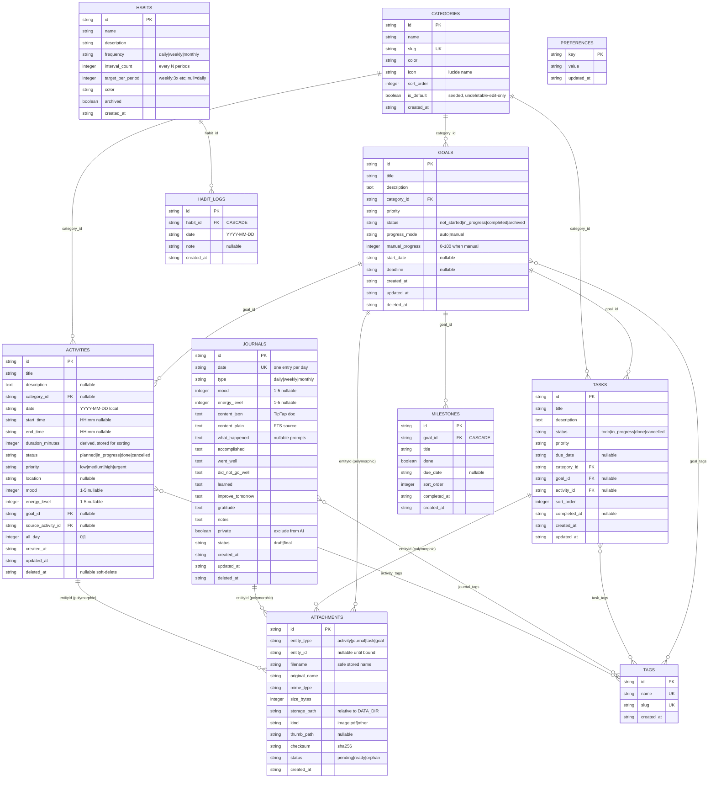

# Chunk 06 — Database Architecture & Schema

## 1. Database option evaluation (spec §4)

| Criterion (weight) | A · SQLite + Drizzle | B · SQLite + Prisma | C · PostgreSQL + Drizzle | D · PGlite | E · IndexedDB |
|---|---|---|---|---|---|
| Local dev simplicity (×3) | ★★★★★ file, zero servers | ★★★★ needs engine download | ★★ needs docker/brew service | ★★★★ wasm, no install | ★★★★★ browser-native |
| Data ownership / portability (×3) | ★★★★★ copy one file anywhere, open with any SQLite tool | ★★★★★ same DB | ★★★★ dump/pg_dump, server-bound | ★★★ app-scoped dir, nonstandard | ★★ per-browser-origin, invisible to user, evictable |
| Performance @ personal scale (×2) | ★★★★★ WAL, sub-ms reads; 100k rows trivial | ★★★★ same DB, RPS overhead from engine | ★★★★★ overkill | ★★★ wasm overhead | ★★★ no SQL, JS loops |
| Backup/restore (×3) | ★★★★★ file copy OR built-in `.backup` API — atomic | ★★★★ same | ★★★ logical dump | ★★★★ | ★★ no native export |
| Migration tooling (×2) | ★★★★★ drizzle-kit, plain SQL diffs | ★★★★ prisma migrate | ★★★★★ | ★★★ | ★ n/a (manual) |
| Scalability / future growth (×1) | ★★★★ to ~100 GB / heavy multi-writer → C | ★★★★ same | ★★★★★ | ★★ | ★ |
| Offline story (browser) (×1) | ★★ (server-local, app runs locally = effectively offline) | ★★ | ★★ | ★★★★ (only true in-browser SQL) | ★★★★★ |
| Developer experience (×2) | ★★★★★ typed SQL, sync driver, tiny | ★★★★ DX nice, heavier | ★★★★ | ★★★ young ecosystem | ★★ callback hell / idb wrappers |
| Future cloud migration (×1) | ★★★★★ same SQL → libsql/Turso/PG path | ★★★★ | ★★★★★ | ★★ | ★ |
| **Weighted total** | **96** | 82 | 66 | 55 | 41 |

**Recommendation: Option A — SQLite + Drizzle ORM + `better-sqlite3`.**

Reasoning beyond the matrix:
1. The product *is* a file. `DATA_DIR` containing `personal-activity.db` + `attachments/` satisfies privacy, ownership, backup, and deployment (§43) with one concept.
2. FTS5 full-text search ships inside SQLite — the global-search feature needs zero new infrastructure (§17, chunk 11 §1).
3. `better-sqlite3` is synchronous — ideal with a single-user, single-process Node server: no pool, no async query noise, transactions trivially safe; WAL makes reader/writer concurrency a non-issue.
4. Drizzle keeps migrations as human-readable SQL (auditable = trust), generates TS types from schema, and its SQL-dialect closeness makes the *documented* escape hatch to PostgreSQL/Drizzle (§"future migration" below) mechanical.
5. Prisma's engine binary, query compiler latency, and opaque migrations buy nothing here. PGlite's in-process-wasm model is brilliant for tests, premature for the product (durability/attach performance still maturing). IndexedDB fails data-ownership: per-origin, silently evictable, invisible to file-level backup.

**Accepted limits:** one writer at a time (fine — single process), `DATABASE()` timezone semantics avoided by storing local-date TEXT (§03 §4.1), full-text needs triggers (designed below).

## 2. Storage conventions

- DB file: `{DATA_DIR}/personal-activity.db`; pragmas on connect: `journal_mode=WAL`, `synchronous=NORMAL`, `foreign_keys=ON`, `busy_timeout=5000`, `temp_store=MEMORY`, `cache_size=-32000` (32 MB).
- IDs: UUIDv7 `TEXT` PKs (sortable, locality, no autoincrement leak).
- Timestamps: `created_at`/`updated_at`/event times as `TEXT` ISO-8601 with offset (`2026-10-02T14:30:00+07:00`) **+** companion `*_epoch INTEGER` only where ordering matters (`activities.start_epoch`). Day-bucket fields are `TEXT` `YYYY-MM-DD` local dates (`date` column everywhere).
- Booleans: `INTEGER 0/1`. Enums: `TEXT` + CHECK constraint (readable backups, safe evolution).
- Money-like/none. JSON columns: `TEXT` + Zod parse (journal doc, preferences value).
- Naming: snake_case tables plural; FK `<entity>_id`; indexes `idx_<table>_<cols>`; unique `uq_<table>_<cols>`.

## 3. Entity relationship diagram (spec §38)



Junction tables `activity_tags`, `journal_tags`, `task_tags`, `goal_tags` = (`<x>_id`, `tag_id`) composite PK + FK CASCADE both sides (not drawn per-entity to keep the ERD readable).

### Relationship explanation

- **Polymorphic attachments.** One `attachments` table serves 4 owners. Chosen over 4 FK columns because: entity sets will grow (future `milestone` attachments), listing is uniform, and referential integrity is enforced at *service* level (validate entityType+entityId exists on bind; nightly orphan sweep marks `status=orphan`). Cost documented in chunk 14 risk R7.
- **Tags** are first-class (unique slug) + 4 junction tables — enables "browse by tag" across all entities and cheap rename. Free-text-per-column rejected (duplicate chaos, no global tag search).
- **Category** is a shared, user-extensible dimension for activities/tasks/goals/journals-via-tags; seeded defaults (Work/Study/Personal/Health/Exercise/Project/Other). Deleting an in-use category blocks (RESTRICT) → service offers "uncategorized" reassign first. `category_id` nullable → uncategorized = NULL (no extra table).
- **Goals 1..* Milestones** hard CASCADE (milestone is meaningless without goal). Goals `SET NULL` on tasks/activities → goal deletion must not erase work history.
- **Task `activity_id`** nullable one-way link (task realized as activity); `RESTRICT` delete of linked activity until unlinked.
- **Journals**: unique `date` for `type='daily'` enforced by partial unique index `(date) WHERE type='daily' AND deleted_at IS NULL` — weekly/monthly coexist.
- **HabitLogs** = the only high-volume fact table; natural key `(habit_id, date)` unique; no FK to activities — habits are self-contained; "linked activity id" column considered and dropped (post-hoc correlation ≠ intent; keep MVP lean).
- **Preferences** key-value with Zod-validated value per key; avoids column-add churn (`theme`, `week_start`, `display_name`, `shortcuts`, `attachment_max_bytes`, …).
- **No User table in MVP** (assumption A1). `users` + `sessions` spec'd as *additive* tables for Phase-2 auth flag (chunk 09) so enabling auth is `ALTER`-free (new tables only) and backup format carries an optional `users` section.

## 4. Full SQL schema (DDL blueprint)

Drizzle `schema.ts` must emit equivalent SQL. Condensed but complete; `…common` = `created_at TEXT NOT NULL, updated_at TEXT NOT NULL`.

```sql
CREATE TABLE categories (
  id TEXT PRIMARY KEY, name TEXT NOT NULL, slug TEXT NOT NULL UNIQUE,
  color TEXT, icon TEXT, sort_order INTEGER NOT NULL DEFAULT 0,
  is_default INTEGER NOT NULL DEFAULT 0, created_at TEXT NOT NULL,
  CHECK (length(name) BETWEEN 1 AND 40)
);

CREATE TABLE tags (
  id TEXT PRIMARY KEY, name TEXT NOT NULL, slug TEXT NOT NULL UNIQUE,
  created_at TEXT NOT NULL
);

CREATE TABLE goals (
  id TEXT PRIMARY KEY, title TEXT NOT NULL CHECK (length(title) <= 200),
  description TEXT,
  category_id TEXT REFERENCES categories(id) ON DELETE SET NULL,
  priority TEXT NOT NULL DEFAULT 'medium'
    CHECK (priority IN ('low','medium','high','urgent')),
  status TEXT NOT NULL DEFAULT 'not_started'
    CHECK (status IN ('not_started','in_progress','completed','archived')),
  progress_mode TEXT NOT NULL DEFAULT 'auto' CHECK (progress_mode IN ('auto','manual')),
  manual_progress INTEGER CHECK (manual_progress BETWEEN 0 AND 100),
  start_date TEXT, deadline TEXT,
  created_at TEXT NOT NULL, updated_at TEXT NOT NULL, deleted_at TEXT,
  CHECK (deadline IS NULL OR start_date IS NULL OR deadline >= start_date)
);

CREATE TABLE milestones (
  id TEXT PRIMARY KEY,
  goal_id TEXT NOT NULL REFERENCES goals(id) ON DELETE CASCADE,
  title TEXT NOT NULL CHECK (length(title) <= 200),
  done INTEGER NOT NULL DEFAULT 0,
  due_date TEXT, sort_order INTEGER NOT NULL DEFAULT 0,
  completed_at TEXT, created_at TEXT NOT NULL
);

CREATE TABLE activities (
  id TEXT PRIMARY KEY, title TEXT NOT NULL CHECK (length(title) <= 200),
  description TEXT,
  category_id TEXT REFERENCES categories(id) ON DELETE SET NULL,
  goal_id TEXT REFERENCES goals(id) ON DELETE SET NULL,
  source_activity_id TEXT REFERENCES activities(id) ON DELETE SET NULL,
  date TEXT NOT NULL,                       -- YYYY-MM-DD local
  start_time TEXT, end_time TEXT,           -- HH:mm local, nullable
  start_epoch INTEGER, duration_minutes INTEGER,
  all_day INTEGER NOT NULL DEFAULT 0,
  status TEXT NOT NULL DEFAULT 'planned'
    CHECK (status IN ('planned','in_progress','done','cancelled')),
  priority TEXT NOT NULL DEFAULT 'medium'
    CHECK (priority IN ('low','medium','high','urgent')),
  location TEXT, mood INTEGER CHECK (mood BETWEEN 1 AND 5),
  energy_level INTEGER CHECK (energy_level BETWEEN 1 AND 5),
  created_at TEXT NOT NULL, updated_at TEXT NOT NULL, deleted_at TEXT,
  CHECK (start_time IS NULL OR end_time IS NULL OR end_time > start_time)
);

CREATE TABLE tasks (
  id TEXT PRIMARY KEY, title TEXT NOT NULL CHECK (length(title) <= 200),
  description TEXT,
  status TEXT NOT NULL DEFAULT 'todo'
    CHECK (status IN ('todo','in_progress','done','cancelled')),
  priority TEXT NOT NULL DEFAULT 'medium'
    CHECK (priority IN ('low','medium','high','urgent')),
  due_date TEXT,
  category_id TEXT REFERENCES categories(id) ON DELETE SET NULL,
  goal_id TEXT REFERENCES goals(id) ON DELETE SET NULL,
  activity_id TEXT REFERENCES activities(id) ON DELETE RESTRICT,
  sort_order INTEGER NOT NULL DEFAULT 0,
  completed_at TEXT, created_at TEXT NOT NULL, updated_at TEXT NOT NULL
);

CREATE TABLE journals (
  id TEXT PRIMARY KEY,
  date TEXT NOT NULL,                       -- YYYY-MM-DD local
  type TEXT NOT NULL DEFAULT 'daily' CHECK (type IN ('daily','weekly','monthly')),
  mood INTEGER CHECK (mood BETWEEN 1 AND 5),
  energy_level INTEGER CHECK (energy_level BETWEEN 1 AND 5),
  content_json TEXT NOT NULL DEFAULT '{}',
  content_plain TEXT NOT NULL DEFAULT '',
  what_happened TEXT, accomplished TEXT, went_well TEXT, did_not_go_well TEXT,
  learned TEXT, improve_tomorrow TEXT, gratitude TEXT, notes TEXT,
  private INTEGER NOT NULL DEFAULT 0,
  status TEXT NOT NULL DEFAULT 'draft' CHECK (status IN ('draft','final')),
  created_at TEXT NOT NULL, updated_at TEXT NOT NULL, deleted_at TEXT
);

CREATE TABLE habits (
  id TEXT PRIMARY KEY, name TEXT NOT NULL CHECK (length(name) <= 80),
  description TEXT,
  frequency TEXT NOT NULL DEFAULT 'daily' CHECK (frequency IN ('daily','weekly','monthly')),
  interval_count INTEGER NOT NULL DEFAULT 1 CHECK (interval_count >= 1),
  target_per_period INTEGER CHECK (target_per_period >= 1),
  color TEXT, archived INTEGER NOT NULL DEFAULT 0,
  created_at TEXT NOT NULL, updated_at TEXT NOT NULL
);

CREATE TABLE habit_logs (
  id TEXT PRIMARY KEY,
  habit_id TEXT NOT NULL REFERENCES habits(id) ON DELETE CASCADE,
  date TEXT NOT NULL,                       -- YYYY-MM-DD
  note TEXT, created_at TEXT NOT NULL
);

CREATE TABLE attachments (
  id TEXT PRIMARY KEY,
  entity_type TEXT NOT NULL CHECK (entity_type IN ('activity','journal','task','goal')),
  entity_id TEXT,                           -- NULL while pending; service-bound
  filename TEXT NOT NULL, original_name TEXT NOT NULL,
  mime_type TEXT NOT NULL, size_bytes INTEGER NOT NULL,
  storage_path TEXT NOT NULL UNIQUE, kind TEXT NOT NULL CHECK (kind IN ('image','pdf','other')),
  thumb_path TEXT, checksum TEXT NOT NULL,
  status TEXT NOT NULL DEFAULT 'pending' CHECK (status IN ('pending','ready','orphan')),
  created_at TEXT NOT NULL
);

CREATE TABLE activity_tags (activity_id TEXT NOT NULL REFERENCES activities(id) ON DELETE CASCADE,
  tag_id TEXT NOT NULL REFERENCES tags(id) ON DELETE CASCADE, PRIMARY KEY (activity_id, tag_id));
CREATE TABLE journal_tags (journal_id TEXT NOT NULL REFERENCES journals(id) ON DELETE CASCADE,
  tag_id TEXT NOT NULL REFERENCES tags(id) ON DELETE CASCADE, PRIMARY KEY (journal_id, tag_id));
CREATE TABLE task_tags   (task_id TEXT NOT NULL REFERENCES tasks(id) ON DELETE CASCADE,
  tag_id TEXT NOT NULL REFERENCES tags(id) ON DELETE CASCADE, PRIMARY KEY (task_id, tag_id));
CREATE TABLE goal_tags   (goal_id TEXT NOT NULL REFERENCES goals(id) ON DELETE CASCADE,
  tag_id TEXT NOT NULL REFERENCES tags(id) ON DELETE CASCADE, PRIMARY KEY (goal_id, tag_id));

CREATE TABLE preferences (key TEXT PRIMARY KEY, value TEXT NOT NULL, updated_at TEXT NOT NULL);

CREATE TABLE meta (key TEXT PRIMARY KEY, value TEXT NOT NULL);
-- meta('schema_version') = integer; app checks vs drizzle journal on boot
```

## 5. Indexing strategy (spec §38.4)

```sql
-- activity browsing: the dashboard/today/calendar path
CREATE INDEX idx_act_date_alive      ON activities(date, deleted_at) WHERE deleted_at IS NULL;
CREATE INDEX idx_act_cat_date        ON activities(category_id, date);
CREATE INDEX idx_act_status_date     ON activities(status, date)    WHERE deleted_at IS NULL;
CREATE INDEX idx_act_goal            ON activities(goal_id)         WHERE goal_id IS NOT NULL;
CREATE INDEX idx_act_epoch           ON activities(start_epoch)     WHERE start_epoch IS NOT NULL;
-- tasks
CREATE INDEX idx_task_status_due     ON tasks(status, due_date);
CREATE INDEX idx_task_goal           ON tasks(goal_id)              WHERE goal_id IS NOT NULL;
CREATE INDEX idx_task_due_alive      ON tasks(due_date)             WHERE status IN ('todo','in_progress');
-- goals / milestones
CREATE INDEX idx_goal_status         ON goals(status)               WHERE deleted_at IS NULL;
CREATE INDEX idx_goal_deadline       ON goals(deadline)             WHERE deleted_at IS NULL AND deadline IS NOT NULL;
CREATE INDEX idx_ms_goal             ON milestones(goal_id, sort_order);
-- journals
CREATE UNIQUE INDEX uq_journal_daily ON journals(date) WHERE type='daily' AND deleted_at IS NULL;
CREATE INDEX idx_journal_date        ON journals(date DESC);
-- habits
CREATE UNIQUE INDEX uq_habitlog      ON habit_logs(habit_id, date);
CREATE INDEX idx_habitlog_date       ON habit_logs(date);
-- attachments
CREATE INDEX idx_att_entity          ON attachments(entity_type, entity_id);
CREATE INDEX idx_att_status          ON attachments(status)         WHERE status != 'ready';
-- tags
CREATE INDEX idx_tag_act             ON activity_tags(tag_id);
CREATE INDEX idx_tag_journal         ON journal_tags(tag_id);
CREATE INDEX idx_tag_task            ON task_tags(tag_id);
CREATE INDEX idx_tag_goal            ON goal_tags(tag_id);
-- fts tables: see chunk 11 §1 (external-content FTS5 + trigram for CJK-ish tolerance optional; default unicode61)
```

Principles: partial indexes where `deleted_at`/status filters are permanent (smaller = faster); covering `(date, id)` for keyset pagination; `PRAGMA optimize` on graceful shutdown; query plans spot-checked with `EXPLAIN QUERY PLAN` in CI for the 8 golden queries (dashboard snapshot, today, calendar range, search, habits heatmap, goal list, tasks lists, stats week).

## 6. Derived-data rules (single source of truth)

| Derived value | Rule | Where computed |
|---------------|------|----------------|
| `duration_minutes` | `end-start` in minutes; stored snapshot on save **because** edits happen after delete-of-time; recomputed if either changes; NULL if incomplete | service (writes column) |
| Goal progress % | auto: `round(done milestones / total × 100)`, 0% if none; manual: `manual_progress` | `lib/domain/goal-progress` |
| Habit streak | gap-and-island over `habit_logs` per frequency calendar (daily: consecutive days; weekly: weeks meeting target; monthly: months meeting target) | `lib/domain/habit-streak` |
| Completion rate | logs in window / expected occurrences in window (frequency-aware) | same module |
| Productivity score (0–100) | weighted: tasks done 35% · planned-activity adherence 25% · habit consistency 25% · journal+reflection presence 15%; documented formula chunk 11 §3.4 | `lib/domain/productivity-score` |
| Journal `content_plain` | deterministic HTML-strip of TipTap JSON on save (FTS + preview + export) | service |

## 7. Transactions & integrity rules

- Every multi-statement mutation in a `db.transaction()` (better-sqlite3 immediate tx): create-with-tags, import, backup-snapshot, journal-save(+FTS+attachments-bind).
- Import runs inside one txn with deferred FTS rebuild; on any row error → rollback + structured report (chunk 11 §2.3).
- Weekly maintenance job (in-app, on-boot-if-stale): `VACUUM`, `PRAGMA integrity_check` logged, orphan attachment sweep.

## 8. Migration & versioning policy

- drizzle-kit generates SQL diffs → committed to `drizzle/`; `db/migrate.ts` applies idempotently at startup (before first request; Docker healthcheck waits on it).
- `meta('schema_version')` mirrors backup contract (chunk 11 §2) — import refuses unknown-newer versions, auto-migrates older known ones via registered transforms.
- Column changes follow expand→migrate→contract (never destructive in one release); destructive SQL must carry a `-- LOSSY:` comment + paired backup reminder.

## 9. PostgreSQL / future migration path (documented, not built)

If the app ever needs multi-writer sync: repositories are the only SQL surface; SQLite-specific touchpoints = pragmas, FTS5 module, partial indexes — all have PG equivalents (`tsvector`, partial indexes identical). `drizzle` dialect switch + `postgres` driver ≈ bounded work. IndexedDB/PGlite remain rejected (chunk 06 §1).
