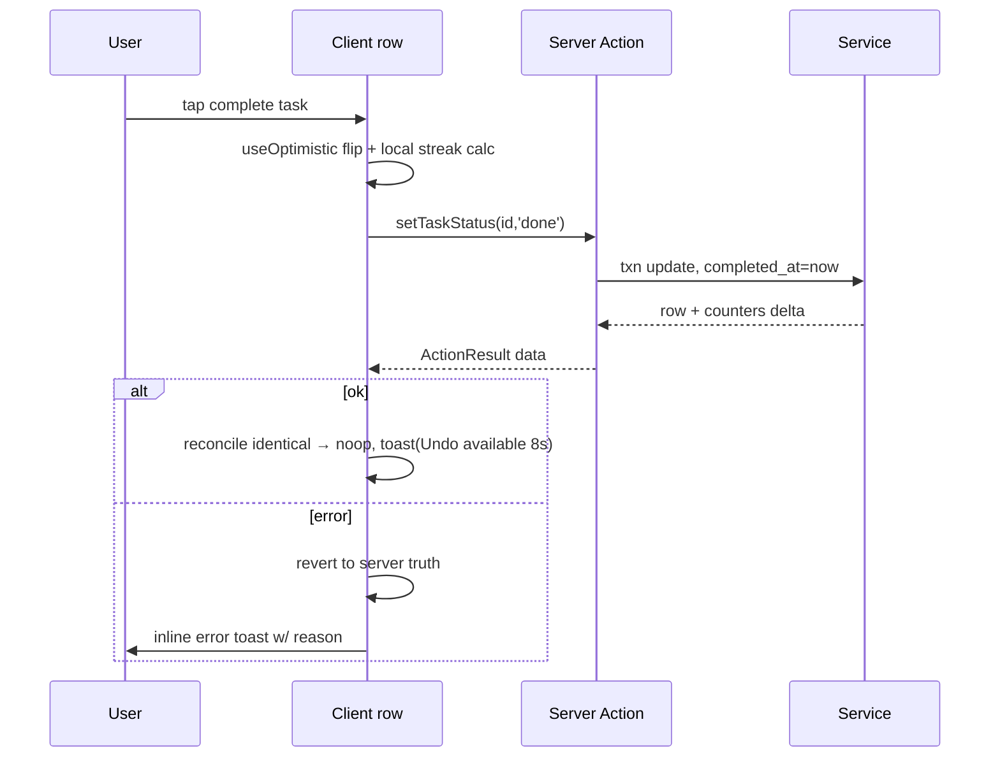

# Chunk 07 — API Architecture & Server Actions

> **As built:** deviations for this area are recorded in [16-implementation-notes.md](16-implementation-notes.md).

## 1. Server Actions vs Route Handlers — decision rule (spec §39)

| Use | For | Why |
|-----|-----|-----|
| **Server Actions** (default) | every create/update/delete/toggle mutation; form flows; optimistic client calls | No endpoint design tax, type-safe RPC from components, progressive enhancement (forms work pre-JS), CSRF + same-origin protections built into Next, revalidation (`revalidateTag`) is native |
| **Route Handlers** | (a) file streaming GET, (b) multipart upload POST, (c) binary downloads (export), (d) future machine-facing API, (e) health | Streaming/binary/`FormData`-first ergonomics; stable URLs (``, `fetch` upload progress); external-tool compatibility |

Data-fetching reads are **not** APIs: they are RSC loaders in `queries.ts` / repository reads. Only the command palette and calendar prefetch *optionally* hit JSON endpoints (documented below) because they need ad-hoc client-side fetches — both remain thin wrappers over the same service functions (no logic duplication).

## 2. Route handler inventory (complete)

All under `src/app/api/`. Responses use the shared envelope (§5). Auth column: MVP all handlers assume local-only; when auth flag on, every handler passes `requireSession()` except `/health`.

| Method · Path | Purpose | Notes |
|---|---|---|
| `POST /api/attachments` | multipart upload → store + row | fields: `file`, `entityType`, optional `entityId`; validation pipeline §08; 413/415/422 codes |
| `GET /api/files/:id` | stream original file | `Content-Disposition: inline` unless `?dl=1`; immutable cache w/ ETag id-version; `X-Content-Type-Options: nosniff`; CSP `default-src 'none'` + `Content-Disposition` for html/svg-mislead protection (svg served only if trusted-extension policy, else download) |
| `GET /api/files/:id/thumb` | generated thumbnail (images) | 404 fallback → original |
| `DELETE /api/attachments/:id` | delete row + file | action-equivalent exists; REST kept for API parity |
| `GET /api/export?format=json|csv|zip` | stream backup archive | chunk 11 §2; `Content-Disposition` w/ dated filename |
| `POST /api/import` | multipart restore archive | transactional; returns per-entity diff report |
| `GET /api/search?q=&types=&limit=` | FTS5 JSON results | used by ⌘K palette |
| `GET /api/events?from=&to=&types=` | calendar feed JSON | client calendar prefetch |
| `GET /api/health` | `{ok, db:"writable", uptime, schemaVersion}` | no auth; never exposes paths/errors detail |
| `* /api/ai/*` | **Phase 3** summary/generate endpoints | flag-gated, localhost providers only by default |

**Deliberately absent REST CRUD** for activities/journals/tasks/goals/habits — spec example endpoints (`GET/POST /api/activities`, `PATCH/DELETE /:id`) are *satisfied at the action layer*; exposing full REST CRUD day-one would double the surface without a client that needs it. **Compliance note:** when Phase 3 machine access is requested, a generated REST shim over the same services is the documented path; acceptance criterion AC-API-1 (chunk 10 §10) covers "every mutation reachable via a stable interface."

## 3. Server Actions catalog (grouped by feature, `features/<x>/actions.ts`)

Actions receive **typed input** (plain object) from client forms or `FormData` from progressive-enhancement forms; return `ActionResult<T>` (§5). All names exported from `'use server'` modules.

### Common CRUD actions per entity

| Action | Input (Zod schema in `schemas/`) | Behavior |
|--------|----------------------------------|----------|
| `createActivity(input)` | `activityInsertSchema` | derive duration/epoch, tag upsert, txn, revalidate `activities`,`dashboard`,`calendar` |
| `updateActivity(id, patch)` | `activityPatchSchema` | diff-safe partial update, version check via `updated_at` |
| `deleteActivity(id, {hard})` | | default soft → `deleted_at`; hard removes row+junctions, attachments→orphan sweep |
| `duplicateActivity(id, {date})` | | copy minus times, set `source_activity_id` |
| `setActivityStatus(id, status)` | | completes/starts, maintains timestamps |
| `attachTags(entityKind, id, tagIds)` | | idempotent set-replace |
| `createJournalForDate(date)` / `saveJournal(input)` | `journalUpsertSchema` | **upsert by date+type**; plain-text extraction; autosave-safe |
| `finalizeJournal(id)` / `deleteJournal(id)` | | status draft↔final; soft delete |
| `createTask / updateTask / deleteTask` | `taskSchema` | |
| `setTaskStatus(id, status)` | | sets/clears `completed_at` |
| `reorderTasks(orderedIds, listCtx)` | | bulk `sort_order` |
| `convertTaskToActivity(taskId, {date})` | Phase 2 | link back via `activity_id` |
| `createGoal / updateGoal / deleteGoal(soft) / archiveGoal` | `goalSchema` | |
| `setGoalProgressMode(id, mode, manual?)` | | |
| `addMilestone(goalId, input) / updateMilestone / deleteMilestone / toggleMilestone(id)` | | toggle sets `completed_at`; revalidate goal+dashboard |
| `linkTaskToGoal(taskId, goalId|null) / linkActivityToGoal` | | |
| `createHabit / updateHabit / archiveHabit / deleteHabit(hard w/ confirm)` | `habitSchema` | |
| `toggleHabitLog(habitId, date)` | | unique index upsert/delete; returns new streak for optimistic UI |
| `setPreference(key, value)` | per-key Zod map | whitelisted keys only |
| `seedDefaults / completeOnboarding(prefs)` | | idempotent |
| `exportData(format)` | | triggers `GET /api/export` URL return |
| `validateBackup(file)` / `importBackup(file, {strategy})` | | two-step: preview report → apply |
| `deleteEverything(confirmPhrase)` | | settings → danger zone; requires phrase `DELETE`; auto-backup first |

### Action contract rules

1. **Validate first** — `schema.safeParse`; on failure return `{ok:false, fieldErrors}` (HTTP never — actions aren't HTTP-coded).
2. **No partial failure mid-txn** — multi-table writes inside `db.transaction`.
3. **Revalidate last** — tags emitted after commit, batched set defined per action in code comment.
4. **Auth hook point** — every action's line 2 (when flag): `await requireSession()` — placed once in a shared `guardedAction()` wrapper.
5. **Idempotency where cheap** — `toggleHabitLog` carries expected state; mismatch → return current truth instead of blindly flipping.
6. **Errors logged server-side, generic client-side** (chunk 13 §2).
7. Action modules contain no queries; queries modules contain no mutations (lint rule).

## 4. Data flow: optimistic UI pattern



## 5. Shared contracts

```ts
// src/types/result.ts
type ActionResult<T> =
  | { ok: true;  data: T; revalidated?: string[] }
  | { ok: false; code: ActionErrorCode;           // VALIDATION | NOT_FOUND | CONFLICT | FORBIDDEN | STORAGE | DB | UNKNOWN
        message: string; fieldErrors?: Record<string, string[]>; details?: never };

// Route handler JSON envelope (chunk 13 §2 mapping table):
{ "ok": false, "error": { "code": "FILE_TOO_LARGE", "message": "File exceeds 10 MB limit.", "requestId": "…" } }
```

`requestId` ties UI error to structured server log without leaking internals (spec §37 "never expose stack traces").
