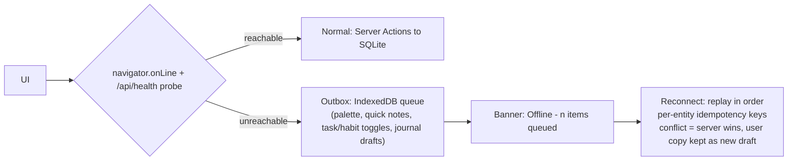

# Chunk 12 — PWA, Offline Strategy, AI Integration, Notifications, Logging

## 1. PWA strategy (spec §32)

**Decision: Phase 2, with the shell prepared in Phase 1.**

| Feature | Phase | Reasoning |
|---------|-------|-----------|
| Installable (manifest, icons, standalone display) | **P1 (trivial)** | `app/manifest.ts` + icons cost nothing; "install" ≠ "offline" |
| App-shell offline (nav + cached static + "you're offline" screens) | **P2** | Service worker +precached routes = small win, low risk |
| **Full data offline (write while offline)** | **P2, scoped** | The honest blocker: SQLite lives in the *Node* process, not the browser. True offline writes require a client datastore + sync layer = the complexity this SDD explicitly rejects for MVP (see §2). |
| Background sync of queued writes | **P2** | paired with outbox below |
| Local notifications | **P2** | §4 |

Why not Phase 1: MVP is designed to be used on the machine that holds the data (`localhost` or LAN NAS) — the server is *right there*, so offline is nearly a non-requirement. Spending the first cycle on SW caching + IndexedDB mirroring would delay the features that make the product valuable (capture, journal, backup) and add a sync layer that's the #1 listed risk (chunk 14 R5). Ship install + shell cache later when users actually report "airplane mode usage."

## 2. Offline-first evaluation (spec §33)

Target architecture from spec (`UI → local data layer → IndexedDB/SQLite → sync → optional server`) evaluated:

| Criterion | Full offline-first (client IndexedDB/PGlite + sync) | **Chosen: local-server-first** |
|---|---|---|
| Matches "local & private" | ✅ | ✅ same — no cloud exists |
| Works when app server unreachable | ✅ (in browser) | ➖ only if server process is down/remote |
| Single source of truth | ❌ two stores + merge engine | ✅ one SQLite file |
| Data reliability (crash/eviction) | ❌ browser storage eviction, IndexedDB opacity | ✅ WAL + file copy backup |
| Dev complexity | ❌ high (conflict resolution, migrations ×2, sync protocol) | ✅ low |
| Multi-device later | ✅ (eventually) | ➖ needs sync layer anyway; no head start worth taking |
| Backup story | ❌ browser-bound data | ✅ copy folder |

**Conclusion:** "Local-first" for this product means *the user's own machine runs the server*, not *the browser is the database*. SQLite-on-disk already delivers privacy/ownership/reliability without a sync layer.

**P2 pragmatic offline plan (bounded complexity):**

Rules: outbox limited to append-light ops (create activity/task/habit-log, journal draft text saves); no offline deletes/edits of existing entities in P2 (avoids most conflict classes); replay serialized in one txn batch; UI marks queued items with a clock chip. This keeps the *reliability vs complexity* balance the spec asks for, and defers any true multi-device sync to a Phase-3+ decision (documented seam, not built).

## 3. AI integration (spec §34)

**Hard rule:** `AI_ENABLED=false` default; removing all AI code leaves a fully functional app (no feature degrades except summary/assist buttons hidden — enforced by an AI-off integration run in CI).

### 3.1 Abstraction (port + adapters)

```ts
interface AIService {
  summarizeDay(ctx: ActivitySummaryInput): Promise<Result<string>>
  weeklyReview(ctx: ReviewInput): Promise<Result<{summary, themes[]}>>
  journalAssistant(ctx: {prompt, excerpt}): Promise<Result<string[]>>   // reflection questions
  breakDownGoal(ctx: {title, deadline}): Promise<Result<{milestones: string[], tasks: string[]}>>
  providerInfo(): {id, remote, model}
}
// adapters: NullProvider (default, no-ops w/ disabled UI) · OllamaProvider (loopback)
//           OpenAIProvider · GeminiProvider · LocalModelProvider (llama.cpp server)
```
Factory reads `AI_PROVIDER`; per-feature enable flags `ai.enabled.dailySummary`, `ai.enabled.weeklyReview`, …; prompt+response audit log written to `data/ai-log.jsonl` (local, redactable, off switch).

### 3.2 Features (all opt-in, Phase 3)

| Feature | Input (minimal) | Output | Fallback |
|---------|-----------------|--------|----------|
| Daily summary | today's activities titles+categories+counters | 2–3 calm sentences | server-side deterministic template summary (no AI) shown as "summary" — AI only upgrades wording |
| Weekly review | week buckets + counts, journal `learned/improve` excerpts | summary + themes bullets | stats page already has numbers |
| Journal assistant | current prompt + last 3 non-private excerpts | follow-up questions only | static question bank |
| Goal assistant | goal title + deadline + category | milestone/task suggestions (user edits before saving; nothing auto-created) | templates per category |

### 3.3 Privacy gates (before any network send)

1. Consent modal per feature, listing exactly the text to be sent (pre-rendered payload preview) + destination/model.
2. `journal.private=1` excluded always; tag exclusion list (`ai.exclude_tags`); regex redaction (email/phone/URL) default-on.
3. Remote providers require env `AI_ALLOW_REMOTE=true` — UI shows a persistent badge "AI: remote" while enabled.
4. No training/telemetry uploads; prompts never logged with content unless audit log on (default on, local only, one-click wipe).
5. Rate/size caps: payload ≤ 8 KB text, 60 s cooldown between requests.

## 4. Notifications (spec §35)

MVP: **none implemented** beyond in-app nudges (dashboard journal card, streak-at-risk chip, overdue banner) — these cost no permissions and cover most value.

Phase 2 minimal layer: preference-driven local reminders using **Service Worker + Notification API + periodic background sync where browser supports** (`Periodic Synchronization API` Chromium; iOS Safari no-op fallback documented honestly): journal-at-21:00, habit-incomplete-at-20:00, overdue-task-daily-once, goal-deadline-T-2-days. Scheduling client-side from `preferences` (no server cron needed; server-side cron considered and rejected — device may be off). Snooze/dnd windows. Not Phase 1 because it forces PWA+SW which §1 defers. Email/webpush explicitly out of scope (web-push = third-party service dependency; email = SMTP secrets).

## 5. Logging strategy (spec §46)

| Environment | Mode |
|-------------|------|
| Development | pretty single-line via `pino-pretty`, levels ≥ debug, SQL statements optional flag `LOG_SQL=1` (drizzle logger adapter) |
| Production | `pino` structured JSON to stdout (container log driver handles rotation) + `data/logs/app.jsonl` rolling (10 MB × 5) so local users can inspect without a terminal |

Structured event taxonomy (stable keys, machine-quotable in tests): `db.migrate.applied`, `entity.created {entity,id}` (no content), `attachment.uploaded {id,size,mime}` (no filename), `backup.exported/exported_bytes/imported {counts}` , `auth.login_failed {ip}` (P2), `error.unexpected {requestId, msg, stack?prod:false}`.

**Privacy rule (spec §46):** log IDs, counters, durations, codes — **never journal bodies, activity descriptions, attachment names, or search queries** (query *hit counts* allowed, never the term — flagged as a lintable convention: `logger.info` cannot receive a `content` field). Security-relevant events (auth failures, upload rejections, import checksum mismatch, delete-everything) logged at `warn` with timestamps, retained 90 d, surfaced in a "Recent security events" list (P2 with auth). Error logs keep `requestId` linking UI → log. `AI prompt log` separate file with its own toggle. Health endpoint reports only booleans/counters, no paths.
