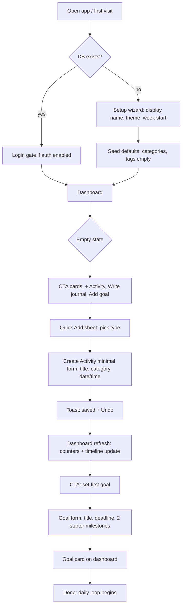
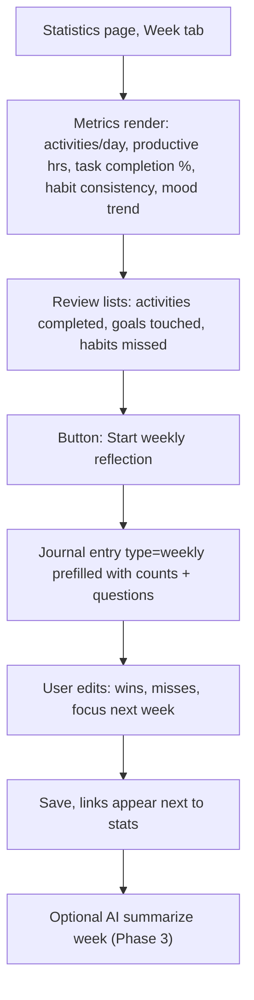
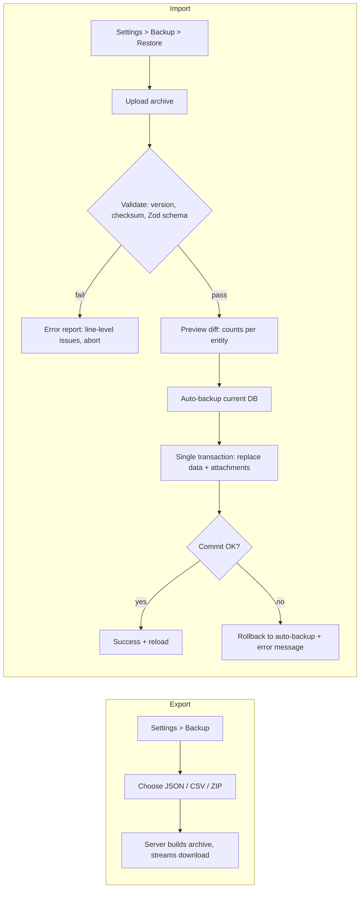
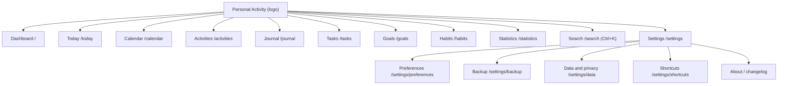
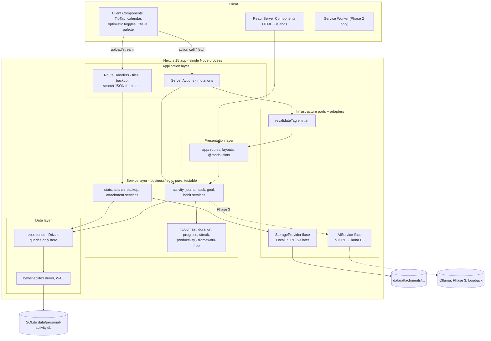
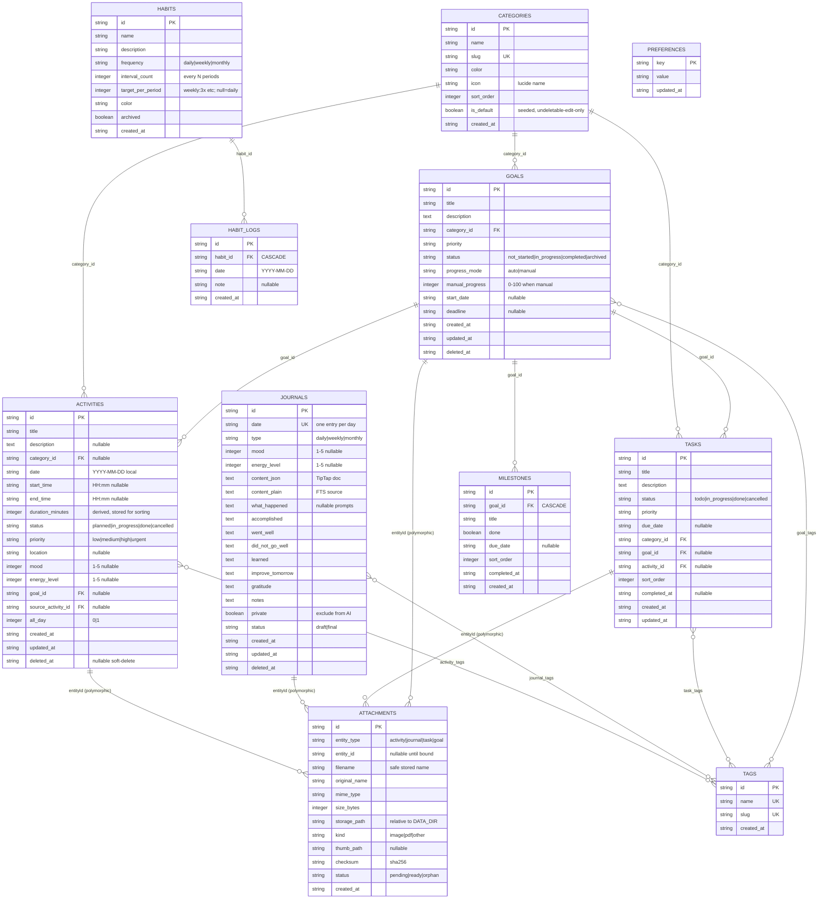
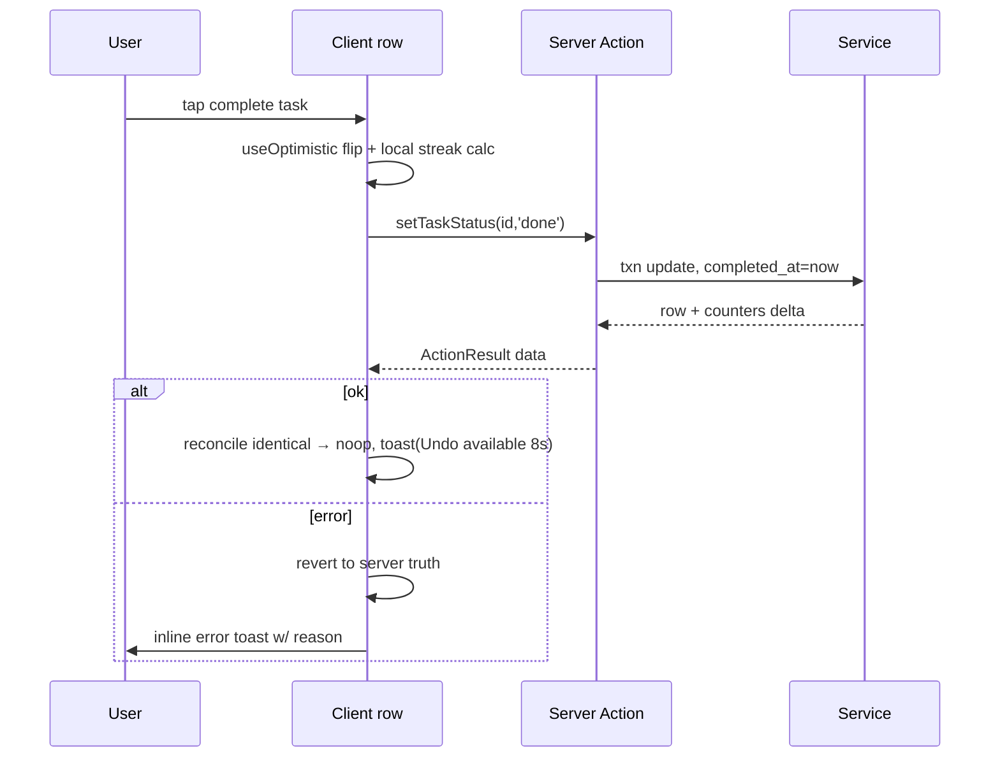
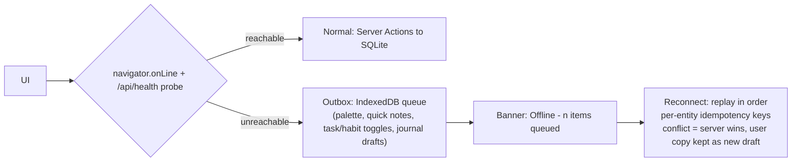

# Personal Activity — Software Design Document

**Version 1.0 · 2026-10-02 · Master assembly of chunks 01–15. Source spec: plan_SSD.txt (sections 1–58).**

## Table of contents
- [# Personal Activity — Software Design Document](01-overview.md)
- [# Chunk 02 — Requirements](02-requirements.md)
- [# Chunk 03 — User Flows, Feature Specification, Information Architecture](03-user-flows.md)
- [# Chunk 04 — UI/UX Specification & Design System](04-uiux-design-system.md)
- [# Chunk 05 — System Architecture, Technology Stack, Decision Matrix](05-architecture.md)
- [# Chunk 06 — Database Architecture & Schema](06-database.md)
- [# Chunk 07 — API Architecture & Server Actions](07-api-server-actions.md)
- [# Chunk 08 — File Storage Architecture & Attachments (spec §5, §18)](08-storage-attachments.md)
- [# Chunk 09 — Authentication, Authorization, Privacy, Security, Deployment](09-auth-security.md)
- [# Chunk 10 — Feature Specification, Pages & Acceptance Criteria](10-features.md)
- [# Chunk 11 — Backup/Restore, Search Architecture, Statistics Architecture](11-backup-search-stats.md)
- [# Chunk 12 — PWA, Offline Strategy, AI Integration, Notifications, Logging](12-pwa-offline-ai-notif.md)
- [# Chunk 13 — Testing, Error Handling, Environment, Development Environment](13-quality.md)
- [# Chunk 14 — MVP Roadmap, Development Order, Risks, What NOT to Build](14-risks-roadmap.md)
- [# Chunk 15 — Final SDD Index & Final Recommendation (spec §56–57)](15-final-recommendation.md)


---

# Personal Activity — Software Design Document

**Version:** 1.0 · **Status:** Approved blueprint · **Date:** 2026-10-02
**Document set:** `docs/sdd/01…15` (this file is chunk 01). Assembled master: `docs/sdd/SDD.md`.

---

## Part 1 — Executive Summary

**Personal Activity** is a private, local-first personal activity OS: one web application that combines activity tracking, daily journaling, tasks, goals with milestones, habits, calendar, timeline, statistics, search, and full export/restore — without requiring cloud services, third-party accounts, or AI.

The architecture is a **modular monolith on Next.js 15 (App Router) + TypeScript**, using **SQLite via Drizzle ORM** as the single owned data file and **local filesystem** storage for attachments behind a swappable `StorageProvider` interface. The whole product lives in one directory: delete it and nothing is lost elsewhere; copy it and everything is backed up.

Core delivery boundary (MVP / Phase 1) ships: dashboard, activities, journal, tasks, goals + milestones, habits, calendar, timeline, attachments, FTS5 search, dark mode, and ZIP backup/restore. AI, offline PWA sync, charts-rich analytics, and notifications are later, strictly additive phases.

**Guiding engineering rule:** every layer must be explainable to one developer. No microservices, no queues, no Kubernetes, no distributed sync in MVP. Complexity enters only through named, reversible seams (`StorageProvider`, `AIService`, auth upgrade path).

## Part 2 — Product Vision

> A private, local-first Personal Activity OS that combines activity tracking, journaling, tasks, goals, habits, calendar, statistics, personal reflection, and optional AI-powered insights into one clean and intuitive application.

The product answers one question for the user every day: **"where did my time go, and am I moving toward what matters?"**

Vision properties:

1. **Own your data.** A single folder holds the app, the database file, and attachments. Export is a first-class feature, not an afterthought.
2. **Useful with zero network.** The app runs from `localhost` with no external calls required for any core feature.
3. **Low-friction capture.** Recording an activity or journal line takes seconds (quick add, keyboard palette, mobile FAB).
4. **Reflection loop built in.** Daily → weekly → monthly reflection is a designed flow, not a blank text box.
5. **AI as an optional lens.** Summaries, insights, and planning help arrive through the `AIService` abstraction (local Ollama first). Turning AI off removes nothing essential.

## Part 3 — Goals and Objectives

### Product goals

| # | Goal | Success measure |
|---|------|-----------------|
| G1 | User logs ≥ 5 activities on a typical day by week 2 | Activity count per active day in local stats |
| G2 | Journal habit formed | ≥ 4 entries/week sustained over a month |
| G3 | Full history retrievable | Any record findable via search in < 200 ms p95 |
| G4 | Zero data hostage-taking | Export → wipe → import restores 100% of records |
| G5 | Daily usability on phone | Core capture flows usable one-handed < 10 s |

### Engineering objectives

| # | Objective | Constraint |
|---|-----------|------------|
| E1 | Single-binary-ish deployment | `pnpm start` or one Docker container, one volume |
| E2 | Cold dashboard render | < 1.5 s on local SSD, mid-range laptop |
| E3 | 10-year data horizon | Schema versioned; migrations reversible-forward; SQLite file at 50k activities stays fast |
| E4 | Type safety end-to-end | DB row → service → action → UI, no `any` at boundaries |
| E5 | Testable core | Pure functions for duration, streaks, progress, productivity score |

## Part 4 — Scope

### In scope (documented by this SDD)

- Personal Activity web app (desktop + mobile responsive, installable PWA in Phase 2)
- Entities: Activities, Journals, Tasks, Goals, Milestones, Habits, Habit logs, Categories, Tags, Attachments, Preferences
- Calendar, Timeline, Dashboard, Global search (FTS5), Statistics, Daily/weekly/monthly reflection
- Export/Import (JSON/CSV/ZIP), attachment storage (local FS)
- Single-user operation; optional local auth gate (Phase 2)
- Optional AI via provider abstraction (Phase 3)

### Out of scope (see § "What NOT to build", chunk 14)

- Multi-user, collaboration, sharing, social features
- Real-time sync between devices, CRDT merge engines
- Native mobile apps, browser extensions
- Enterprise permissions/roles, orgs, teams
- Time-tracking metering (stopwatch) beyond start/end duration
- E2E encryption at rest (documented as future option; threat model assumes disk-level trust)

## Part 5 — Assumptions

| # | Assumption | If wrong |
|---|-----------|----------|
| A1 | Single user, single primary device (laptop/phone of same person) | Revisit auth + sync design (documented seam in chunk 09) |
| A2 | App runs on user's own machine or private LAN (Docker/NAS/VPS behind Tailscale) | Cloud deploy requires auth module → Phase 2 becomes mandatory |
| A3 | Data volume ≤ ~50k activities, ~5k journal entries, ~50k habit-log rows over years | FTS5 + indexes sized for this; PostgreSQL migration path exists (chunk 06) |
| A4 | Disk is trusted (device not shared); OS user account is the security boundary | Enable auth gate + optional at-rest encryption (future) |
| A5 | Node.js 22 LTS available; SQLite ≥ 3.4x (FTS5, JSON1 compiled — bundled via `better-sqlite3`) | Pin dependency, no system SQLite reliance |
| A6 | User performs their own backups; app reminds and makes it easy but cannot guarantee it | Phase 2 auto-backup snapshot on each write-day |
| A7 | AI features may send *selected* text to local Ollama by default; remote providers require explicit per-feature opt-in | Privacy gates specified in chunk 12 |
| A8 | English UI first; i18n seam via `next-intl` deferred (not in MVP) | Add locale layer in Phase 3 if needed |
| A9 | Attachments ≤ 10 MB/file default cap, images + PDF priority | Raise cap via config; streaming storage unchanged |

## Requirement → SDD section map

Spec §1–58 coverage (numbers = sections of `plan_SSD.txt`):

| Spec § | Topic | Where answered |
|--------|-------|----------------|
| 1–2 | Overview, objective | This chunk: Parts 1–4 |
| 3 | Tech preference | Chunk 05 |
| 4 | Database options A–E | Chunk 06 §1 |
| 5 | File storage | Chunk 08 |
| 6 | System architecture | Chunk 05 §2 |
| 7 | Dashboard | Chunk 10 §1 |
| 8–13 | Activity, journal, goals, milestones, habits, tasks | Chunk 10 §2–§7 |
| 14–15 | Calendar, timeline | Chunk 10 §8–§9 |
| 16 | Statistics + charts eval | Chunk 11 §3 |
| 17 | Global search | Chunk 11 §1 |
| 18 | Attachments | Chunk 08 |
| 19 | Data ownership | Chunk 11 §2 |
| 20 | Privacy | Chunk 09 §3 |
| 21 | Authentication | Chunk 09 §1 |
| 22–28 | UI/UX, nav, design system, dark mode, shortcuts, quick add | Chunk 04 |
| 29 | State management | Chunk 05 §5 |
| 30 | Validation | Chunk 05 §6 |
| 31 | Performance | Chunk 05 §7 |
| 32–33 | PWA + offline-first | Chunk 12 §1–§2 |
| 34 | AI integration | Chunk 12 §3 |
| 35 | Notifications | Chunk 12 §4 |
| 36 | Accessibility | Chunk 04 §8 |
| 37 | Security | Chunk 09 §4 |
| 38 | Database design | Chunk 06 |
| 39 | API architecture | Chunk 07 |
| 40 | Folder structure | Chunk 05 §4 |
| 41–43 | Env, dev env, deployment | Chunk 13 §4, chunk 05 §8, chunk 09 §5 |
| 44–46 | Testing, error handling, logging | Chunk 13 §1–§3, chunk 12 §5 |
| 47 | User flows | Chunk 03 |
| 48 | Pages | Chunk 10 (per feature) + chunk 03 §IA |
| 49 | MVP definition | Chunk 14 §1 |
| 50 | Decision matrix | Chunk 05 §3 |
| 51 | Constraints | Chunk 05 §1 |
| 52 | Risks | Chunk 14 §4 |
| 53 | Acceptance criteria | Chunk 10 (per feature) |
| 54 | Development order | Chunk 14 §3 |
| 55 | What not to build | Chunk 14 §5 |
| 56–57 | SDD structure, final recommendation | Full set + chunk 15 |

---

# Chunk 02 — Requirements

## 1. Functional Requirements

Priority: **M** = must (Phase 1), **S** = should (Phase 2), **C** = could (Phase 3).

### FR-A Activities

| ID | Requirement | P |
|----|-------------|---|
| FR-A1 | Create/read/update/delete activity with fields: title, description, category, date, startTime, endTime, duration (derived), status, priority, location, mood, energyLevel, tags | M |
| FR-A2 | Duplicate activity (same day or chosen date) | M |
| FR-A3 | Filter by date range, category, tag, status, priority, mood; sort by date/start/priority; free-text search within list | M |
| FR-A4 | Activity detail shows attachments, related tasks, linked goal | M |
| FR-A5 | Statuses: Planned / In Progress / Done / Cancelled. Completing from list is one tap | M |
| FR-A6 | Timeline and calendar projections of activities | M |
| FR-A7 | Convert activity ↔ task (copy fields, keep link) | S |
| FR-A8 | Recurring activity templates | C |

### FR-J Journal

| ID | Requirement | P |
|----|-------------|---|
| FR-J1 | One journal entry per date (unique constraint); create/edit with structured prompts: mood, energy, what happened, accomplished, went well, did not go well, learned, improve tomorrow, gratitude, notes | M |
| FR-J2 | Rich text via TipTap JSON; plain-text extraction for search | M |
| FR-J3 | Autosave draft (debounced ≤ 2 s after pause) with visible save state | M |
| FR-J4 | Browse by date, month list, search; date filter | M |
| FR-J5 | Attachments per entry | M |
| FR-J6 | Export single entry as Markdown | S |
| FR-J7 | Lock/private entries excluded from AI context by default | S |

### FR-T Tasks

| ID | Requirement | P |
|----|-------------|---|
| FR-T1 | Task CRUD: title, description, status (Todo/In Progress/Done/Cancelled), priority (Low/Med/High/Urgent), dueDate, category, tags, optional goalId, optional activityId | M |
| FR-T2 | Quick-add list ("today", "next 7 days", "overdue", "done today") | M |
| FR-T3 | Complete/uncomplete updates `completedAt`; stats consume it | M |
| FR-T4 | Reorder within list (manual sort index) | S |
| FR-T5 | Subtasks | C |

### FR-G Goals & milestones

| ID | Requirement | P |
|----|-------------|---|
| FR-G1 | Goal CRUD: title, description, category, priority, startDate, deadline, status (Not Started/In Progress/Completed/Archived), progressMode (auto/manual), manualProgress | M |
| FR-G2 | Milestones CRUD under a goal: title, done, dueDate optional, sortOrder | M |
| FR-G3 | Auto progress = completed milestones / total milestones; manual override when progressMode=manual; empty milestones → 0% (or manual) | M |
| FR-G4 | Link tasks and activities to goal; goal page aggregates them | M |
| FR-G5 | Goal deadline appears on calendar | M |
| FR-G6 | Archive hides from active lists, keeps history | M |
| FR-G7 | AI: break goal into milestones/tasks | C |

### FR-H Habits

| ID | Requirement | P |
|----|-------------|---|
| FR-H1 | Habit CRUD: name, description, frequency (daily/weekly/monthly + `intervalCount`), targetPerPeriod (for weekly e.g. 3×/week), active flag, color, archivedAt | M |
| FR-H2 | Log completion for a specific date (toggle); one row per (habit, date); backfilling past days allowed | M |
| FR-H3 | Streak (current + best) and completion rate computed | M |
| FR-H4 | Calendar heatmap (last 12 months) per habit; 7-dot strip in list | M |
| FR-H5 | Habit completion today on dashboard/today page | M |
| FR-H6 | Habit reminders | S |

### FR-C Calendar & timeline

| ID | Requirement | P |
|----|-------------|---|
| FR-C1 | Month/week/day views; events from activities, due tasks, goal deadlines, habit due markers, journal-exists dot | M |
| FR-C2 | Filter which entity types show | M |
| FR-C3 | Click day → day detail with timeline; click event → detail | M |
| FR-C4 | Drag-to-create activity on month/week grid | C |
| FR-C5 | Timeline component: hour rail + items, empty-state prompts | M |

### FR-S Search

| ID | Requirement | P |
|----|-------------|---|
| FR-S1 | Global FTS5 search across activities, journals, tasks, goals (title+desc/body), tags | M |
| FR-S2 | Command palette (Ctrl/Cmd+K) with instant results + page routes `/search?q=` | M |
| FR-S3 | Filter results by type, date range | S |
| FR-S4 | Attachment filename search | S |

### FR-B Backup / data ownership

| ID | Requirement | P |
|----|-------------|---|
| FR-B1 | Export all data: JSON (full, canonical), CSV (per-entity zip), ZIP (data.json + metadata.json + schema-version.json + attachments/) | M |
| FR-B2 | Import backup with schema-version check, validation, duplicate strategy (merge-by-id default), transactional apply, error report | M |
| FR-B3 | Pre-import automatic safety backup stored under `data/backups/auto/` | M |
| FR-B4 | Single-entity quick export (journal → Markdown) | S |

### FR-D Dashboard, reflection, stats

| ID | Requirement | P |
|----|-------------|---|
| FR-D1 | Dashboard: greeting + date, today counters (activities, tasks done/total, habits done/total, goal avg %), today timeline, recent journal snippet, quick actions | M |
| FR-D2 | Daily reflection = journal prompts for today (same entity, FR-J) | M |
| FR-D3 | Statistics page: daily/weekly/monthly metrics, category distribution, mood trend, habit consistency | S (counts M, charts S) |
| FR-D4 | Weekly/monthly reflection template entries | S |
| FR-D5 | AI daily summary / weekly review / themes | C |

### FR-U UI/platform

| ID | Requirement | P |
|----|-------------|---|
| FR-U1 | Dark / light / system theme with persisted preference | M |
| FR-U2 | Collapsible sidebar (desktop), bottom nav + FAB + "More" sheet (mobile) | M |
| FR-U3 | Keyboard shortcuts: ⌘/Ctrl+K search, N activity, J journal, T task, ? shortcut help; user-disableable | S |
| FR-U4 | Quick Add sheet: Activity/Journal/Task/Goal/Habit in ≤ 2 interactions | M |
| FR-U5 | PWA installable + offline app-shell | S |
| FR-U6 | Preferences: locale-agnostic date/time format, week start, attachment limits | M |
| FR-U7 | Local auth gate (passkey or password) when enabled | S |

## 2. Non-Functional Requirements

| Category | NFR | Target |
|----------|-----|--------|
| Privacy | Core features with zero network | 100% — no mandatory outbound calls; CSP forbids it (§09) |
| Privacy | Third-party scripts in MVP | 0 (analytics excluded by default) |
| Performance | Server action p50 / p95 (list queries ≤ 5k rows) | < 30 ms / < 150 ms |
| Performance | Dashboard TTI local | < 1.5 s; Lighthouse mobile ≥ 85 perf |
| Performance | Search | < 200 ms p95 over 10 years of entries |
| Performance | Attachment upload 5 MB image | < 2 s on local disk |
| Scale | Design ceiling | 100k activities / 10k journals / 1M habit_logs still indexed-fast; beyond → PG path |
| Reliability | Durability | SQLite WAL; no lost writes on clean exit; auto-VACUUM weekly |
| Reliability | Backup integrity | Import validates checksum+version; restore proven by CI test |
| Usability | Capture friction | New activity in ≤ 3 interactions from dashboard |
| Usability | Journal uninterrupted typing | Autosave without focus loss or modals |
| Accessibility | WCAG 2.1 AA | Contrast ≥ 4.5:1 text, full keyboard paths, SR labels, reduced-motion |
| Maintainability | Single developer + AI agents | Feature folders vertical-sliced; strict TS; ≤ 300 LOC/component guideline |
| Maintainability | Coverage | ≥ 80% on services/utils; every FR has an integration test |
| Portability | OS | Windows / macOS / Linux dev; Docker linux deployment |
| Data ownership | Location | Everything under `DATA_DIR` (default `./data`) |
| i18n | Strings externalized where cheap | Phase 3 (`next-intl`) |

## 3. User Personas

### P1 — "Raka, the solo builder" (primary)
28, software developer, freelances, works from home. Wants to prove to himself where his day went, keep a private journal without handing thoughts to a big-tech cloud, track a learning goal (Next.js) with visible progress. Uses laptop 80% / phone 20%. Cares: speed of capture, dark mode, own-the-data. Tolerates: no sync between devices if backup covers it.

### P2 — "Dinda, the structured student"
21, university student. Needs daily habit streaks (study, exercise, reading), assignment-like tasks with due dates, calendar week view for classes. Mobile-first. Cares: beautiful simple UI, streaks motivation, low typing effort. Tolerates: installing PWA on phone.

### P3 — "Pak Aryo, the reflective professional"
41, manager. Journals every evening, tracks quarterly goals with milestones, reviews monthly statistics to prepare self-assessment. Values privacy above all — will not paste journal into any external AI. Cares: export, encryption later, calm typography for long reading. Tolerates: running Docker on a home NAS.

Edge roles deliberately *not* personas: team, admin, shared household device (out of scope).

## 4. User Stories

Format: story → acceptance criteria live in chunk 10; key ones referenced here.

### Activities
- US-01 As a user, I can log an activity with title/category/time range so I can see my day later. (FR-A1)
- US-02 As a user, I can mark an activity Done from the today list in one tap. (FR-A5)
- US-03 As a user, I can tag activities ("deepwork", "client-x") and filter by tag. (FR-A1/A3)
- US-04 As a user, I can duplicate yesterday's standup activity onto today. (FR-A2)
- US-05 As a user, I can attach a photo of my whiteboard notes to an activity. (FR-A1, §08)
- US-06 As a user, I can record mood/energy with an activity so weekly trends make sense. (FR-A1)

### Journal
- US-10 As a user, opening "Journal for today" always shows my existing entry or a fresh template — never a forked copy. (FR-J1)
- US-11 As a user, my writing is saved automatically while I type. (FR-J3)
- US-12 As a user, I can pick a mood emoji and it appears in stats trends. (FR-J1, §11)
- US-13 As a user, I can search "visa application" and find the March journal paragraph. (FR-S1)
- US-14 As a user, I can attach my running screenshot to the entry. (FR-J5)

### Tasks / goals / habits
- US-20 As a user, I see today's tasks vs overdue vs done in three glanceable lists. (FR-T2)
- US-21 As a user, a task can point at goal "Learn Next.js" so goal page shows related work. (FR-T1/G4)
- US-30 As a user, my goal progress auto-updates as I check milestones. (FR-G3)
- US-31 As a user, I can set 65% progress manually for an ambiguous goal. (FR-G1)
- US-32 As a user, an overdue goal deadline shows red on calendar. (FR-G5)
- US-40 As a user, I check "Read" habit today and my 12-day streak grows. (FR-H2/H3)
- US-41 As a user, I backfill a missed yesterday from the heatmap. (FR-H2)
- US-42 As a user, weekly habit "Gym 3×/week" shows this week's dots, not 7-day daily expectation. (FR-H1)

### Calendar / timeline / dashboard
- US-50 As a user, month view shows colored dots per entity type; toggling hides habits. (FR-C1/C2)
- US-51 As a user, tapping a day opens timeline ordered by startTime with gaps visible. (FR-C5)
- US-52 As a user, dashboard answers "how is today going?" in < 5 s. (FR-D1)

### Data ownership / privacy / AI
- US-60 As a user, one click downloads a ZIP containing everything. (FR-B1)
- US-61 As a user, I restore that ZIP on a fresh install and all links survive. (FR-B2)
- US-62 As a user, I can enable a PIN/passkey lock before sharing my laptop screen context. (FR-U7)
- US-70 As a user, AI weekly summary runs against local Ollama only unless I explicitly allow cloud. (FR-D5, §12)

### Reflection / stats
- US-80 As a user, Sunday I get a weekly review worksheet pre-filled with counts. (FR-D4)
- US-81 As a user, monthly chart shows productive hours vs category mix. (FR-D3)

---

# Chunk 03 — User Flows, Feature Specification, Information Architecture

## 1. User Flows (spec §47)

### 1.1 First-time user (onboarding)



Rules:
- No account creation step in Phase 1 (assumption A1/A2). Setup wizard writes `preferences` row only.
- Seeding is idempotent, runs inside first-connection migration hook.
- Skip-setup link always available; defaults: theme=system, week start=Sunday.

### 1.2 Daily usage loop

```mermaid
flowchart LR
    A["Morning: open Dashboard"] --> B["Review today tasks + habits"]
    B --> C["Work block"]
    C --> D["Quick Add: log activity (Ctrl+N or FAB)"]
    D --> E{"Activity type"}
    E -- planned earlier --> F["Mark planned Done"]
    E -- ad hoc --> G["Create + auto-fill start = last end"]
    F --> H["Afternoon: check habits on Today page"]
    G --> H
    H --> I["Evening: open Journal (Ctrl+J)"]
    I --> J["Answer prompts, pick mood"]
    J --> K{"Streak-worthy?"}
    K -- yes --> H
    K -- no --> L["Autosave, done"]
    L --> M["Optional: AI day summary (Phase 3, local only)"]
```



### 1.3 Weekly review flow



Monthly reflection reuses same flow with `type=monthly` and month range.

### 1.4 Backup / restore flow



### 1.5 Attachment upload flow (data flow)

```mermaid
sequenceDiagram
    participant U as Client (dropzone)
    participant A as Route POST /api/attachments
    participant V as validation layer
    participant S as LocalStorageProvider
    participant DB as SQLite
    U->>A: FormData(file, entityType, entityId?)
    A->>V: size cap, magic bytes, MIME allowlist, name sanitize
    V-->>A: OK / 415 / 413 / 422
    A->>DB: INSERT attachment row (status=pending if entityId null)
    A->>S: put(key=uuid.ext under entityType/yyyy/mm)
    S-->>A: storagePath
    A->>DB: UPDATE row status=ready
    A-->>U: {id, url}
    Note over U,A: GET /api/files/:id streams with CSP + nosniff; unbound drafts GC after 72 h
```

## 2. Information Architecture & navigation (spec §23–24)

### 2.1 Desktop IA



Sidebar: collapsible (icon rail ↔ 240 px), state in `localStorage`; sections divided visually: main nav / Search / Settings+Backup (spec §23 dividers). "＋ Add" primary button top-left opens Quick Add sheet.

### 2.2 Mobile IA

- Bottom nav 5 slots: **Home(/) · Today · [+ FAB] · Calendar · More**
- FAB → Quick Add sheet (Activity, Task, Journal, Habit check, Goal)
- More → sheet listing Activities, Journal(all), Tasks, Goals, Habits, Statistics, Search, Settings
- Long-press FAB (Phase 2) → "last used type" shortcut

### 2.3 URL state contract

| Page | URL params owned | Notes |
|------|------------------|-------|
| /activities | `?range=&category=&tags=&status=&sort=&page=&q=` | Server-parsed, Zod schema, shareable/bookmarkable |
| /journal | `?view=month&date=YYYY-MM-DD` | Deep link to entry = `/journal/[date]` |
| /calendar | `?view=month&cursor=YYYY-MM&types=a,t,g,h,j` | `types` = entity filter set |
| /tasks | `?list=today\|week\|overdue\|done&goal=&category=` | |
| /goals | `?status=active\|all\|archived` | |
| /habits | `?view=grid\|heatmap&month=` | |
| /statistics | `?period=day\|week\|month&from=` | |
| /search | `?q=&types=&from=&to=` | |

Rule: **filters that survive reload go in the URL**; ephemeral UI state (dialog open, row hover, draft text) never does.

## 3. Page inventory & routing (spec §48)

Routes under `app/(shell)` group (all share sidebar/bottom-nav layout). Per-page Purpose = chunk 10 sections; Layout/Components = chunk 04 + §2 above; Data = primary query below; Actions = chunk 07 §3; States = chunk 11 §4.

| Route | RSC/client split | Data (primary query) | User actions | Empty/Loading/Error (states convention) | Responsive |
|-------|------------------|----------------------|--------------|------------------------------------------|------------|
| `/` dashboard | RSC + island (QuickAdd) | `getDashboardSnapshot(today)` | quick add, toggles | wizard if no prefs; zero-data CTA cards; skeletons; toast+retry | 2-col → 1-col stack |
| `/today` | RSC | day slice union | check habits, add prefilled | day-empty prompt | mobile-first page |
| `/activities` | RSC list + client filters | paginated join tags/category | CRUD, dup, filter | EmptyState+CTA, skeleton rows, per-segment error | table→stacked cards; filter→sheet |
| `/activities/new` | — dialog via `@modal` | — | create | — | dialog→drawer |
| `/activities/[id]` | RSC + edit dialog | activity + attachments + related | edit/dup/delete | 404 → not-found | drawer mobile |
| `/journal` | RSC month grid | entries for month | open/create day entry | months w/o entries dimmed | grid compresses |
| `/journal/[date]` | RSC shell + TipTap client | entry by date (or template) — canonical journal URL is date; `/journal/[id]` alias redirect | write, autosave, mood, attach, finalize | fresh template shown | 720 px reading, full-bleed mobile |
| `/tasks` | RSC + optimistic rows | grouped lists | add/toggle/reorder | "No tasks for today. Add one with Ctrl+T." | lanes stack |
| `/goals` · `/goals/[id]` | RSC + progress island | goals / goal+milestones+linked | CRUD, milestones, links | cards grid; archived tab | grid→1-col |
| `/habits` | RSC + check islands | habits + logs window | CRUD, check, backfill | add-first-habit CTA | strips scroll-x |
| `/calendar` | client-heavy view | `getEventsForRange(from,to)` | navigate, filter, click-create | day cells blank, peek popover | swipe month |
| `/statistics` | RSC aggregates + Recharts islands | precomputed buckets | period switch, review CTA | all-zero empty state | charts ≤ 5 series |
| `/search` | RSC | FTS5 query | drill by type | "no matches" + suggestions | palette mirrors |
| `/settings/{,backup,preferences,data,shortcuts}` | RSC + forms | prefs, storage size, backup history | save, export/restore | backup-history empty | stacked |
| `/lock` (Phase 2) | client | — | unlock | — | — |

Parallel routes: `@modal` slot hosts create/edit dialogs so deep links open dialog over list.

## 4. Feature specification summary

Full per-feature detail + acceptance criteria: **chunk 10**. Boundary rules that apply across features:

1. **Dates**: all calendar-day logic uses *local* dates stored as `TEXT 'YYYY-MM-DD'`; timed events store `startTime/endTime` as local `HH:mm` TEXT + `start_epoch INTEGER` companion for ordering. No timezone math in DB beyond date bucketing.
2. **Ids**: UUIDv7 string, generated in service layer (time-ordered → index-friendly).
3. **Soft delete** on `activities`, `journals`, `goals` (`deleted_at`); hard delete only via explicit "delete forever" or cascade. Others hard-delete with confirm.
4. **Optimistic UI**: toggles (task done, habit check, milestone) mutate immediately, roll back on action error + toast.
5. **Undo**: create/complete actions expose Undo in toast for 8 s (client-side compensating action, not DB transaction).
6. **Derived fields** (duration, progress, streak, completion-rate) computed in pure `lib/domain/*` — single source of truth in base rows; duration column is a documented snapshot exception (§06 §6).
7. **Empty state = design feature**: every list defines a calm empty state with the one next action (chunk 04 §9).

---

# Chunk 04 — UI/UX Specification & Design System

## 1. UX principles (spec §22)

1. **Calm tool, not dashboard toy.** Content-first chrome; color reserved for meaning (status, category, mood), never decoration. No gradients, glassmorphism, or hero animations.
2. **Glanceable today.** The only question on `/`: "how is today going + what's next." Secondary data lives one tap away.
3. **Capture in seconds.** Every creation path ≤ 3 interactions; keyboard and FAB parity.
4. **Write without interruption.** Journal autosaves, no modal confirmations while typing, distraction-free width.
5. **Reversible actions.** Destructive ops confirm once, soft-delete where valuable, Undo toast where possible.
6. **One thing per surface.** No card with two different metrics; no list with more than one primary action inline.
7. **Density switch** (compact/comfortable) in preferences for power users, default comfortable.
8. **Empty states teach**, errors explain and offer the next click.

## 2. Layout system

- App shell: CSS grid `[sidebar 240px | main 1fr]`; sidebar collapses to 64 px rail (< 1280 px auto, toggle manual).
- Content max widths: forms 640 px, reading (journal) 720 px, lists/tables full fluid up to 1280 px, dashboards 1120 px.
- Spacing scale: 4 px base → `0.5/1/1.5/2/3/4/6/8` tailwind tokens; card gap `gap-4`; section gap `mt-8`.
- Breakpoints: `sm 640 / md 768 / lg 1024 / xl 1280`; mobile nav swaps at `md`.
- Page structure template: `PageHeader (title + primary actions) → filters bar (if any) → content → pagination/infinite`.

### Dashboard information budget (anti-overload rule, spec §7)

Exactly 4 zones, ordered: ① greeting+date+counters strip ② primary CTA row (quick add) ③ today timeline (next 5 + collapse) ④ one rotating card (journal snippet | current goal | habit ring — chosen by recency heuristic). Anything else is a nav link, never a card.

## 3. Typography (spec §25)

**Evaluation:**

| Font | Pros | Cons | Verdict |
|------|------|------|---------|
| Inter | UI legend, tabular nums, variable, excellent screen hinting | ubiquitous | ✅ **Chosen (UI + body)** |
| Geist | Matches Vercel aesthetic, crisp | limited weights historically, weaker long-form body | rejected |
| Plus Jakarta Sans | friendly character | looser fit numbers, less neutral for dense tables | rejected |

Scale (desktop / mobile in parentheses, rem):
`display 30(24) · h1 24(20) · h2 20(17) · h3 16(15) · body 15(14) · journal body 17(16) leading-1.7 · caption 13 · micro 12 · tabular 13` — journal reads intentionally larger; weights: regular(400) body, medium(500) UI, semibold(600) headings only. `font-feature-settings: "tnum"` on all metrics/counts/times.

## 4. Color system (spec §25–26)

Neutral-first, semantic tokens as CSS variables in `globals.css` (shadcn convention), light + dark + high-contrast-dark sets. Light: `bg oklch(0.99 0.002 265)`, `surface oklch(0.985 …)`; dark: `bg oklch(0.17 0.008 265)` — never pure `#000` (halation). Text `foreground` on `background` ≥ 12:1, muted text ≥ 4.8:1.

| Token | Light (oklch) | Dark | Use |
|-------|--------------|------|-----|
| `background` | 0.995 | 0.17 | page |
| `surface` / `card` | 1.0 | 0.21 | cards, sidebar |
| `foreground` | 0.22 | 0.96 | main text |
| `muted-foreground` | 0.50 | 0.70 | secondary text |
| `border` | 0.92 | 0.28 | hairlines (1px, never shadows-only) |
| `primary` | 0.45 (ink navy `oklch(0.45 0.12 262)`) | 0.72 same hue | CTAs, links, focus |
| `primary-foreground` | 0.99 | 0.18 | |
| `accent` | 0.95 tint of primary | 0.28 tint | hover fills, selected rows |
| `success` | 0.62 0.17 152 | 0.72 0.17 152 | done, saved, habit check |
| `warning` | 0.75 0.15 85 | 0.80 0.14 85 | overdue soon, streak-at-risk |
| `danger` | 0.58 0.21 27 | 0.64 0.20 25 | delete, overdue, validation |
| `ring` | primary α 40% | | focus-visible 2px |

Category colors are a fixed 8-slot pastel set ( Work `#4C6EF5`, Study `#7C3AED`, Personal `#0EA5E9`, Health `#10B981`, Exercise `#F59E0B`, Project `#EC4899`, Family `#14B8A6`, Other `#94A3B8`) used *only* for dots/heatmap/badges; both modes desaturate dark variants. Mood scale = 5 neutral-to-warm swatches. Priority = text + border treatment, not red-everything.

Dark mode: three states light/dark/system (`next-themes`, class strategy, system default); charts swap axis/grid tokens; images dimmed via `brightness(0.9)` optional. Elevation: `shadow-2xs/xs` only for floating layers (menu, dialog) — flat cards separated by border + 0.5 surface step.

## 5. Iconography & motion

- **Lucide** throughout, 1.5px stroke, sizes 14/16/20; never emoji as sole meaning carrier.
- Motion: 150–200 ms ease-out for dialogs/dropdowns; layout shifts 0 anim by default; skeletons fade-in 100 ms; `prefers-reduced-motion: reduce` kills all transitions except opacity.
- No parallax, no count-up animations, no confetti (streak milestones get a subtle badge, not fireworks).

## 6. Component inventory (spec §25)

Base primitives from **shadcn/ui** (Radix under the hood): Button, Input, Textarea, Select, Dialog, Drawer(mobile vaul), Sheet(sidebar), DropdownMenu, Tooltip, Toast(sonner), Tabs, Badge, Card, Command, Popover, Calendar, DatePicker, TimeField, Progress, Avatar, Switch, Checkbox, RadioGroup, Form(Zod-driven), Skeleton, Empty, ScrollArea, Separator, Alert.

Custom composite components:

| Component | Description |
|-----------|-------------|
| `AppSidebar` / `BottomNav` / `MoreSheet` | navigation per §2 |
| `QuickAddSheet` | type picker → minimal inline form |
| `Timeline` | hour rail + event blocks, "now" line, gap detection, click-to-create |
| `CalendarMonth / Week / Day` | event dots + ranges, type filters |
| `HabitStrip` (7/30 dots) · `HabitHeatmap` (12-mo grid, GitHub-style but neutral palette) | |
| `GoalCard` + `RingProgress` | milestone checklist inline |
| `StatCard`, `ProductivityStrip` | dashboard counters, tabular |
| `MoodPicker`, `EnergyPicker` | 5-step segmented, aria labels |
| `AttachmentDropzone`, `FileCard`, `ImagePreviewDialog` | |
| `JournalEditor` | TipTap wrapper + prompt sidebar + save state |
| `CommandPalette` | ⌘K: nav, search, create |
| `EntityFilterBar` | URL-synced multi-facet filter |
| `DatePill` | today-style localized date chip |
| `EmptyState`, `ErrorState`, `OfflineBanner`(P2), `PaginationBar`, `InfiniteList` | |
| `ChartCard` | Recharts wrapper w/ theme tokens, SR data table fallback |
| `TagInput` | combobox create-or-select |
| `ConfirmDialog`, `UndoToast` | destructive/create affordances |

## 7. Keyboard shortcuts (spec §27)

| Keys | Action | Scope |
|------|--------|-------|
| ⌘/Ctrl+K | Command palette / global search | global |
| ⌘/Ctrl+N | New activity (Quick Add pre-selected) | global |
| ⌘/Ctrl+J | Open today's journal | global |
| ⌘/Ctrl+T | New task | global |
| ⌘/Ctrl+B | Toggle sidebar | desktop |
| `?` | Shortcuts help dialog | global (not in field) |
| `E` | Edit focused item | lists |
| `Enter` / `Esc` | open / close dialog | dialogs |
| ⌘/Ctrl+Enter | Save form/journal | forms |
| `/` | Focus search | lists |
| `G then D/T/C/J…` | Go to Dashboard/Today/Calendar/Journal | global (Phase 2) |

Conflict rule: single-letter shortcuts ignored inside inputs/editors. Users can disable all or remap the four capture chords in `/settings/shortcuts` (stored in `preferences`, implemented as client state in `ShortcutProvider`; registry data-driven so remap = config change).

## 8. Accessibility strategy (spec §36)

- All interactive components from Radix → focus trap, aria, keyboard patterns pre-solved; custom components inherit shadcn primitives, never re-implement dialog/menu.
- Route change → move focus to `h1` region (`tabIndex={-1}`), announce via `role=status` live region ("Tasks, loaded 12 items").
- Forms: `Form` component wires label↔input, `aria-invalid`, error text via `aria-describedby`; errors summarized above submit with links.
- Timeline/calendar: visual grid is `aria-hidden`; parallel `sr-only` semantic list of events with same data. Heatmap cells are buttons with `aria-label="March 14, 2026, completed"`.
- Color: never sole signal — status chips = dot + text; charts use pattern + direct labels. Contrast automated in CI (`axe` in Playwright, eslint-plugin-jsx-a11y error level).
- Focus-visible ring always ≥ 3:1 against adjacent; min touch target 44×44 px on mobile (`min-tap` utility).
- Reduced-motion honored globally; density switch keeps text resizable to 200% without breakage.
- Time inputs: 24h and 12h per preference; dates localized `Intl`.

## 9. Tone of voice & copy rules

- Microcopy sentence case, no exclamation marks in system states. Buttons = verb + object ("Add activity", "Save entry", "Restore backup"). Errors: what happened + what to do ("Couldn't save — file exceeds 10 MB. Compress or attach a smaller file."). Greetings: "Good morning/afternoon/evening, {name}". Empties: one line + single CTA ("No tasks for today. Add one with ⌘T."). Delete confirmations state cascade truth ("This also removes 2 attached photos").

## 10. Responsive behavior contract

- 2-column dashboard desktop → single column ordered: counters, CTA, timeline, card. Filters bar wraps into "Filter" sheet on mobile. Data tables (backup history, statistics detail) become stacked cards. Dialog → vaul drawer bottom-sheet < md. Date pickers full-screen sheet on mobile. TipTap toolbar collapses into overflow menu; prompt labels become collapsible sections. Charts: width 100%, legend below, max 5 series else switch to list.

---

# Chunk 05 — System Architecture, Technology Stack, Decision Matrix

## 1. Architecture constraints (spec §51)

Driving constraints, in priority order:

1. **Local-first & private** — runs offline from one machine; no mandatory external service.
2. **Single-owner simplicity** — one developer + AI agents must hold the whole design in their head.
3. **Data ownership** — entire state under one `DATA_DIR`; portable by file copy.
4. **Modular monolith** — strict internal layering, single deployable; seams named but not activated.
5. **Type-safe end-to-end** — schema (Drizzle) → validation (Zod) → service → action → component.
6. **Reversible choices** — storage/auth/AI/db behind interfaces so swaps don't touch business logic.

Rejected outright for MVP: microservices, k8s, message brokers, GraphQL, separate API server, Redis cache, CDN dependency, ORM-with-runtime-codegen-daemon complexity, event sourcing.

## 2. System architecture (spec §6)



**Layering rules (enforced by eslint boundaries + code review):**

| Layer | May import | May never import |
|-------|-----------|------------------|
| `app/` | features/components, services (read), schemas | repositories, driver, fs |
| Server Actions | services, schemas | drizzle/sql directly |
| Services | repositories, `lib/domain`, ports (StorageProvider) | React, next/server |
| Repositories | `db/schema`, `db/client` | business rules, other repos' concerns |
| `lib/domain` | nothing app-specific (pure TS) | db, react, fs |

```mermaid
sequenceDiagram
    participant C as Client
    participant A as Server Action (features/activities/actions.ts)
    participant Z as activityInputSchema.parse
    participant S as ActivityService
    participant R as ActivityRepository
    participant D as SQLite (WAL txn)
    C->>A: formData / typed input
    A->>Z: validate (server-side Zod)
    Z-->>A: typed dto (or throws fieldErrors)
    A->>S: createActivity(dto)
    S->>S: uuid v7, derive duration, default status, sanitize
    S->>R: insert + tags upsert + FTS trigger
    R->>D: BEGIN; INSERT activity, activity_tags; COMMIT
    D-->>R: ok
    R-->>S: row
    S->>S: revalidateTag('activities'), 'dashboard'
    S-->>A: Activity
    A-->>C: ok + data - toast + router refresh / optimistic reconcile
```

## 3. Technology stack & decision matrix (spec §3, §50)

| Area | Options | Recommendation | Reason (project-specific, not popularity) |
|------|---------|----------------|-------------------------------------------|
| Framework | Next.js / Remix / Vite+SPA / SvelteKit | **Next.js 15 (App Router) + React 19 + TypeScript 5.7 strict** | Spec preference; RSC minimizes client JS for data-heavy personal app; Server Actions kill boilerplate for local CRUD; deploy story for self-host. Remix viable but loses action/form integration + ecosystem of chosen libs |
| Language | TS / JS | **TS strict, `noUncheckedIndexedAccess`, path alias `@/*`** | 10-year data + single maintainer → types are the memory |
| DB | A SQLite+Drizzle / B SQLite+Prisma / C Postgres+Drizzle / D PGlite / E IndexedDB | **Option A: SQLite + Drizzle** (details chunk 06) | Single-file ownership, zero server, WAL perf fits 1 user, backup=copy, FTS5 built in. Prisma: heavier engines, binary bloat, weaker migration control in local-first. Postgres: server process = deployment friction for MVP. PGlite: wasm, immature durability story on Node long-run, no better-sqlite3 perf. IndexedDB: browser-scoped (fails "copy folder" ownership), per-origin data loss risk |
| ORM | Drizzle / Prisma / Kysely / raw | **Drizzle ORM + better-sqlite3** | SQL-first, types from schema, zero codegen step, migrations as inspectable SQL files, tiny runtime. Kysely close second; Prisma rejected above |
| Migrations | drizzle-kit | **drizzle-kit generate + `migrations/` committed, `_journal` + app `schema_version`** | Human-readable SQL diffs; auditable = ownership |
| UI | Tailwind / vanilla-extract / CSS Modules | **Tailwind CSS v4** (CSS-first config) | Spec; tokens as CSS vars; team+AI agent familiarity |
| Components | shadcn/ui / MUI / Radix raw / Chakra | **shadcn/ui (copied source)** | Spec; ownership of component code matches data-ownership ethos; theming via tokens; a11y from Radix |
| Icons | Lucide | **Lucide** | Spec; consistent stroke set |
| Fonts | Inter / Geist / Plus Jakarta | **Inter** (chunk 04 §3) | tabular numerals for stats, variable font |
| Validation | Zod / Valibot / Yup | **Zod v4** | Spec-friendly, one schema drives forms+server+DB dto; bundle cost irrelevant (server-side primary, shared but tree-shaken client). Valibot faster+smaller but ecosystem adapters (react-hook-form/shadcn Form, drizzle-zod) all speak Zod today — DX beats 2 KB |
| State | Zustand / Context / TanStack Query / none | **Mostly none: RSC + Server Actions + URL.** TanStack Query only for the 2 genuinely client-paginated/infinite flows; Zustand limited to `ShortcutProvider` + UI-only stores; Context for theme/session prefs | Don't build a cache we don't need — server has the data; "global state" is the DB |
| Data fetching | Server Components / TanStack Query / SWR | **RSC reads, Server Actions writes**; Query islands where refetch-on-focus/optimistic pagination matters (activities infinite list) | Local loopback fetch latency ~0 — the usual "server cache" pain is absent; cache invalidation via `revalidateTag` |
| Forms | react-hook-form + Zod resolver | **RHF only where dynamic (journal multi-field, goal editor); native `<form action>` + server validation elsewhere** | Progressive enhancement, fewer client JS |
| Editor | TipTap / Lexical / CodeMirror+Markdown | **TipTap** (comparison chunk 10 §3) | Structured JSON persistence matches DB storage + FTS plaintext extraction; prompt-section extensions fit journal; lower lift than Lexical custom pipeline; Markdown textarea viable fallback but weaker mobile + structured export |
| Dates | date-fns v4 / Day.js / Temporal | **date-fns** (+ `Intl` formatting) | Tree-shakeable, tz helpers for streak logic; Temporal still staging |
| Charts | Recharts / Chart.js / visx | **Recharts** (eval chunk 11 §3) | Declarative React composition w/ theme tokens, SSR-safe wrapper; Chart.js canvas = theme/a11y friction |
| Upload | Uppy / plain fetch | **plain fetch + FormData → route handler** | One entity, one flow — library overkill |
| Testing | Vitest / Jest; Playwright; Testing Library | **Vitest + Playwright + TL/react + axe-core** | Spec; Vitest = ESM speed, shares TS config; Jest no advantage (chunk 13 §1) |
| E2E | Playwright / Cypress | **Playwright** | Spec; better multi-context, mobile emulation |
| Lint/format | ESLint 9 flat + Prettier + typescript-eslint + eslint-plugin-boundaries + tailwind plugin + jsx-a11y | ✅ | Boundaries plugin enforces §2 layer table mechanically |
| PWA | @serwist/next or none | **Deferred Phase 2, then @serwist/next** | App-shell offline ≠ data offline for SQLite server; honest scope first (chunk 12 §1) |
| Auth | none / Auth.js / Better Auth / custom | **none in MVP; Better-Auth behind flag Phase 2** (chunk 09) | Local-only assumption; Auth.js = heavier + provider focus we don't need |
| Logging | pino / consola | **pino** (prod structured) + thin `logger` façade | Spec §46 |
| Zip | fflate | **fflate** | pure JS, streams, small, no native build |
| IDs | uuid v7 | **uuid (v7)** | time-sortable PKs → locality → index efficiency |
| Package mgr | pnpm / npm | **pnpm** | disk-efficient monorepo-ready, spec lists first |
| Runtime/Node | Node 22 LTS | ✅ | Next 15 requires ≥ 18.18; 22 LTS = current stable recommendation |
| Deploy | Vercel / Docker / bare | **Docker (node:22-slim) for self-host; bare `pnpm start` fine; Vercel explicitly discouraged** | FS attachments + SQLite need persistent disk (chunk 09 §5) |

## 4. Folder structure (spec §40)

```text
personal-activity/
├── data/                          # gitignored — THE user's folder (DATA_DIR)
│   ├── personal-activity.db(+ -wal/-shm)
│   ├── attachments/{activities|journals|tasks|goals}/{yyyy}/{mm}/{uuid}.jpg
│   └── backups/{auto/,manual/}
├── drizzle/                       # generated SQL migrations (committed)
├── drizzle.config.ts
├── playwright.config.ts · vitest.config.ts · next.config.ts
├── public/                        # static, manifest icons, offline shell
├── src/
│   ├── app/                       # ROUTING ONLY — thin: layouts, pages, route handlers
│   │   ├── (auth)/lock/           # Phase 2
│   │   ├── (shell)/               # authed app group w/ sidebar layout
│   │   │   ├── page.tsx           # dashboard
│   │   │   ├── today/ activities/ activities/@modal/… journal/ tasks/
│   │   │   ├── goals/ habits/ calendar/ statistics/ search/
│   │   │   └── settings/{backup,preferences,data,shortcuts}/
│   │   ├── api/                   # route handlers: attachments, files/[id],
│   │   │   │                      # backup/export, health (chunk 07)
│   │   │   └── …
│   │   ├── onboarding/            # setup wizard (outside shell)
│   │   ├── error.tsx global-error.tsx not-found.tsx loading.tsx
│   │   └── layout.tsx globals.css manifest.ts robots? (no robots for local)
│   ├── components/                # cross-feature UI
│   │   ├── ui/                    # shadcn primitives (owned copies)
│   │   ├── layout/                # app-sidebar, bottom-nav, page-header, theme-provider
│   │   └── shared/                # empty-state, stat-card, confirm-dialog, undo-toast,
│   │                              # attachment-dropzone, timeline, calendar-*, chart-card…
│   ├── features/                  # VERTICAL SLICES — the heart of modularity
│   │   └── activities/
│   │       ├── actions.ts         # 'use server' — zod parse → service → result
│   │       ├── queries.ts         # server read helpers (RSC data loaders)
│   │       ├── service.ts         # business rules, orchestration, revalidate
│   │       ├── repository.ts      # drizzle queries, the ONLY sql for this feature
│   │       ├── components/        # activity-list, activity-form, filter-bar…
│   │       ├── hooks/             # use-activities-infinite (client islands)
│   │       └── types.ts           # feature-local view models
│   │   ├── journal/ tasks/ goals/ habits/ calendar/ statistics/
│   │   ├── search/ attachments/ backup/ settings/ dashboard/
│   ├── db/
│   │   ├── schema.ts              # ALL tables (drizzle) — single source of shape
│   │   ├── client.ts              # better-sqlite3 singleton + pragma setup + lazy migrate
│   │   ├── migrate.ts · seed.ts   # seed = default categories
│   │   └── fts.ts                 # FTS5 bootstrap + maintenance
│   ├── schemas/                   # Zod: entity + input + search + backup contracts
│   ├── lib/
│   │   ├── domain/                # PURE: duration.ts goal-progress.ts habit-streak.ts
│   │   │                          #         productivity-score.ts mood.ts dates.ts
│   │   ├── storage/               # StorageProvider iface + local-fs adapter (+ s3 stub)
│   │   ├── ai/                    # AIService iface + providers (Phase 3)
│   │   ├── auth/                  # session helpers (Phase 2 behind flag)
│   │   ├── files/                 # magic-mime detect, sanitize, safe-zip helpers
│   │   ├── logger.ts errors.ts ids.ts utils.ts cn.ts constants.ts
│   │   └── security/              # headers, csrf helpers, rate-limiter(mem)
│   ├── hooks/                     # global client hooks (use-shortcuts, use-media-query…)
│   ├── config/                    # site.ts, nav.ts, categories.ts, shortcuts.ts
│   ├── types/                     # shared TS types, db inferred re-exports
│   └── tests/                     # unit/ integration/ e2e/ factories/ setup/
├── .env.example · package.json · tsconfig.json · eslint.config.mjs · components.json
```

**Why `features/` wins over `services/`+`repositories/` top-level dirs (spec sketch):** personal-domain services are *about* their feature; colocating action/service/repository/components makes deletion-by-folder possible and keeps AI-agent context local. Cross-feature logic lives in `lib/domain` (pure) or is explicitly called through another feature's `service.ts` export — never reach into another feature's repository.

## 5. State management map (spec §29)

| State kind | Examples | Where it lives | Mechanism |
|-----------|----------|----------------|-----------|
| Server state | activities list, journal body, stats | RSC props + Cache Components | `revalidateTag` after mutations |
| Mutating client state | optimistic task toggle, habit check | component local + reconciled via returned action payload | `useOptimistic`, roll back on `Result.error` |
| URL state | filters, page, calendar view, search query, selected date | URL search params | Zod-parsed `searchParams` → canonical; `nuqs`-style tiny helper optional |
| Persistent UI state | sidebar collapsed, density, theme | localStorage (+ cookie for theme FOUC) | `useLocalStorageState` hook |
| Global client state (minimal) | shortcut bindings, command palette open, upload queue progress | React Context (shortcuts/prefs) + tiny Zustand store (upload queue only, shared across sheets) | avoid "god store" |
| Derived state | durations, streaks, progress %, counters | computed server-side in RSC; client recomputes only optimistic previews | `lib/domain` shared pure fns |

Rules of thumb: if it matters after reload → DB or URL; if it matters after tab close → nothing; anything else → component. TanStack Query appears exactly at: activities infinite scroll, attachment upload status polling-after-drop, calendar prefetch neighbors. Everything else stays server-first.

## 6. Validation strategy (spec §30)

- Single source: `src/schemas/*.ts` (Zod v4). Drizzle `createInsertSchema`/`selectSchema` extended with refinements; actions `safeParse` inputs; client `Form` uses same schema via `@hookform/resolvers/zod`.
- Every mutation runs **server** validation regardless of client state; client validation is UX, never security.
- Cross-field rules in schema (endTime > startTime; intervalCount ≥ 1; weekly habit target ≤ intervalCount×7).
- Sanitization during parse: trim, collapse whitespace, strip control chars, length caps (title ≤ 200, desc ≤ 5k, journal doc size ≤ 1 MB JSON), tag normalization (lowercase, ≤ 24 chars, ≤ 20/entity).
- TipTap JSON validated by dedicated schema subset (allowlisted nodes/marks — no raw HTML ever persisted; render via schema → XSS-safe).
- Boundary DTOs: `Result<T, FieldErrors>` from all actions (chunk 07 §5) so forms map errors field-by-field.

## 7. Performance plan (spec §31)

**Predicted bottlenecks → mitigation:**

| Bottleneck | Mitigation |
|------------|-----------|
| Dashboard fan-out queries | one `getDashboardSnapshot` with 5 indexed narrow queries batched in single connection; counters as `count(*)` on covering indexes |
| FTS write amplification (external-content triggers) | trigger-based (fast); periodic `optimalize` via `PRAGMA optimize` on shutdown hook; reindex command available |
| Large history lists | keyset pagination (`(date, id) < cursor`), no OFFSET beyond page 3; virtualized long lists (> 100 rows) |
| Journal autosave storms | 1.5 s debounce + `INSERT … ON CONFLICT` upsert; body stored as `text` json, FTS on extracted plain column updated in same txn |
| Heatmap year loads | per-habit aggregate query `GROUP BY date` over 365 rows — bounded, cached 60 s via tag |
| Calendar month range queries | composite index `(date)` per entity; single `getEventsForRange` union-all query |
| Attachment directory growth | hashed subdirs `yyyy/mm`; never readdir-heavy UI — DB is the listing; weekly VACUUM cron + `busy_timeout` |
| SQLite write serialization | WAL mode + `busy_timeout=5000`; single process anyway; transactions kept < 5 ms (no fs work inside txns) |
| Image payloads mobile | `next/image` local provider, AVIF/WebP auto, thumbnail generated on upload (sharp) stored alongside |
| Overfetch | RSC sends serialized payload only for visible slice; command palette queries limit 10/type |

Load budget: HTML shell < 30 KB gzip route chunk; first client JS < 120 KB gzip on /; TipTap + Recharts loaded per-route only. `next build` bundle analyzer in CI asserts budgets.

---

# Chunk 06 — Database Architecture & Schema

## 1. Database option evaluation (spec §4)

| Criterion (weight) | A · SQLite + Drizzle | B · SQLite + Prisma | C · PostgreSQL + Drizzle | D · PGlite | E · IndexedDB |
|---|---|---|---|---|---|
| Local dev simplicity (×3) | ★★★★★ file, zero servers | ★★★★ needs engine download | ★★ needs docker/brew service | ★★★★ wasm, no install | ★★★★★ browser-native |
| Data ownership / portability (×3) | ★★★★★ copy one file anywhere, open with any SQLite tool | ★★★★★ same DB | ★★★★ dump/pg_dump, server-bound | ★★★ app-scoped dir, nonstandard | ★★ per-browser-origin, invisible to user, evictable |
| Performance @ personal scale (×2) | ★★★★★ WAL, sub-ms reads; 100k rows trivial | ★★★★ same DB, RPS overhead from engine | ★★★★★ overkill | ★★★ wasm overhead | ★★★ no SQL, JS loops |
| Backup/restore (×3) | ★★★★★ file copy OR built-in `.backup` API — atomic | ★★★★ same | ★★★ logical dump | ★★★★ | ★★ no native export |
| Migration tooling (×2) | ★★★★★ drizzle-kit, plain SQL diffs | ★★★★ prisma migrate | ★★★★★ | ★★★ | ★ n/a (manual) |
| Scalability / future growth (×1) | ★★★★ to ~100 GB / heavy multi-writer → C | ★★★★ same | ★★★★★ | ★★ | ★ |
| Offline story (browser) (×1) | ★★ (server-local, app runs locally = effectively offline) | ★★ | ★★ | ★★★★ (only true in-browser SQL) | ★★★★★ |
| Developer experience (×2) | ★★★★★ typed SQL, sync driver, tiny | ★★★★ DX nice, heavier | ★★★★ | ★★★ young ecosystem | ★★ callback hell / idb wrappers |
| Future cloud migration (×1) | ★★★★★ same SQL → libsql/Turso/PG path | ★★★★ | ★★★★★ | ★★ | ★ |
| **Weighted total** | **96** | 82 | 66 | 55 | 41 |

**Recommendation: Option A — SQLite + Drizzle ORM + `better-sqlite3`.**

Reasoning beyond the matrix:
1. The product *is* a file. `DATA_DIR` containing `personal-activity.db` + `attachments/` satisfies privacy, ownership, backup, and deployment (§43) with one concept.
2. FTS5 full-text search ships inside SQLite — the global-search feature needs zero new infrastructure (§17, chunk 11 §1).
3. `better-sqlite3` is synchronous — ideal with a single-user, single-process Node server: no pool, no async query noise, transactions trivially safe; WAL makes reader/writer concurrency a non-issue.
4. Drizzle keeps migrations as human-readable SQL (auditable = trust), generates TS types from schema, and its SQL-dialect closeness makes the *documented* escape hatch to PostgreSQL/Drizzle (§"future migration" below) mechanical.
5. Prisma's engine binary, query compiler latency, and opaque migrations buy nothing here. PGlite's in-process-wasm model is brilliant for tests, premature for the product (durability/attach performance still maturing). IndexedDB fails data-ownership: per-origin, silently evictable, invisible to file-level backup.

**Accepted limits:** one writer at a time (fine — single process), `DATABASE()` timezone semantics avoided by storing local-date TEXT (§03 §4.1), full-text needs triggers (designed below).

## 2. Storage conventions

- DB file: `{DATA_DIR}/personal-activity.db`; pragmas on connect: `journal_mode=WAL`, `synchronous=NORMAL`, `foreign_keys=ON`, `busy_timeout=5000`, `temp_store=MEMORY`, `cache_size=-32000` (32 MB).
- IDs: UUIDv7 `TEXT` PKs (sortable, locality, no autoincrement leak).
- Timestamps: `created_at`/`updated_at`/event times as `TEXT` ISO-8601 with offset (`2026-10-02T14:30:00+07:00`) **+** companion `*_epoch INTEGER` only where ordering matters (`activities.start_epoch`). Day-bucket fields are `TEXT` `YYYY-MM-DD` local dates (`date` column everywhere).
- Booleans: `INTEGER 0/1`. Enums: `TEXT` + CHECK constraint (readable backups, safe evolution).
- Money-like/none. JSON columns: `TEXT` + Zod parse (journal doc, preferences value).
- Naming: snake_case tables plural; FK `<entity>_id`; indexes `idx_<table>_<cols>`; unique `uq_<table>_<cols>`.

## 3. Entity relationship diagram (spec §38)



Junction tables `activity_tags`, `journal_tags`, `task_tags`, `goal_tags` = (`<x>_id`, `tag_id`) composite PK + FK CASCADE both sides (not drawn per-entity to keep the ERD readable).

### Relationship explanation

- **Polymorphic attachments.** One `attachments` table serves 4 owners. Chosen over 4 FK columns because: entity sets will grow (future `milestone` attachments), listing is uniform, and referential integrity is enforced at *service* level (validate entityType+entityId exists on bind; nightly orphan sweep marks `status=orphan`). Cost documented in chunk 14 risk R7.
- **Tags** are first-class (unique slug) + 4 junction tables — enables "browse by tag" across all entities and cheap rename. Free-text-per-column rejected (duplicate chaos, no global tag search).
- **Category** is a shared, user-extensible dimension for activities/tasks/goals/journals-via-tags; seeded defaults (Work/Study/Personal/Health/Exercise/Project/Other). Deleting an in-use category blocks (RESTRICT) → service offers "uncategorized" reassign first. `category_id` nullable → uncategorized = NULL (no extra table).
- **Goals 1..* Milestones** hard CASCADE (milestone is meaningless without goal). Goals `SET NULL` on tasks/activities → goal deletion must not erase work history.
- **Task `activity_id`** nullable one-way link (task realized as activity); `RESTRICT` delete of linked activity until unlinked.
- **Journals**: unique `date` for `type='daily'` enforced by partial unique index `(date) WHERE type='daily' AND deleted_at IS NULL` — weekly/monthly coexist.
- **HabitLogs** = the only high-volume fact table; natural key `(habit_id, date)` unique; no FK to activities — habits are self-contained; "linked activity id" column considered and dropped (post-hoc correlation ≠ intent; keep MVP lean).
- **Preferences** key-value with Zod-validated value per key; avoids column-add churn (`theme`, `week_start`, `display_name`, `shortcuts`, `attachment_max_bytes`, …).
- **No User table in MVP** (assumption A1). `users` + `sessions` spec'd as *additive* tables for Phase-2 auth flag (chunk 09) so enabling auth is `ALTER`-free (new tables only) and backup format carries an optional `users` section.

## 4. Full SQL schema (DDL blueprint)

Drizzle `schema.ts` must emit equivalent SQL. Condensed but complete; `…common` = `created_at TEXT NOT NULL, updated_at TEXT NOT NULL`.

```sql
CREATE TABLE categories (
  id TEXT PRIMARY KEY, name TEXT NOT NULL, slug TEXT NOT NULL UNIQUE,
  color TEXT, icon TEXT, sort_order INTEGER NOT NULL DEFAULT 0,
  is_default INTEGER NOT NULL DEFAULT 0, created_at TEXT NOT NULL,
  CHECK (length(name) BETWEEN 1 AND 40)
);

CREATE TABLE tags (
  id TEXT PRIMARY KEY, name TEXT NOT NULL, slug TEXT NOT NULL UNIQUE,
  created_at TEXT NOT NULL
);

CREATE TABLE goals (
  id TEXT PRIMARY KEY, title TEXT NOT NULL CHECK (length(title) <= 200),
  description TEXT,
  category_id TEXT REFERENCES categories(id) ON DELETE SET NULL,
  priority TEXT NOT NULL DEFAULT 'medium'
    CHECK (priority IN ('low','medium','high','urgent')),
  status TEXT NOT NULL DEFAULT 'not_started'
    CHECK (status IN ('not_started','in_progress','completed','archived')),
  progress_mode TEXT NOT NULL DEFAULT 'auto' CHECK (progress_mode IN ('auto','manual')),
  manual_progress INTEGER CHECK (manual_progress BETWEEN 0 AND 100),
  start_date TEXT, deadline TEXT,
  created_at TEXT NOT NULL, updated_at TEXT NOT NULL, deleted_at TEXT,
  CHECK (deadline IS NULL OR start_date IS NULL OR deadline >= start_date)
);

CREATE TABLE milestones (
  id TEXT PRIMARY KEY,
  goal_id TEXT NOT NULL REFERENCES goals(id) ON DELETE CASCADE,
  title TEXT NOT NULL CHECK (length(title) <= 200),
  done INTEGER NOT NULL DEFAULT 0,
  due_date TEXT, sort_order INTEGER NOT NULL DEFAULT 0,
  completed_at TEXT, created_at TEXT NOT NULL
);

CREATE TABLE activities (
  id TEXT PRIMARY KEY, title TEXT NOT NULL CHECK (length(title) <= 200),
  description TEXT,
  category_id TEXT REFERENCES categories(id) ON DELETE SET NULL,
  goal_id TEXT REFERENCES goals(id) ON DELETE SET NULL,
  source_activity_id TEXT REFERENCES activities(id) ON DELETE SET NULL,
  date TEXT NOT NULL,                       -- YYYY-MM-DD local
  start_time TEXT, end_time TEXT,           -- HH:mm local, nullable
  start_epoch INTEGER, duration_minutes INTEGER,
  all_day INTEGER NOT NULL DEFAULT 0,
  status TEXT NOT NULL DEFAULT 'planned'
    CHECK (status IN ('planned','in_progress','done','cancelled')),
  priority TEXT NOT NULL DEFAULT 'medium'
    CHECK (priority IN ('low','medium','high','urgent')),
  location TEXT, mood INTEGER CHECK (mood BETWEEN 1 AND 5),
  energy_level INTEGER CHECK (energy_level BETWEEN 1 AND 5),
  created_at TEXT NOT NULL, updated_at TEXT NOT NULL, deleted_at TEXT,
  CHECK (start_time IS NULL OR end_time IS NULL OR end_time > start_time)
);

CREATE TABLE tasks (
  id TEXT PRIMARY KEY, title TEXT NOT NULL CHECK (length(title) <= 200),
  description TEXT,
  status TEXT NOT NULL DEFAULT 'todo'
    CHECK (status IN ('todo','in_progress','done','cancelled')),
  priority TEXT NOT NULL DEFAULT 'medium'
    CHECK (priority IN ('low','medium','high','urgent')),
  due_date TEXT,
  category_id TEXT REFERENCES categories(id) ON DELETE SET NULL,
  goal_id TEXT REFERENCES goals(id) ON DELETE SET NULL,
  activity_id TEXT REFERENCES activities(id) ON DELETE RESTRICT,
  sort_order INTEGER NOT NULL DEFAULT 0,
  completed_at TEXT, created_at TEXT NOT NULL, updated_at TEXT NOT NULL
);

CREATE TABLE journals (
  id TEXT PRIMARY KEY,
  date TEXT NOT NULL,                       -- YYYY-MM-DD local
  type TEXT NOT NULL DEFAULT 'daily' CHECK (type IN ('daily','weekly','monthly')),
  mood INTEGER CHECK (mood BETWEEN 1 AND 5),
  energy_level INTEGER CHECK (energy_level BETWEEN 1 AND 5),
  content_json TEXT NOT NULL DEFAULT '{}',
  content_plain TEXT NOT NULL DEFAULT '',
  what_happened TEXT, accomplished TEXT, went_well TEXT, did_not_go_well TEXT,
  learned TEXT, improve_tomorrow TEXT, gratitude TEXT, notes TEXT,
  private INTEGER NOT NULL DEFAULT 0,
  status TEXT NOT NULL DEFAULT 'draft' CHECK (status IN ('draft','final')),
  created_at TEXT NOT NULL, updated_at TEXT NOT NULL, deleted_at TEXT
);

CREATE TABLE habits (
  id TEXT PRIMARY KEY, name TEXT NOT NULL CHECK (length(name) <= 80),
  description TEXT,
  frequency TEXT NOT NULL DEFAULT 'daily' CHECK (frequency IN ('daily','weekly','monthly')),
  interval_count INTEGER NOT NULL DEFAULT 1 CHECK (interval_count >= 1),
  target_per_period INTEGER CHECK (target_per_period >= 1),
  color TEXT, archived INTEGER NOT NULL DEFAULT 0,
  created_at TEXT NOT NULL, updated_at TEXT NOT NULL
);

CREATE TABLE habit_logs (
  id TEXT PRIMARY KEY,
  habit_id TEXT NOT NULL REFERENCES habits(id) ON DELETE CASCADE,
  date TEXT NOT NULL,                       -- YYYY-MM-DD
  note TEXT, created_at TEXT NOT NULL
);

CREATE TABLE attachments (
  id TEXT PRIMARY KEY,
  entity_type TEXT NOT NULL CHECK (entity_type IN ('activity','journal','task','goal')),
  entity_id TEXT,                           -- NULL while pending; service-bound
  filename TEXT NOT NULL, original_name TEXT NOT NULL,
  mime_type TEXT NOT NULL, size_bytes INTEGER NOT NULL,
  storage_path TEXT NOT NULL UNIQUE, kind TEXT NOT NULL CHECK (kind IN ('image','pdf','other')),
  thumb_path TEXT, checksum TEXT NOT NULL,
  status TEXT NOT NULL DEFAULT 'pending' CHECK (status IN ('pending','ready','orphan')),
  created_at TEXT NOT NULL
);

CREATE TABLE activity_tags (activity_id TEXT NOT NULL REFERENCES activities(id) ON DELETE CASCADE,
  tag_id TEXT NOT NULL REFERENCES tags(id) ON DELETE CASCADE, PRIMARY KEY (activity_id, tag_id));
CREATE TABLE journal_tags (journal_id TEXT NOT NULL REFERENCES journals(id) ON DELETE CASCADE,
  tag_id TEXT NOT NULL REFERENCES tags(id) ON DELETE CASCADE, PRIMARY KEY (journal_id, tag_id));
CREATE TABLE task_tags   (task_id TEXT NOT NULL REFERENCES tasks(id) ON DELETE CASCADE,
  tag_id TEXT NOT NULL REFERENCES tags(id) ON DELETE CASCADE, PRIMARY KEY (task_id, tag_id));
CREATE TABLE goal_tags   (goal_id TEXT NOT NULL REFERENCES goals(id) ON DELETE CASCADE,
  tag_id TEXT NOT NULL REFERENCES tags(id) ON DELETE CASCADE, PRIMARY KEY (goal_id, tag_id));

CREATE TABLE preferences (key TEXT PRIMARY KEY, value TEXT NOT NULL, updated_at TEXT NOT NULL);

CREATE TABLE meta (key TEXT PRIMARY KEY, value TEXT NOT NULL);
-- meta('schema_version') = integer; app checks vs drizzle journal on boot
```

## 5. Indexing strategy (spec §38.4)

```sql
-- activity browsing: the dashboard/today/calendar path
CREATE INDEX idx_act_date_alive      ON activities(date, deleted_at) WHERE deleted_at IS NULL;
CREATE INDEX idx_act_cat_date        ON activities(category_id, date);
CREATE INDEX idx_act_status_date     ON activities(status, date)    WHERE deleted_at IS NULL;
CREATE INDEX idx_act_goal            ON activities(goal_id)         WHERE goal_id IS NOT NULL;
CREATE INDEX idx_act_epoch           ON activities(start_epoch)     WHERE start_epoch IS NOT NULL;
-- tasks
CREATE INDEX idx_task_status_due     ON tasks(status, due_date);
CREATE INDEX idx_task_goal           ON tasks(goal_id)              WHERE goal_id IS NOT NULL;
CREATE INDEX idx_task_due_alive      ON tasks(due_date)             WHERE status IN ('todo','in_progress');
-- goals / milestones
CREATE INDEX idx_goal_status         ON goals(status)               WHERE deleted_at IS NULL;
CREATE INDEX idx_goal_deadline       ON goals(deadline)             WHERE deleted_at IS NULL AND deadline IS NOT NULL;
CREATE INDEX idx_ms_goal             ON milestones(goal_id, sort_order);
-- journals
CREATE UNIQUE INDEX uq_journal_daily ON journals(date) WHERE type='daily' AND deleted_at IS NULL;
CREATE INDEX idx_journal_date        ON journals(date DESC);
-- habits
CREATE UNIQUE INDEX uq_habitlog      ON habit_logs(habit_id, date);
CREATE INDEX idx_habitlog_date       ON habit_logs(date);
-- attachments
CREATE INDEX idx_att_entity          ON attachments(entity_type, entity_id);
CREATE INDEX idx_att_status          ON attachments(status)         WHERE status != 'ready';
-- tags
CREATE INDEX idx_tag_act             ON activity_tags(tag_id);
CREATE INDEX idx_tag_journal         ON journal_tags(tag_id);
CREATE INDEX idx_tag_task            ON task_tags(tag_id);
CREATE INDEX idx_tag_goal            ON goal_tags(tag_id);
-- fts tables: see chunk 11 §1 (external-content FTS5 + trigram for CJK-ish tolerance optional; default unicode61)
```

Principles: partial indexes where `deleted_at`/status filters are permanent (smaller = faster); covering `(date, id)` for keyset pagination; `PRAGMA optimize` on graceful shutdown; query plans spot-checked with `EXPLAIN QUERY PLAN` in CI for the 8 golden queries (dashboard snapshot, today, calendar range, search, habits heatmap, goal list, tasks lists, stats week).

## 6. Derived-data rules (single source of truth)

| Derived value | Rule | Where computed |
|---------------|------|----------------|
| `duration_minutes` | `end-start` in minutes; stored snapshot on save **because** edits happen after delete-of-time; recomputed if either changes; NULL if incomplete | service (writes column) |
| Goal progress % | auto: `round(done milestones / total × 100)`, 0% if none; manual: `manual_progress` | `lib/domain/goal-progress` |
| Habit streak | gap-and-island over `habit_logs` per frequency calendar (daily: consecutive days; weekly: weeks meeting target; monthly: months meeting target) | `lib/domain/habit-streak` |
| Completion rate | logs in window / expected occurrences in window (frequency-aware) | same module |
| Productivity score (0–100) | weighted: tasks done 35% · planned-activity adherence 25% · habit consistency 25% · journal+reflection presence 15%; documented formula chunk 11 §3.4 | `lib/domain/productivity-score` |
| Journal `content_plain` | deterministic HTML-strip of TipTap JSON on save (FTS + preview + export) | service |

## 7. Transactions & integrity rules

- Every multi-statement mutation in a `db.transaction()` (better-sqlite3 immediate tx): create-with-tags, import, backup-snapshot, journal-save(+FTS+attachments-bind).
- Import runs inside one txn with deferred FTS rebuild; on any row error → rollback + structured report (chunk 11 §2.3).
- Weekly maintenance job (in-app, on-boot-if-stale): `VACUUM`, `PRAGMA integrity_check` logged, orphan attachment sweep.

## 8. Migration & versioning policy

- drizzle-kit generates SQL diffs → committed to `drizzle/`; `db/migrate.ts` applies idempotently at startup (before first request; Docker healthcheck waits on it).
- `meta('schema_version')` mirrors backup contract (chunk 11 §2) — import refuses unknown-newer versions, auto-migrates older known ones via registered transforms.
- Column changes follow expand→migrate→contract (never destructive in one release); destructive SQL must carry a `-- LOSSY:` comment + paired backup reminder.

## 9. PostgreSQL / future migration path (documented, not built)

If the app ever needs multi-writer sync: repositories are the only SQL surface; SQLite-specific touchpoints = pragmas, FTS5 module, partial indexes — all have PG equivalents (`tsvector`, partial indexes identical). `drizzle` dialect switch + `postgres` driver ≈ bounded work. IndexedDB/PGlite remain rejected (chunk 06 §1).

---

# Chunk 07 — API Architecture & Server Actions

## 1. Server Actions vs Route Handlers — decision rule (spec §39)

| Use | For | Why |
|-----|-----|-----|
| **Server Actions** (default) | every create/update/delete/toggle mutation; form flows; optimistic client calls | No endpoint design tax, type-safe RPC from components, progressive enhancement (forms work pre-JS), CSRF + same-origin protections built into Next, revalidation (`revalidateTag`) is native |
| **Route Handlers** | (a) file streaming GET, (b) multipart upload POST, (c) binary downloads (export), (d) future machine-facing API, (e) health | Streaming/binary/`FormData`-first ergonomics; stable URLs (``, `fetch` upload progress); external-tool compatibility |

Data-fetching reads are **not** APIs: they are RSC loaders in `queries.ts` / repository reads. Only the command palette and calendar prefetch *optionally* hit JSON endpoints (documented below) because they need ad-hoc client-side fetches — both remain thin wrappers over the same service functions (no logic duplication).

## 2. Route handler inventory (complete)

All under `src/app/api/`. Responses use the shared envelope (§5). Auth column: MVP all handlers assume local-only; when auth flag on, every handler passes `requireSession()` except `/health`.

| Method · Path | Purpose | Notes |
|---|---|---|
| `POST /api/attachments` | multipart upload → store + row | fields: `file`, `entityType`, optional `entityId`; validation pipeline §08; 413/415/422 codes |
| `GET /api/files/:id` | stream original file | `Content-Disposition: inline` unless `?dl=1`; immutable cache w/ ETag id-version; `X-Content-Type-Options: nosniff`; CSP `default-src 'none'` + `Content-Disposition` for html/svg-mislead protection (svg served only if trusted-extension policy, else download) |
| `GET /api/files/:id/thumb` | generated thumbnail (images) | 404 fallback → original |
| `DELETE /api/attachments/:id` | delete row + file | action-equivalent exists; REST kept for API parity |
| `GET /api/export?format=json|csv|zip` | stream backup archive | chunk 11 §2; `Content-Disposition` w/ dated filename |
| `POST /api/import` | multipart restore archive | transactional; returns per-entity diff report |
| `GET /api/search?q=&types=&limit=` | FTS5 JSON results | used by ⌘K palette |
| `GET /api/events?from=&to=&types=` | calendar feed JSON | client calendar prefetch |
| `GET /api/health` | `{ok, db:"writable", uptime, schemaVersion}` | no auth; never exposes paths/errors detail |
| `* /api/ai/*` | **Phase 3** summary/generate endpoints | flag-gated, localhost providers only by default |

**Deliberately absent REST CRUD** for activities/journals/tasks/goals/habits — spec example endpoints (`GET/POST /api/activities`, `PATCH/DELETE /:id`) are *satisfied at the action layer*; exposing full REST CRUD day-one would double the surface without a client that needs it. **Compliance note:** when Phase 3 machine access is requested, a generated REST shim over the same services is the documented path; acceptance criterion AC-API-1 (chunk 10 §10) covers "every mutation reachable via a stable interface."

## 3. Server Actions catalog (grouped by feature, `features/<x>/actions.ts`)

Actions receive **typed input** (plain object) from client forms or `FormData` from progressive-enhancement forms; return `ActionResult<T>` (§5). All names exported from `'use server'` modules.

### Common CRUD actions per entity

| Action | Input (Zod schema in `schemas/`) | Behavior |
|--------|----------------------------------|----------|
| `createActivity(input)` | `activityInsertSchema` | derive duration/epoch, tag upsert, txn, revalidate `activities`,`dashboard`,`calendar` |
| `updateActivity(id, patch)` | `activityPatchSchema` | diff-safe partial update, version check via `updated_at` |
| `deleteActivity(id, {hard})` | | default soft → `deleted_at`; hard removes row+junctions, attachments→orphan sweep |
| `duplicateActivity(id, {date})` | | copy minus times, set `source_activity_id` |
| `setActivityStatus(id, status)` | | completes/starts, maintains timestamps |
| `attachTags(entityKind, id, tagIds)` | | idempotent set-replace |
| `createJournalForDate(date)` / `saveJournal(input)` | `journalUpsertSchema` | **upsert by date+type**; plain-text extraction; autosave-safe |
| `finalizeJournal(id)` / `deleteJournal(id)` | | status draft↔final; soft delete |
| `createTask / updateTask / deleteTask` | `taskSchema` | |
| `setTaskStatus(id, status)` | | sets/clears `completed_at` |
| `reorderTasks(orderedIds, listCtx)` | | bulk `sort_order` |
| `convertTaskToActivity(taskId, {date})` | Phase 2 | link back via `activity_id` |
| `createGoal / updateGoal / deleteGoal(soft) / archiveGoal` | `goalSchema` | |
| `setGoalProgressMode(id, mode, manual?)` | | |
| `addMilestone(goalId, input) / updateMilestone / deleteMilestone / toggleMilestone(id)` | | toggle sets `completed_at`; revalidate goal+dashboard |
| `linkTaskToGoal(taskId, goalId|null) / linkActivityToGoal` | | |
| `createHabit / updateHabit / archiveHabit / deleteHabit(hard w/ confirm)` | `habitSchema` | |
| `toggleHabitLog(habitId, date)` | | unique index upsert/delete; returns new streak for optimistic UI |
| `setPreference(key, value)` | per-key Zod map | whitelisted keys only |
| `seedDefaults / completeOnboarding(prefs)` | | idempotent |
| `exportData(format)` | | triggers `GET /api/export` URL return |
| `validateBackup(file)` / `importBackup(file, {strategy})` | | two-step: preview report → apply |
| `deleteEverything(confirmPhrase)` | | settings → danger zone; requires phrase `DELETE`; auto-backup first |

### Action contract rules

1. **Validate first** — `schema.safeParse`; on failure return `{ok:false, fieldErrors}` (HTTP never — actions aren't HTTP-coded).
2. **No partial failure mid-txn** — multi-table writes inside `db.transaction`.
3. **Revalidate last** — tags emitted after commit, batched set defined per action in code comment.
4. **Auth hook point** — every action's line 2 (when flag): `await requireSession()` — placed once in a shared `guardedAction()` wrapper.
5. **Idempotency where cheap** — `toggleHabitLog` carries expected state; mismatch → return current truth instead of blindly flipping.
6. **Errors logged server-side, generic client-side** (chunk 13 §2).
7. Action modules contain no queries; queries modules contain no mutations (lint rule).

## 4. Data flow: optimistic UI pattern



## 5. Shared contracts

```ts
// src/types/result.ts
type ActionResult<T> =
  | { ok: true;  data: T; revalidated?: string[] }
  | { ok: false; code: ActionErrorCode;           // VALIDATION | NOT_FOUND | CONFLICT | FORBIDDEN | STORAGE | DB | UNKNOWN
        message: string; fieldErrors?: Record<string, string[]>; details?: never };

// Route handler JSON envelope (chunk 13 §2 mapping table):
{ "ok": false, "error": { "code": "FILE_TOO_LARGE", "message": "File exceeds 10 MB limit.", "requestId": "…" } }
```

`requestId` ties UI error to structured server log without leaking internals (spec §37 "never expose stack traces").

---

# Chunk 08 — File Storage Architecture & Attachments (spec §5, §18)

## 1. Storage option evaluation

| Criterion | Local filesystem | SQLite BLOB | IndexedDB | Object storage (S3) |
|---|---|---|---|---|
| Backup simplicity | ★★★★ (copy dir) | ★★★★★ (in db file) | ★★ (browser) | ★★ (separate export) |
| DB bloat / integrity risk | ★★★★★ none | ★★ VACUUM pain, corruption blast radius | n/a | ★★★★★ |
| Streaming/preview perf | ★★★★★ sendfile + Range | ★★★ memory + txn | ★★★★ | ★★★★ |
| Privacy | ★★★★★ on-device | ★★★★★ | ★★★★ | ★★ (third party!) |
| Multi-host scale | ★★ | ★ | ★ | ★★★★★ |
| MVP fit | ✅ chosen | ❌ "no large files in DB" per spec | ❌ browser-bound | ❌ future phase |

**Decision: local filesystem under `DATA_DIR`, with a provider abstraction so `LocalStorageProvider → S3StorageProvider/CloudStorageProvider` swaps later without touching business logic.**

## 2. Directory layout

```text
data/
├── personal-activity.db
├── attachments/
│   ├── activities/2026/10/{uuid}.jpg        # primary, extension from validated MIME
│   ├── journals/2026/10/{uuid}.pdf
│   ├── tasks/2026/10/{uuid}.png
│   └── goals/2026/10/{uuid}.webp
├── thumbs/{attachmentId}.webp               # 512px, quality 78 (images only)
└── tmp/uploads/                             # streaming target before commit, purged hourly
```

Path rule: `{entityType}/{yyyy}/{mm}/{attachmentUuid}{ext}` — DB `storage_path` stores relative path only. Entity type from allowlist enum, date from attachment id (v7 timestamp), uuid generated server-side — user filename never touches the path (spec §18 "secure file naming").

## 3. StorageProvider interface (port)

```ts
interface StorageProvider {
  put(stream: ReadableStream, key: string, meta: {size, mime}): Promise<{ok:true} | FileError>;
  get(key: string): Promise<ReadableStream>;        // lazy, supports Range upstream
  head(key: string): Promise<{size, etag} | null>;
  delete(key: string): Promise<void>;
  createReadStream(key, {start?, end?}): Readable;  // for /api/files
  ensureDir(sub: string): Promise<void>;
  usageBytes(): Promise<number>;                    // dashboard/storage settings
}
```

Adapters: `local-fs.ts` (default), `memory.ts` (tests), `s3.ts` (stub only — Phase 3, never default). Selection via `STORAGE_PROVIDER` env + factory; **attachment service depends only on the interface** (verified by boundary lint rule: no `fs/promises` import outside `lib/storage` + `lib/files`).

## 4. Upload pipeline (acceptance-grade detail)

Steps, all server-side in `POST /api/attachments` (chunk 07 §2):

1. **Parse multipart** via Web `FormData` (Next runtime). Reject if no file.
2. **Size cap**: `size_bytes ≤ preferences.attachment_max_bytes` (default 10 MB; env ceiling `ATTACHMENT_MAX_BYTES`). Enforced twice: header-ish check on `file.size`, and byte-limited stream write to `tmp/uploads` (defense against lies). 413 `FILE_TOO_LARGE`.
3. **Type validation**: allowlist by *sniffed magic bytes* (`lib/files/magic-mime.ts`), not client-declared MIME. Allowed set: JPG `FF D8 FF`, PNG `89 50 4E 47…`, WEBP `RIFF….WEBP`, GIF (optional), PDF `%PDF-`. Client MIME must *also* be in allowlist (double gate). Mismatch → 415 `FILE_TYPE_UNSUPPORTED`. Extension derived from sniff result, never from original filename.
4. **Sanitize display name**: `original_name` stored for UX only, length ≤ 150, control chars stripped, no path separators (download filename built via RFC 5987 `filename*`).
5. **Write to tmp → hash**: stream to tmp, `sha256` computed in-flight (dedupe + tamper check at restore), then move to final path (same fs = rename; atomic).
6. **DB row**: `status=pending` if no `entityId`; otherwise bind immediately — service validates `entityId` exists in the claimed `entity_type` table (closes the "malicious bind" hole even local).
7. **Image post-process**: rotate-per-EXIF, downscale ≤ 4096 px primary copy, generate thumb (sharp, off the request path via micro queue after commit).
8. Response `{id, url:"/api/files/:id", thumbUrl}`; client adds to entity form; on entity save, action `bindAttachments(ids, entityKind, entityId)` flips to `ready` in same txn as the entity write.

**Serving**: `GET /api/files/:id` → row → provider stream. Headers: `Content-Type: <validated>`, `X-Content-Type-Options: nosniff`, `Content-Security-Policy: default-src 'none'; sandbox`, `Cache-Control: private, max-age=31536000, immutable`, `Accept-Ranges: bytes`. `?dl=1` adds `Content-Disposition: attachment`. SVG deliberately excluded from MVP allowlist (embedded-script risk); documented future: sanitize via `svgo`+deny-list or rasterize-on-upload.

## 5. Integrity & lifecycle

| Event | Behavior |
|-------|----------|
| Activity/journal soft delete | attachments stay (restore keeps files) |
| Hard delete entity | attachments marked `orphan`, files deleted by sweep, row kept for 30 d (undo window) then purged |
| Abandoned upload (never bound) | `pending` older than 72 h → sweep deletes |
| Import backup | files restored first, DB rows verified `checksum` spot-sample; mismatch reported |
| Corruption suspicion | `GET /api/health` + settings "Verify storage" action walks rows → provider.head |
| Disk low | upload precheck `free ≥ 2×size` else 507 INSUFFICIENT_STORAGE with message |

## 6. Attachment model (spec fields) — mapping

`id` ✓ · `filename` (safe stored name `{uuid}.jpg`) ✓ · `originalName` ✓ · `mimeType` ✓ (sniffed) · `size` ✓ · `storagePath` ✓ · `entityType` ✓ enum · `entityId` ✓ nullable-until-bind · `createdAt` ✓. Extras: `kind`, `checksum`, `thumbPath`, `status` (each earning its place: preview, verify, perf, lifecycle).

## 7. Settings surface

`/settings/data`: total size (entities vs attachments), per-type counts, top 10 largest, storage provider display, "Verify attachments" action, `attachment_max_bytes` slider, dangerous "delete all attachments + files" (export-first modal, typed confirm).

## 8. Testing seam (chunk 13)

`MemoryStorageProvider` + factory injection makes the pipeline testable without fs: 24 cases incl. polyglot PNG-header-with-JS-chunk, zip-bomb-style truncated stream mid-upload (tmp purge verified), filename `../../../etc/passwd`, `entityId` pointing at wrong type table, 10 MB+1 byte, HEIC (rejected, message suggests convert).

---

# Chunk 09 — Authentication, Authorization, Privacy, Security, Deployment

## 1. Authentication evaluation (spec §21)

| Option | Fit for local-only single user | Verdict |
|--------|-------------------------------|---------|
| **Local-only access (no auth)** | The app is a file-backed tool on a personal device; the OS user *is* the account. Auth adds password loss risk + friction against "open and write" ethos. Server binds `127.0.0.1` by default → nobody else can reach it. | ✅ **MVP choice** |
| Custom session (hand-rolled cookie) | Reinvents the weakest part of security for little gain | ❌ |
| Auth.js (NextAuth v5) | Provider-oriented (OAuth) — exactly the third-party dependency privacy rejects; DB adapter heavier than needed | ❌ |
| Better Auth | Local-first design, passkey/password in own SQLite, light, TS-native | ⚠️ **Phase 2 opt-in** — the upgrade path we standardize on |

**Design:** `AUTH_ENABLED` (env) + `requireSession()` hook already threaded through every action/route (chunk 07 §3 rule 4) means enabling auth later adds *zero* new call sites. Tables `users(id, name, password_hash, created_at)` + `sessions(id, user_id, token_hash, expires_at, …)` shipped **from day one in schema** but empty-and-unused until flag flips (expand-migrate-contract compliance, and it keeps the backup contract stable). When enabled: single user row, argon2id via Better Auth, passkey optional, 30-day rotating sessions, lock screen `/lock`, failed-attempt backoff (in-memory + persisted counter), HTTPS-only cookie `__Secure-pa_session` when behind TLS else `SameSite=Lax` on localhost. Recovery = delete `sessions` rows via CLI `pnpm db:unlock` (documented escape hatch, physical access implies ownership per A4).

## 2. Authorization

MVP: one actor → **all-or-nothing read/write on the user's own data** post-login. No roles (spec §55). Two real rules do exist:
- `journal.private=1` excluded from AI contexts + from export *variants* chosen by user ("exclude private").
- Destructive surfaces (delete-everything, import-over) require typed confirmation + auto-backup.
Authz model documented so Phase-2 multi-device (chunk 15) would map capabilities onto same session.

## 3. Privacy architecture (spec §20)

| Concern | Answer |
|---------|--------|
| Where is data? | Entirely in `DATA_DIR` (db + attachments + backups) on the user's disk. No cloud, no sync, telemetry absent by default (`NEXT_TELEMETRY_DISABLED=1` baked). |
| How protected at rest? | Threat model A4: OS-account/disk boundary (FileVault/BitLocker/LUKS recommended in settings page). Optional Phase 3: SQLCipher or cryptomator folder. Documented honestly, not overclaimed. |
| Attachments? | Same disk; never embedded into 3rd-party previews; served only by our route with `private` cache + nosniff headers. |
| Network exposure? | Dev/prod bind `HOSTNAME=127.0.0.1`; Docker maps to LAN only with explicit `-p 127.0.0.1:3000` in compose; remote access recommended via **Tailscale/VPN, not public ports**. CSP forbids loading any remote script/font/style (self-host Inter via `next/font` local pipeline — build-time, runtime zero calls). No external `` allowlisted. |
| Analytics? | None. Health page local-only. |
| AI & privacy? | Default provider `ollama` on loopback; remote providers need `AI_ALLOW_REMOTE=true` + per-feature consent modal with data-preview of exact text leaving the device. `private` journals and any text in `excluded_tags` stripped from prompts; redaction pass (emails/phone regex) before send. Full prompt+response audit log (local, redactable). See chunk 12 §3. |
| Backups? | ZIPs land in `data/backups` or user downloads; settings warns "backups are unencrypted — store accordingly"; optional password-protected AES ZIP (Phase 2, `--encrypted` export). |
| Search indexing? | FTS5 content lives inside the same local db — no secondary index service. |
| Sharing a screenshot? | Command palette "focus mode" hides journal bodies from lists (user choice, Phase 2). |

## 4. Security checklist (spec §37)

| Threat | Controls |
|--------|----------|
| **XSS** | React escaping; TipTap schema allowlist, no raw HTML persistence; `dangerouslySetInnerHTML` banned via lint; CSP `script-src 'self'`; file routes `sandbox` + `nosniff`; SVG blocked |
| **CSRF** | Server Actions carry Next origin verification; all state-changing HTTP routes same-origin `fetch` with custom header check; `Origin` allowlist middleware; cookies `SameSite=Lax` (+`Secure` behind TLS) |
| **SQL injection** | Drizzle query builder + prepared stmts only; no string SQL; dynamic sort columns via key-mapping enum; CI lint: raw sql template usage requires review tag |
| **Path traversal** | `storage_path` relative resolution with `resolve()` prefix assert; user filenames never in paths; export download filename server-generated |
| **File upload** | §08 pipeline (magic bytes, caps, tmp+commit, no exec bit concerns on target fs documented) |
| **MIME confusion** | Sniffed truth stored; served type from DB, not client; no-sniff header |
| **DoS on self** | Rate limiter (in-memory token bucket) on upload/import/health; import size ≤ 2× current db; max body 25 MB |
| **AuthN/Z** | §1/§2; session token = 256-bit, hashed at rest; rotation; revoke-all action |
| **Secrets** | `.env.local` gitignored + pre-commit secret scanner (gitleaks); config validated at boot (`zod` on env — fail fast, no secrets in logs); `AUTH_SECRET`/`AI_API_KEY` never client-prefixed |
| **Headers** | `X-Frame-Options: DENY`, `X-Content-Type-Options: nosniff`, `Referrer-Policy: no-referrer`, `Permissions-Policy` deny camera/mic/geo/etc., CSP (chunk 05) |
| **Supply chain** | pnpm lockfile + `pnpm audit` CI gate (high+ blocks), `next` pinned minor, postinstall allowlist |
| **Error disclosure** | production generic messages + requestId; stack only server logs (§13) |
| **Physical loss** | settings recommends full-disk encryption + auto-backup reminder cadence |
| **Backup tamper** | sha256 manifest + `schema_version` check on import |
| **Dependency on CDN** | none; fonts bundled; offline install PWA |

## 5. Deployment environments (spec §43)

| Target | How | Privacy implication | Verdict |
|--------|-----|---------------------|---------|
| **localhost** dev | `pnpm dev` on `127.0.0.1:3000` | zero egress | primary daily use |
| **Self-host Docker** (NAS/VPS/home server) | `Dockerfile`: node:22-slim multi-stage, non-root `uid 1001`, volumes `./data:/app/data`, `HOSTNAME=0.0.0.0` **only inside private network/Tailscale serve**; healthcheck = `/api/health` | data stays on owned hardware; expose only if VPN; if public → auth flag mandatory | ✅ recommended distribution |
| Bare metal | `pnpm build && pnpm start` + systemd/cronicle, `backup.cron` copies data dir | as above | for tinkerers |
| **Vercel/Cloudflare/Render** | serverless | ❌ no persistent FS for SQLite+attachments (would force external DB/storage → breaks core promise); only after Phase-3 "optional cloud sync mode" with user-owned Postgres + S3-compatible bucket + E2E client-side encryption research | **not recommended** — documented why, honoring spec §43 |

Compose example contract (for chunk 15's `docker-compose.yml` blueprint, not code here): ports loopback, volume, env `TZ` (dates! A local-date model assumes the *device* TZ is the user's — container must inherit user TZ), restart policy, read_only root fs with tmpfs `/tmp`.

## 6. Session management details (Phase 2 auth mode)

Server-side `sessions` table; token = `sid.signature` cookie? No — opaque 32-byte base64url, stored hashed; cookie `httpOnly, sameSite=lax, secure=auto(if https detected)`, 30 d idle sliding with absolute 180 d cap, device list in `/settings/data` with "sign out everywhere," login from new device (LAN) allowed — passkeys preferred UX. Auth middleware at layout + action wrapper only; static asset requests unauthenticated by design (no user content served pre-auth; `/api/files/:id` **does** require session when flag on).

---

# Chunk 10 — Feature Specification, Pages & Acceptance Criteria

Per feature: purpose → layout/components → data → actions → states → responsive → acceptance criteria (Given/When/Then, spec §53). Page-level template items from spec §48 all covered.

---

## 1. Dashboard `/` (spec §7)

**Purpose:** answer "how is today going, what's next" in one glance. Not a launcher, not a widget zoo.

**Layout (desktop 1120 px):** greeting line (`Good evening, Raka · Tuesday, October 2` + date pill) → metrics strip 4×`StatCard`: Activities today (n), Tasks (`done/total` + mini progress ring), Habits (`done/total` dots), Goals (avg active-goal %) → primary CTA `[+ Add activity]` (secondary: journal, task) → `Timeline` "Today's Timeline" (next/last 5 + "view day") → one rotating context card (empty-yesterday journal? → write-journal card; goal with milestone due? → that; else last journal snippet) → `DailyReflection` prompt inline if journal missing ("What did you accomplish today?" → opens journal).

**Data:** `getDashboardSnapshot(date)` = 5 queries (counts, next events, journal latest, habits summary, goals avg) — all covered by §06 indexes.
**Actions:** quick-add, habit toggles, task check inline, open journal.
**States:** first-run wizard (no prefs) → onboarding; zero data → 3 CTA cards with one line each, counters show `0` not dashes; action error → toast; stale data impossible (RSC).
**Responsive:** mobile order = greeting/counters(2×2 grid)/CTA/timeline/card; bottom nav present.
**AC:**
- Given a new user opens the app for the first time, when setup wizard completes, then dashboard shows zeros + CTA cards and no error.
- Given today has 3 activities, when user opens `/`, then timeline lists exactly those 3 ordered by start time, undated ones last.
- Given user completes an activity from dashboard, when action returns ok, then counters and timeline update without full reload and Undo toast appears.

## 2. Today `/today` (spec §7 variant, mobile-first)

Dense single-day sheet: hour-grain timeline (full day), sections Tasks-today / Habits (one-tap checks) / Journal status card / water-break style "gaps > 2 h" hint. Same data slice, day-scoped. AC: Given a habit already logged today, its chip shows checked state; tapping unlogs (second-tap undo toast).

## 3. Activities (spec §8)

**Model fields:** per chunk 06 `activities` table exactly covering spec list (`duration` stored derived; tags junction; location/mood/energy). CRUD + duplicate + search/filter/sort + tagging + timeline + calendar + attachments.

**List page `/activities`:** header + `[+ New]`; `EntityFilterBar` (date-range presets: today/7d/30d/custom, category chips, tag multi, status, priority, sort newest/oldest/longest) URL-synced; virtualized list rows: date chip, title, category dot, time range, duration, tags, status badge, mood; row click → detail dialog (`@modal`); multi-select (Phase 2 bulk). **Form:** title*, date*, all-day toggle OR start+end (duration live), category, tags, priority, status, location, mood, energy, description, goal link, attachments dropzone. Validation inline (Zod shared). **Detail:** everything + related tasks + attachments grid + edit/duplicate/delete.

**AC (spec §53 exemplar expanded):**
- Given user is on Activities, when they create "Coding" 15:00–17:00 Work, then it's stored, appears on dashboard & calendar & today timeline, is found by search "coding", and lists duration 120.
- Given an activity exists, when user duplicates to Oct 5, then a new id is created with `source_activity_id` set and attachments are *not* copied (link noted).
- Given filters `category=Health&status=done`, when reload/share URL, then same results reproduce.
- Given end<start, when save, then field error "End time must be after start time" server+client.
- Given delete (soft), when undo pressed within 8 s on toast, then row restored.

## 4. Journal (spec §9)

**Editor evaluation (spec asks select one):**

| | TipTap | Lexical | Markdown textarea |
|---|---|---|---|
| Structured persistence | ✅ JSON doc → DB + FTS plain | ✅ but custom pipeline | ➖ raw md, structure = convention |
| Prompt-section integration (one doc per section or sectioned doc) | ✅ extensions/prosemirror blocks | doable, more code | ➖ headings-by-convention |
| Mobile writing feel | ✅ native-ish WYSIWYG | ✅ | ➖ symbols visible |
| Images/attachments inline | ✅ node views ↔ upload flow | ✅ | ✅ link-style |
| Bundle / maintenance effort | med (but batteries) | high (DIY everything) | low |
| Autosave friendliness | ✅ onChange JSON | ✅ | ✅ |

**Choice: TipTap** — schema allowlist (paragraph, headings, lists, quote, bold/italic/link, image-node with local src) = XSS-safe + future Markdown/PDF export deterministic. (Markdown kept as *import/export format*, not editing format.)

**Entry model:** unique-per-date daily entry; fixed prompt fields (§06 schema) + `content_json` long-form. Opening `/journal/[date]` upserts nothing until first change (draft on first keystroke, debounce ≤ 2 s save, `status=draft`; explicit "Mark done" → final). Entry header: date nav (← →, today), mood+energy pickers, type (daily), private lock toggle, attachments, export md. Left rail (desktop): prompt outline jump; mobile: collapsible prompt sheet. `/journal` browse: month calendar w/ dots (dot intensity = has entry; color = mood), list-by-month toggle, search bar.

**AC:**
- Given user types in empty Oct 2 entry and waits 2 s, then `journals` row exists (draft) and reload keeps text; closing tab mid-debounce → beforeunload flush (sendBeacon fallback to save-draft action).
- Given an entry exists for today, when user hits ⌘J, then that entry opens (never a duplicate).
- Given user searches "visa", when journal body matches, then result shows with snippet at match.
- Given `private=1`, when AI summary runs, then its text is absent from prompt (AC asserted in chunk 12 tests).

## 5. Tasks (spec §13)

`/tasks`: four swimlanes Today / This week / Someday (no due) / Done (collapsible, today+yesterday) + overdue red banner; add row pinned top (`+ quick add` enter-to-create, ⌥-shift parses `!high`, `#tag`, `today`, `friday` — lightweight natural syntax, parsed client, validated server); drag reorder within lane (`sort_order` txn); swipe-complete mobile; filters by category/goal/tag/priority; link badges to goal/activity. Detail sheet: description, due date+time, goal, tags, attachments. Keep-simple guardrails: no projects/labels hierarchy/subtasks in MVP (Phase 3), statuses exactly 4.

**AC:**
- Given task "Fix router bug" due yesterday todo, when user opens /tasks, then it appears in overdue banner with danger accent and in Today list ("late" chip).
- Given complete, then `completed_at` set, lane moves with optimistic + reconcile, stats counters reflect same day, dashboard `5/7` updates.
- Given cancel, task leaves counts but stays history (not deleted).

## 6. Goals & Milestones (spec §10–11)

`/goals`: cards grid (active) + tabs Archived / Completed; card: title, category, progress bar/ring, deadline countdown ("42 d left" / overdue red), milestone mini-checklist top 3, linked counts (n tasks, n activities). Detail `/goals/[id]`: header (status chip, edit, archive), progress ring + mode toggle (auto ↔ manual slider), milestone list (add inline, checkbox toggles, drag order, optional due), description, linked tasks (inline complete) + linked activities (timeline excerpt) + attachments + notes-as-tag. Create: title, desc, category, priority, start, deadline, then starter milestone prompts. Status machine: `not_started → in_progress` auto when first milestone done; `completed` when 100% or manual; archived separate toggle.

**Progress strategy (spec §11):** default **auto = completed/total milestones**, rounded, live; empty = 0%. `progress_mode=manual` when outcome is fuzzy (health, learning vibes): slider 0–100; UI always shows which mode + formula tooltip ("3 of 5"). Rationale: milestones are the user's own decomposition — deriving from them avoids double bookkeeping and stale manual rot, while manual mode respects goals that resist decomposition. No weighted milestones in MVP (complexity); documented future.

**AC:**
- Given goal has 5 milestones 2 done, when viewing list/detail/dashboard, then 40% everywhere (single domain fn).
- Given auto mode, when user toggles last milestone, then status flips completed + confetti-free badge + revalidate.
- Given manual 65%, when a milestone toggles, progress stays 65% (mode respected).
- Given deadline Oct 30, calendar shows red marker from day past; dashboard goals card sorts overdue first.

## 7. Habits (spec §12)

`/habits`: active list with `HabitStrip` last 7 days dots (filled=done, outline-miss for daily past dates, neutral for not-yet; weekly habits show week progress `●●○ /3`), streak flame-number (text, not emoji-only), today check button (big tap target), archived tab; add-sheet: name, freq (daily/weekly/monthly), interval, target-per-period (weekly 3×), color. Detail per habit: `HabitHeatmap` 12 mo grid (click = toggle backfill), stats row (30-d rate, best streak, longest), history list w/ optional notes. Streak rules: daily = consecutive calendar days incl today-or-yesterday-not-yet gap grace; weekly = consecutive weeks hitting target; monthly analogous. Rate = hit periods / elapsed periods since creation (cap 100). MVP guard: no habit→activity auto-link, no smart schedules.

**AC:**
- Given streak 12 days logged daily, when checking today, then strip fills, streak → 13, dashboard `4/5 → 5/5`, all optimistic.
- Given yesterday missed, when viewing heatmap, then cell outline-miss; tapping toggles it and recomputes streak (now broken → shows best streak instead, honest).
- Given weekly habit target 3× with 2 logs this week, strip shows `2/3` not "missed".

## 8. Calendar (spec §14)

`/calendar`: segmented Month | Week | Day; month grid: day cells with up-to-3 event chips + `+n`, per-entity color dots row (activity=cat color, task=due, goal=deadline, habit=ring check, journal=dot), `types` filter popover persisted to URL; week: time-grid for timed activities + all-day lane, tasks on due day lane; day: reuses Timeline. Interactions: click cell → peek popover (events + "+ add activity/task" prefilled date), click event → detail modal route; keyboard arrows move cursor-day; month via ← → + date picker "jump". Mobile: swipe month, week horizontally scrollable, add via FAB prefills. Data: single `getEventsForRange` union query (≤ 6 weeks cells) — indexed. AC: Given filter types hides habits, heatmaps unaffected elsewhere; Given activity 09:00–10:30, week view positions block correctly (offsets for 2 same-slot stack); Given task w/o due date never renders.

## 9. Timeline (spec §15)

Shared `Timeline` component (dashboard/today/day/calendar-day): left hour rail with "now" marker line; items = timed activities (block height ∝ duration), journal entry flag at evening slot, tasks w/ time shown inline; gap visualization ("2 h gap — log something?" quick-create prefill start=gap-begin); undated items under "Whenever" tail. AC: Given events 08/10/13/15/19 matching spec mock, render order+labels identical concept; Given event in-progress, pulsing dot (reduced-motion safe).

## 10. Statistics (spec §16)

See chunk 11 §3 (architecture) — pages: `/statistics` tabs Day|Week|Month: cards row (counts), category distribution bar/donut, productive-hours line, habit consistency grid, mood sparkline, task completion funnel, journal streak calendar; "Weekly review" CTA (§03 flow). Phase-1 ships counters-only (cards), charts Phase 2.

## 11. Search `/search` + ⌘K

chunk 11 §1. AC: Given query "Next.js", results grouped by entity with type chips + snippet + date, keyboard nav, Enter opens entity; empty query shows recents+quick-nav.

## 12. Settings & preferences `/settings/*`

- `/settings`: index cards to sub-pages, app version, storage usage.
- `/settings/preferences`: display name, theme (system/light/dark), week start, time format, date format preview, density, default journal prompts visibility, locale notes.
- `/settings/data`: storage provider, max upload size, verify attachments action, delete-everything (typed confirm + forced export), session/devices (P2 auth).
- `/settings/backup`: chunk 11 §2.5.
- `/settings/shortcuts`: enable/disable, remap 4 capture chords, cheat-sheet (P2 remap).
- AC: Given name changed, dashboard greeting updates immediately (revalidate + optimistic). Given theme=system + OS dark, reload no flash (cookie + inline class script).

## 13. Cross-cutting API-level acceptance (AC-API-1)

Every mutation exposed as action is covered by an integration test hitting real SQLite temp file; service layer has no Next imports → same functions testable without framework; `queries.ts` golden-SQL EXPLAIN assertions in CI.

---

# Chunk 11 — Backup/Restore, Search Architecture, Statistics Architecture

## 1. Global search (spec §17)

### 1.1 Database capability

SQLite ships **FTS5** (external-content tables). Chosen over LIKE/`instr` scans (no index → O(n) table walk, dies with years of journals) and over adding a search sidecar (violates one-file ownership).

### 1.2 Design

```sql
CREATE VIRTUAL TABLE activities_fts USING fts5(
  title, description, tags,          -- tags denormalized into searchable text
  content='activities', content_rowid='rowid',
  tokenize = 'unicode61 remove_diacritics 2'
);
-- same pattern: journals_fts(title? none — date + content_plain + prompt fields),
--   tasks_fts(title, description, tags), goals_fts(title, description, tags)
```

Write path: **AFTER INSERT/UPDATE/DELETE triggers** on base tables keep FTS in sync inside the same txn (external-content with `insert/delete` 'rebuild'-safe pattern). Journal indexing stores `content_plain` (deterministic strip of TipTap JSON — HTML/tags never pollute). Tags joined from junction at write time into the `tags` column so tag hits surface entities.

Query path (service `search.ts`):

```sql
SELECT a.id, a.date, a.title, snippet(activities_fts, 1, '<b>','</b>',' … ', 12) AS snip,
       bm25(activities_fts, 4.0, 1.0, 2.0) AS score
FROM activities_fts JOIN activities a ON a.rowid = activities_fts.rowid
WHERE activities_fts MATCH ? AND a.deleted_at IS NULL
ORDER BY score LIMIT ?;
```

`MATCH` input sanitized (strip `"*` operator injection unless advanced mode) — user query wrapped as phrase-or-prefix. Union across 4 tables with per-type limits + recency tiebreak; `types` and date-range filters applied via join WHERE.

### 1.3 Surfaces

`⌘K` palette (`GET /api/search`, debounced 200 ms, top 10/type) and `/search?q=` full page (grouped, facet chips by type/date, keyboard-first). Result row = type icon + title + snippet + date → click routes to entity (journal by date, activity id…). Attachment *filename* search = plain LIKE over `attachments.original_name` (low volume), Phase 2. Maintenance: `PRAGMA … ; INSERT INTO x_fts(x_fts) VALUES('optimize')` on the weekly job; `'rebuild'` exposed as `pnpm db:reindex` + settings action.

**Scale guard:** FTS content stays inside db → backup covers search automatically; no separate index to drift. If corpus ever outgrows FTS5 (millions of journal words), documented fallback = split index table + trigrams — not planned.

## 2. Backup & restore (spec §19)

### 2.1 Formats

| Format | Content | Use |
|--------|---------|-----|
| `data.json` | full canonical dump (below) | restore, programmatic ownership |
| `export.csv.zip` | one CSV per table + attachments CSV | spreadsheets, audit |
| `export.zip` | the recommended full backup (below) | human backup |
| journal `.md` | single entry/front-matter Markdown | quick share-to-self |

### 2.2 Archive contract

```text
personal-activity-2026-10-02.zip
├── data.json           # all rows, entities arrayed
├── metadata.json       # exportedAt, appVersion, schemaVersion, counts, attachmentTotalBytes,
│                       #   exportFormat, hostTz, options{excludePrivate}
├── schema-version.json # {version, tableHashes?, migrationsApplied[]} — independent for safety
├── manifest.sha256.json# path → checksum for every entry incl attachments/
└── attachments/…       # files copied verbatim (relative to DATA_DIR)
```

`data.json` shape = table → array of rows, column names as-is (snake_case), `null`s explicit, dates as stored ISO/local. *Deterministic*: rows ordered by PK so two exports of unchanged data are byte-identical (except timestamps in metadata) — enables diffing backups.

### 2.3 Import (restore)

Preconditions: file is zip, contains the 3 control files, `schema-version.json` version ≤ current app version (unknown-newer refused with "update the app"), manifest checksums verified (any mismatch aborts), Zod validates every row against `schemas/backup.ts`. Steps: (1) parse+validate into memory (streamed; size guard) → (2) **preview diff report** — counts per table vs current, conflicts listed, user picks strategy: **merge-by-id (default)** / replace-all / skip-existing → (3) auto-backup current DB+attachments to `data/backups/auto/pre-import-<ts>.zip` → (4) single txn: (replace: wipe rows, delete unlisted attachment files after; merge: upsert each row, re-bind attachment paths) copy attachment files first (write-only, never overwrite different-content same-path) → (5) FTS rebuild → (6) verify counts sample → commit; on error → rollback + point user at auto-backup. Orphan attachment files on disk vs DB reported (offer clean). Foreign-key order respected (goals before milestones, etc.). Import tested in CI with a golden fixture + property checks (export∘import = identity modulo metadata).

### 2.4 Automation

Settings → Backup: manual export button (streamed download) + "Backup folder" mode (writes to `data/backups/manual/`) + reminder card when `max(export, lastAuto) > N days` (default 7) w/ snooze; auto *safety* snapshots (db only via `VACUUM INTO`) daily on boot-if-stale — cheap, never includes attachments by default. No cloud sync (out of scope) but the folder design means users can point Syncthing/Dropbox/iCloud at `data/` — documented with a warning to sync when app is idle (or use `VACUUM INTO` snapshot instead).

## 3. Statistics architecture (spec §16)

### 3.1 Chart library choice

| | Recharts | Chart.js (react-chartjs-2) | visx |
|---|---|---|---|
| React model | declarative composition ✅ | imperative canvas wrapper | DIY (highest effort) |
| Theme integration | SVG → CSS vars/tokens, dark-mode = props | canvas needs JS color re-theming | full DIY |
| SSR/hydration | safe (client islands) | canvas, needs refs | safe |
| A11y | SVG DOM → can attach tables/patterns | canvas → manual aria | DIY |
| Bundle | med (d3 tree-shaken by version) | med | small but + own layers |
| Fit: bar/line/donut/heatmap-ish grids needed | ✅ | ✅ but fighting canvas theming | overkill control |

**Choice: Recharts** — declarative SVG composes with our token system, dark-mode and contrast handled as styling, per-chart `sr-only` data table is straightforward (canvas can't). Chart.js would be the right pick for a canvas-heavy enterprise dashboard; not this.

### 3.2 Computation

All aggregates in repository SQL (bucketed server-side) + pure `lib/domain` functions — never raw in components. Precomputed on read for personal scale (indexed scans over ≤ days×entities rows); `DailySummary` materialization *considered and rejected* for MVP (extra staleness surface, no measurable need at target volume — revisit if `EXPLAIN` shows > 50 ms). Metrics:

| Metric | Definition (documented so UI+tests agree) |
|--------|-------------------------------------------|
| Productive time | Σ duration of `done`/`in_progress` activities where category ≠ (Rest/Other); configurable category list "productive" in prefs |
| Activity count / day | non-deleted rows on date |
| Task completion rate | done-within-window ÷ (due-or-created-in-window non-cancelled) |
| Habit consistency | hit-periods ÷ elapsed-since-creation periods (freq aware), 0–100 |
| Mood trend | avg mood/day of journals (null skipped), line over window |
| Journal frequency | entries ÷ window days, streak = consecutive days |
| Goal progress avg | active goals, mean progress per §10.6 formula |
| Productivity score | §06 §6 weighted formula (documented, shown in tooltip) |

### 3.3 Buckets: day→24h, week→Mon..Sun respecting `week_start`, month→days, quarter/year→weeks; line chart X always ISO dates (no locale parse).

### 3.4 AC:
- Given week with 20 h Work, 5 h Exercise, donut shows correct shares, tooltip hours match sum; changing theme re-colors without refetch.
- Given no data in period, chart area shows empty state card, never NaN axes.
- Given SR user, table toggle exposes same numbers.
- Property test: score ∈ [0,100]; consistency with 0 elapsed → 0; empty period → all zeros (no divide-by-zero).

## 4. Page-state conventions (all features, spec §45 UI states)

Loading: `loading.tsx` skeletons shaped like real content (no spinners > 200 ms) · Empty: designed EmptyState + one CTA · Error: `error.tsx` per segment "Something didn't load — [Retry] [Report: id <code>]" with `reset()` · Success: toast (sonner) with optional Undo · Offline (P2): banner + capture into IndexedDB outbox queue (chunk 12 §2) · Draft/unsaved: save-state indicator idle/saving/saved/failed(retry).

---

# Chunk 12 — PWA, Offline Strategy, AI Integration, Notifications, Logging

## 1. PWA strategy (spec §32)

**Decision: Phase 2, with the shell prepared in Phase 1.**

| Feature | Phase | Reasoning |
|---------|-------|-----------|
| Installable (manifest, icons, standalone display) | **P1 (trivial)** | `app/manifest.ts` + icons cost nothing; "install" ≠ "offline" |
| App-shell offline (nav + cached static + "you're offline" screens) | **P2** | Service worker +precached routes = small win, low risk |
| **Full data offline (write while offline)** | **P2, scoped** | The honest blocker: SQLite lives in the *Node* process, not the browser. True offline writes require a client datastore + sync layer = the complexity this SDD explicitly rejects for MVP (see §2). |
| Background sync of queued writes | **P2** | paired with outbox below |
| Local notifications | **P2** | §4 |

Why not Phase 1: MVP is designed to be used on the machine that holds the data (`localhost` or LAN NAS) — the server is *right there*, so offline is nearly a non-requirement. Spending the first cycle on SW caching + IndexedDB mirroring would delay the features that make the product valuable (capture, journal, backup) and add a sync layer that's the #1 listed risk (chunk 14 R5). Ship install + shell cache later when users actually report "airplane mode usage."

## 2. Offline-first evaluation (spec §33)

Target architecture from spec (`UI → local data layer → IndexedDB/SQLite → sync → optional server`) evaluated:

| Criterion | Full offline-first (client IndexedDB/PGlite + sync) | **Chosen: local-server-first** |
|---|---|---|
| Matches "local & private" | ✅ | ✅ same — no cloud exists |
| Works when app server unreachable | ✅ (in browser) | ➖ only if server process is down/remote |
| Single source of truth | ❌ two stores + merge engine | ✅ one SQLite file |
| Data reliability (crash/eviction) | ❌ browser storage eviction, IndexedDB opacity | ✅ WAL + file copy backup |
| Dev complexity | ❌ high (conflict resolution, migrations ×2, sync protocol) | ✅ low |
| Multi-device later | ✅ (eventually) | ➖ needs sync layer anyway; no head start worth taking |
| Backup story | ❌ browser-bound data | ✅ copy folder |

**Conclusion:** "Local-first" for this product means *the user's own machine runs the server*, not *the browser is the database*. SQLite-on-disk already delivers privacy/ownership/reliability without a sync layer.

**P2 pragmatic offline plan (bounded complexity):**

Rules: outbox limited to append-light ops (create activity/task/habit-log, journal draft text saves); no offline deletes/edits of existing entities in P2 (avoids most conflict classes); replay serialized in one txn batch; UI marks queued items with a clock chip. This keeps the *reliability vs complexity* balance the spec asks for, and defers any true multi-device sync to a Phase-3+ decision (documented seam, not built).

## 3. AI integration (spec §34)

**Hard rule:** `AI_ENABLED=false` default; removing all AI code leaves a fully functional app (no feature degrades except summary/assist buttons hidden — enforced by an AI-off integration run in CI).

### 3.1 Abstraction (port + adapters)

```ts
interface AIService {
  summarizeDay(ctx: ActivitySummaryInput): Promise<Result<string>>
  weeklyReview(ctx: ReviewInput): Promise<Result<{summary, themes[]}>>
  journalAssistant(ctx: {prompt, excerpt}): Promise<Result<string[]>>   // reflection questions
  breakDownGoal(ctx: {title, deadline}): Promise<Result<{milestones: string[], tasks: string[]}>>
  providerInfo(): {id, remote, model}
}
// adapters: NullProvider (default, no-ops w/ disabled UI) · OllamaProvider (loopback)
//           OpenAIProvider · GeminiProvider · LocalModelProvider (llama.cpp server)
```
Factory reads `AI_PROVIDER`; per-feature enable flags `ai.enabled.dailySummary`, `ai.enabled.weeklyReview`, …; prompt+response audit log written to `data/ai-log.jsonl` (local, redactable, off switch).

### 3.2 Features (all opt-in, Phase 3)

| Feature | Input (minimal) | Output | Fallback |
|---------|-----------------|--------|----------|
| Daily summary | today's activities titles+categories+counters | 2–3 calm sentences | server-side deterministic template summary (no AI) shown as "summary" — AI only upgrades wording |
| Weekly review | week buckets + counts, journal `learned/improve` excerpts | summary + themes bullets | stats page already has numbers |
| Journal assistant | current prompt + last 3 non-private excerpts | follow-up questions only | static question bank |
| Goal assistant | goal title + deadline + category | milestone/task suggestions (user edits before saving; nothing auto-created) | templates per category |

### 3.3 Privacy gates (before any network send)

1. Consent modal per feature, listing exactly the text to be sent (pre-rendered payload preview) + destination/model.
2. `journal.private=1` excluded always; tag exclusion list (`ai.exclude_tags`); regex redaction (email/phone/URL) default-on.
3. Remote providers require env `AI_ALLOW_REMOTE=true` — UI shows a persistent badge "AI: remote" while enabled.
4. No training/telemetry uploads; prompts never logged with content unless audit log on (default on, local only, one-click wipe).
5. Rate/size caps: payload ≤ 8 KB text, 60 s cooldown between requests.

## 4. Notifications (spec §35)

MVP: **none implemented** beyond in-app nudges (dashboard journal card, streak-at-risk chip, overdue banner) — these cost no permissions and cover most value.

Phase 2 minimal layer: preference-driven local reminders using **Service Worker + Notification API + periodic background sync where browser supports** (`Periodic Synchronization API` Chromium; iOS Safari no-op fallback documented honestly): journal-at-21:00, habit-incomplete-at-20:00, overdue-task-daily-once, goal-deadline-T-2-days. Scheduling client-side from `preferences` (no server cron needed; server-side cron considered and rejected — device may be off). Snooze/dnd windows. Not Phase 1 because it forces PWA+SW which §1 defers. Email/webpush explicitly out of scope (web-push = third-party service dependency; email = SMTP secrets).

## 5. Logging strategy (spec §46)

| Environment | Mode |
|-------------|------|
| Development | pretty single-line via `pino-pretty`, levels ≥ debug, SQL statements optional flag `LOG_SQL=1` (drizzle logger adapter) |
| Production | `pino` structured JSON to stdout (container log driver handles rotation) + `data/logs/app.jsonl` rolling (10 MB × 5) so local users can inspect without a terminal |

Structured event taxonomy (stable keys, machine-quotable in tests): `db.migrate.applied`, `entity.created {entity,id}` (no content), `attachment.uploaded {id,size,mime}` (no filename), `backup.exported/exported_bytes/imported {counts}` , `auth.login_failed {ip}` (P2), `error.unexpected {requestId, msg, stack?prod:false}`.

**Privacy rule (spec §46):** log IDs, counters, durations, codes — **never journal bodies, activity descriptions, attachment names, or search queries** (query *hit counts* allowed, never the term — flagged as a lintable convention: `logger.info` cannot receive a `content` field). Security-relevant events (auth failures, upload rejections, import checksum mismatch, delete-everything) logged at `warn` with timestamps, retained 90 d, surfaced in a "Recent security events" list (P2 with auth). Error logs keep `requestId` linking UI → log. `AI prompt log` separate file with its own toggle. Health endpoint reports only booleans/counters, no paths.

---

# Chunk 13 — Testing, Error Handling, Environment, Development Environment

## 1. Testing strategy (spec §44)

### 1.1 Layers

| Layer | Tools | Scope | Target |
|-------|-------|-------|--------|
| Unit | **Vitest** (node env, fast; jsdom only for component tests) + Testing Library | pure `lib/domain` fns, schemas, mappers, hooks | ≥ 90% of `lib/domain`; ≥ 80% overall services |
| Integration | Vitest + **real SQLite temp file** (migrations run once per suite via `:memory:` where possible, file DB for WAL/FTS specifics) | repositories, services, actions, FTS, attachments w/ `MemoryStorageProvider`, backup round-trip | every action + every golden query |
| Contract | Vitest suites | backup export∘import identity; Zod schema ↔ Drizzle shape parity; `Result` codes | CI required |
| Component | Testing Library + Playwright component (optional) | forms validation states, timeline layout, palette keyboard nav, theme tokens | key composites |
| E2E | **Playwright** (chromium + webkit emulation, mobile viewport projects) | journeys below, a11y via `@axe-core/playwright`, visual snapshots (theme matrix) | 8 flows |
| Perf guards | custom test | `EXPLAIN QUERY PLAN` on 8 golden queries; `next build` budget check; 50k-row seeded db smoke | block on plan regression |

Why Vitest not Jest: ESM/TS-first with no transform config, shares `tsconfig` paths, watch speed matters for single dev + agents; Jest offers nothing this stack needs extra.

### 1.2 Unit test exemplars (spec-named functions)

```text
calculateDuration(start,end)      → minutes; null when missing; end<start impossible post-validation but guarded
calculateGoalProgress(mode,ms)    → auto ratio, round, empty=0; manual passthrough; 100 cap
calculateHabitStreak(habit,logs)  → daily/weekly/monthly calendars; grace-yesterday; broken→best fallback
calculateProductivityScore(day)   → weighted 0–100; all-zero day = 0; bounds property test
extractPlainFromTipTap(json)      → deterministic text, entity-safe
sanitizeStoragePath / assertWithinDataDir → traversal cases
checksumZip / parseManifest       → tamper cases
```

### 1.3 Integration flows (spec list)

createActivity→appears-in-lists+FTS; createJournal autosave upsert by date (no dup on race); uploadAttachment(polyglot fixture)→bind→serve headers; createGoal+milestone toggle→progress; completeTask→counters; toggleHabit today+backfill→streak; generateStatistics week buckets; exportZip byte-determinism; importZip merge vs replace; **restore-golden-fixture** (v1 archive into fresh app).

### 1.4 E2E journey (spec §44 exact, expanded)

```text
Open dashboard (fresh db) → onboarding wizard → create activity (⌘N) → write journal (⌘J, autosave)
→ upload photo to entry → create goal → add 2 milestones → create task linked to goal
→ complete task → check habit → verify calendar shows activity+goal deadline
→ search finds all four entities → statistics counters reflect day → export ZIP downloads
→ wipe db via delete-everything (typed confirm, skip auto-backup) → restore ZIP → verify all data present
```
Plus: theme toggle matrix screenshots; mobile project: FAB add + bottom nav + habit check; keyboard-only pass (palette, list nav, dialog focus trap); reduced-motion run.

### 1.5 Fixtures & CI

`tests/factories/*` builders per entity (seed helpers reuse `db/seed.ts`); 50k-activity perf fixture generated (not committed); CI (GitHub Actions self-hosted-friendly): typecheck → lint (boundaries+a11y) → unit → integration → build+budget → E2E (chromium) → nightly: webkit+a11y+perf-fixture. Coverage + artifacts (playwright traces) uploaded.

## 2. Error handling (spec §45)

### 2.1 Error taxonomy → envelope → UI

| Code class | Examples | Route handler | Action return | UI |
|------------|----------|---------------|---------------|----|
| VALIDATION | field errors | 422 `{code:"VALIDATION", fieldErrors}` | `ok:false` w/ fieldErrors | inline form errors |
| NOT_FOUND | bad id | 404 | `ok:false NOT_FOUND` | toast + list refresh |
| CONFLICT | journal dup after race, stale edit (`updated_at` mismatch) | 409 | 409 w/ current row | "changed elsewhere — merge?" dialog |
| FORBIDDEN | auth off-mode only | 401/403 | — | → /lock (P2) |
| FILE_* | TOO_LARGE 413, UNSUPPORTED 415, BIND_INVALID 400 | as shown | ok:false STORAGE | dropzone message |
| STORAGE | disk full, write fail | 507/500 | ok:false STORAGE | retry + settings hint |
| DB | constraint, busy timeout | 500 | ok:false DB | generic + requestId |
| UNKNOWN | anything escaping | 500 redacted | ok:false UNKNOWN | generic + requestId |

Rules: `errors.ts` defines class hierarchy w/ `code`; middleware/error boundary maps → envelope; **production responses contain message+requestId only** (stack server log, spec §37); dev mode adds `stack` + `sql`? never (even dev: sql in terminal log only). All UI mutations handle `ok:false` (typed union forces it). `global-error.tsx`: "App crashed — reload; data up to last autosave is safe" (never dead white page). `not-found.tsx`: search box + nav. Route segments own `error.tsx` so a broken calendar doesn't kill the shell nav.

### 2.2 SQLite specifics

`SQLITE_BUSY` → auto-retry 3× backoff → error; `constraint violation` → translate to VALIDATION fieldErrors where FK/UNIQUE is user-meaningful (uq_habitlog double-toggle, uq_journal daily dup); integrity_check failures at boot → **recovery mode**: read-only banner + "restore from backup" flow (data never auto-overwritten).

## 3. Logging — see chunk 12 §5 (taxonomy shared with error codes).

## 4. Environment configuration (spec §41)

Files: `.env.example` (committed, documented) · `.env.local` (dev overrides, gitignored) · `.env` (docker mount) · runtime env beats file. Validated by `config/env.ts` Zod → **fail boot fast with readable message** (secrets `zod.string().min()` but never logged; presence-check only).

```bash
# core
DATA_DIR=./data                 # db + attachments + backups — THE folder
DATABASE_URL=file:./data/personal-activity.db
HOSTNAME=127.0.0.1              # loopback default; LAN = explicit 0.0.0.0
PORT=3000
TZ=Asia/Jakarta                 # container must inherit user's TZ (local-date model)
NODE_ENV=production
NEXT_TELEMETRY_DISABLED=1
# app behavior
ATTACHMENT_MAX_BYTES=10485760
ATTACHMENT_BACKEND=local        # local | memory (tests) | s3(stub, error if selected P1)
AUTH_ENABLED=false
# AUTH_SECRET=                    # required when AUTH_ENABLED=true
# AI_ENABLED=false
# AI_PROVIDER=ollama
# AI_OLLAMA_URL=http://127.0.0.1:11434
# AI_ALLOW_REMOTE=false
# AI_MODEL=llama3.2:3b
# OPENAI_API_KEY= / GEMINI_API_KEY=   # only with AI_ALLOW_REMOTE=true
LOG_LEVEL=info                  # dev: debug
```
`settings/data` shows non-secret resolved config. Git hygiene: `.gitignore` `data/`, `.env*` (keep `.env.example`), pre-commit gitleaks (chunk 09 §4). Docker: never bake env secrets into image; compose `env_file`.

## 5. Development environment (spec §42)

| Tool | Version / choice | Why |
|------|------------------|-----|
| Node.js | **22 LTS (≥22.12)** | Next 15 requires ≥18.18; 22 = current LTS with stable `node:sqlite` era runtime + better-sqlite3 prebuilds |
| Package manager | **pnpm ≥ 9** | spec; disk + workspace headroom |
| Git | required; trunk + short branches | spec |
| Editor | VS Code + ESLint, Prettier, Tailwind IntelliSense, drizzle-kit snippet, SQLite viewer ext (pointed at data file, read-only mode!) | spec |
| SQLite | bundled by better-sqlite3 — no system install; `sqlite3` CLI optional for poking | consistency |
| Docker | optional (deployment + Postgres-if-ever) | spec "optional" honored |
| Extra scripts | `pnpm dev` / `db:generate` / `db:migrate` / `db:studio` / `db:seed` / `db:reindex` / `test` / `test:e2e` / `verify` (lint+types+unit+integration) / `build` | agents run `verify` as gate |
| Onboarding doc | README = "what/where data lives/how to backup in 3 lines" | ownership ethos |

---

# Chunk 14 — MVP Roadmap, Development Order, Risks, What NOT to Build

## 1. MVP definition (spec §49, adjusted)

Phase assignment vs the spec's proposal — **one deliberate change: Habits move from Phase 2 → Phase 1** (schema cost ≈ 2 tables + 200 LOC domain; daily-loop value is among the highest; the habit check on Today/dashboard is the retention engine), and **statistics ships as counters in Phase 1** (dashboard already computes them) with **charts in Phase 2**.

### Phase 1 — MVP (usable daily life-logger, ~4–6 weeks part-time)

```text
Infra: Next 15 + TS strict + Tailwind + shadcn/ui + Drizzle/SQLite + migrations + seed
Design system core (tokens, layout shell, sidebar/bottom-nav, theme 3-state)
Activities CRUD + list/filter + duplicate + tags/categories
Journal (TipTap, prompts, autosave, per-date, browse)
Tasks (lanes, quick add, statuses, links)
Goals + Milestones (+ progress, calendar deadlines)
Habits + HabitLogs (daily/weekly, checks, streaks, heatmap)
Calendar (month/week/day, entity filters) + Timeline component
Attachments (local FS, dropzone, previews, safety pipeline)
Dashboard + Today
Search (FTS5 + ⌘K + /search page)
Backup/Restore (JSON/CSV/ZIP, import w/ preview+txn)
Preferences (incl. density, week start), shortcuts (fixed set), PWA manifest (install only)
Testing: unit domain + integration actions + E2E core journey; a11y basics
```

### Phase 2 — Comfort & reach

```text
Habit extras (notes, bulk backfill polish) · Statistics charts (Recharts) + weekly/monthly reflection
PWA offline app-shell + outbox-queue offline capture · Browser local reminders
Attachment polish (filename search, storage manager) · Natural-language quick-add parser
Keyboard remapping + g-sequences · CSV/MD granular exports · Auto-backup scheduler + restore UI polish
Optional local auth (Better Auth flag, /lock, sessions UI) · Focus mode
```

### Phase 3 — Intelligence & growth

```text
AI (AIService + Ollama default, consent gates, audit log) — summaries, goal breakdown, journal assistant
Advanced analytics (correlations mood↔habits, time-of-day productivity) · Advanced search operators
Automation (templates, recurring activities, if-this journal nudges) · Personal insights digests
Multi-device sync spike (user-owned Postgres/S3 path or CRDT research) · SVG/other formats policy review
i18n (next-intl) · At-rest encryption evaluation
```

**Change vs spec:** only habits + stats-counter moves (plus manifest-not-SW pulled early because it's free). Everything else matches spec intent: PWA-offline, notifications, AI deferred; nothing from spec's Phase 3 pulled forward.

## 2. Milestone acceptance (Definition of Done per phase)

P1 DoD = E2E journey (chunk 13 §1.4 incl. restore-wipe-verify) green on desktop+mobile emulation, `verify` green, data folder portable to fresh machine with zero setup beyond `pnpm install`, a11y axe 0 critical, perf budgets met on 50k fixture.

## 3. Recommended development order (spec §54, dependency-adjusted)

Spec order works with two swaps: **design system before first feature** (it *is* the foundation of every page) and **attachments after journal** (journal is the first real file consumer) and **search after all content entities** (FTS must cover full surface when tested). Dashboard deliberately *after* entities (it composes everything) even though it's the landing page — build entity pages first, then wire `/` to read them.

```text
1  Project setup (Next/TS/Tailwind/eslint-boundaries/vitest/playwright/env-schema, CI skeleton)
2  Design system: tokens, theme(3-state), shadcn primitives, layout shell, sidebar+bottomnav,
   PageHeader/EmptyState/Skeleton/Toast conventions            → app feels real from day 1
3  Database: client+pragmas, drizzle-kit, schema (all MVP tables), migrations, seed categories,
   repository conventions + golden-query EXPLAIN harness
4  Core architecture: Result contract, error taxonomy+logger, ids, lib/domain pure fns + unit tests,
   feature-slice template (activity as the pilot slice end-to-end incl. tests)
5  Schemas (Zod catalog) + action conventions (guardedAction wrapper)
6  Activities (CRUD, list/filter/sort, tags, detail)           ← template validated here
7  Journal (TipTap integration, prompts, autosave, browse)
8  Attachments infra (StorageProvider, upload route, safety pipeline, dropzone) → wire to journal+activities
9  Tasks (lanes, quick add, toggles, links)
10 Goals + Milestones (progress modes, linking)
11 Habits + HabitLogs (checks, streaks, heatmap)
12 Calendar + Timeline (event union query, views, filters)
13 Today page + Dashboard (snapshot queries, rotating card)
14 Search (FTS tables+triggers, /api/search, ⌘K palette, /search page)
15 Preferences + shortcuts + settings pages
16 Statistics counters (domain fns + cards)   [charts P2]
17 Backup/Restore (export formats, zip pipeline, import w/ preview + auto-backup)   ← P1 finale
18 Testing hardening: E2E journey, a11y pass, perf fixture run, budget gates
19 PWA manifest polish → ship v1
── Phase 2 ── 20 SW+offline shell+outbox · 21 charts+reflections · 22 reminders · 23 NL quick-add
24 granular exports/storage mgr · 25 auth flag (Better Auth, /lock, sessions) · 26 remapping/focus mode
── Phase 3 ── 27 AIService+providers+gates · 28 advanced analytics · 29 automation · 30 sync spike/encryption/i18n
```

## 4. Technical risk register (spec §52)

| # | Risk | Impact | Probability | Mitigation |
|---|------|--------|-------------|------------|
| R1 | Database corruption / disk failure → total loss | Critical | Low | WAL + `synchronous=NORMAL`, boot `integrity_check` (fail→recovery mode), daily `VACUUM INTO` snapshots, import-verified ZIPs, restore drill in CI, user-facing backup reminders |
| R2 | Data loss during import/restore | Critical | Med | checksum-validated archive, preview diff w/ counts, auto-backup before apply, single txn + rollback, no destructive op without backup |
| R3 | Attachment storage growth (GBs) | Med | High | size caps, thumbnail strategy, storage usage dashboard, orphan sweeps, "largest files" cleanup tool, documented S3 provider seam |
| R4 | Backup failure / user never backs up | High | Med | one-click export, auto snapshot folder, staleness nudge card, restore flow tested like a feature, README 3-line backup how-to |
| R5 | Offline sync conflicts (P2) | Med | Med | scope offline to append-only outbox, server-wins + user-copy-as-draft policy, idempotency keys; no two-way merge in P2 |
| R6 | Browser storage limits/eviction | Low→Med | Med | outbox capped (≤ 500 items/2 MB) with overflow UI message; browser never holds primary data (local-server-first choice) |
| R7 | Polymorphic attachment FK drift (entity deleted → dangling) | Low | Med | service-level bind validation, nightly orphan sweep, `status` lifecycle, restore-time re-link report |
| R8 | Auth complexity creep | Med | Low | default = no auth (documented threat model); auth behind one flag w/ proven lib (Better Auth); no custom session code ever |
| R9 | AI privacy breach (journal text to cloud) | High | Low→Med | remote off by default, env+UI double gate, consent w/ payload preview, private flag, redaction, audit log, Ollama-first guidance |
| R10 | Performance with large datasets (10 yr usage) | Med | Med | indexed access patterns (partial), keyset pagination, virtualization, FTS (not LIKE), EXPLAIN CI guards, 50k/1M-row fixture tests, weekly VACUUM |
| R11 | Migration problems across versions | Med | Med | committed SQL migrations, schema_version in backups, expand→migrate→contract rule, import auto-transforms older versions, migration tests in CI |
| R12 | File upload vulnerabilities | High | Low | magic-byte sniffing, allowlists, caps, no-exec paths, sanitized served types, sandbox CSP, SVG excluded, security E2E cases |
| R13 | better-sqlite3 native-build friction (platform) | Low | Med | prebuilt binaries via pnpm, Docker linux image pinned, CI matrix includes win32-x64 + linux, documented fallback: Node 22 `node:sqlite` behind driver factory |
| R14 | Scope creep (the "OS" dream) | High | High | this §1 + chunk 15 §5 "postpone" contract; features enter only through named seams; roadmap review at each phase gate |
| R15 | TZ/locale bugs (local-date model) | Med | Med | single local-date convention (§03 §4.1), TZ env in docker, date-fns utils unit tests, no raw `Date` in domain fns |
| R16 | TipTap JSON forward-compat | Low | Low | strict allowed-node schema, version field in stored doc, deterministic plain-text extraction fallback renderer |

## 5. What NOT to build initially (spec §55)

| Excluded | Why postponed |
|----------|---------------|
| Social/sharing/collaboration | Product is a private journal-class tool; sharing inverts the trust model and multiplies auth/permissions cost |
| Multi-user/roles/permissions | One actor (assumption A1); role systems without a second user are pure speculation |
| Real-time sync/multi-device | Needs CRDT/OT layer (R5) — highest complexity item; backup/restore + PWA outbox cover 80% of the felt need |
| Microservices / separate backend | Modular monolith (chunk 05) delivers all current isolation needs; services = ops tax with zero benefit at 1 user |
| Kubernetes / queues / distributed infra | Same — absurd for local-first personal app |
| Full REST CRUD surface | Server Actions cover mutations day-1; REST shim documented when machine clients exist (chunk 07 §2) |
| Complex automation engine / advanced AI agents | Phase-3 rule-based templates + narrow AI features beat open-ended engines on value/complexity |
| Enterprise analytics (cohorts, funnels, exports to BI) | Personal stats questions are fixed-count; chart set defined in chunk 11 §3 |
| E2E encryption at rest / password vaults | Threat model = trusted personal device (A4); honest disk-encryption guidance instead; revisit when threat model changes |
| Native mobile apps / extensions | Responsive PWA covers phone; two codebases would fracture the MVP |
| i18n framework | English first (A8); seam documented, translation later |
| Stopwatch time-tracking | Start/end + duration satisfies; timer state invites "always-running" UX debt |

---

# Chunk 15 — Final SDD Index & Final Recommendation (spec §56–57)

## 1. SDD structure map (spec §56 — all 48 sections, located)

| # | Section | Chunk | # | Section | Chunk |
|---|---------|-------|---|---------|-------|
| 1 | Executive Summary | 01 | 25 | Authorization | 09 §2 |
| 2 | Product Vision | 01 | 26 | Security | 09 §4 |
| 3 | Goals and Objectives | 01 | 27 | Validation | 05 §6 |
| 4 | Scope | 01 | 28 | State Management | 05 §5 |
| 5 | Assumptions | 01 | 29 | Performance | 05 §7 |
| 6 | Functional Requirements | 02 §1 | 30 | Offline Strategy | 12 §2 |
| 7 | Non-Functional Requirements | 02 §2 | 31 | PWA Strategy | 12 §1 |
| 8 | User Personas | 02 §3 | 32 | Backup and Restore | 11 §2 |
| 9 | User Stories | 02 §4 | 33 | Search Architecture | 11 §1 |
| 10 | User Flows | 03 §1 | 34 | Statistics Architecture | 11 §3 |
| 11 | Feature Specification | 03 §4 + 10 | 35 | AI Integration | 12 §3 |
| 12 | UI/UX Specification | 04 | 36 | Notification System | 12 §4 |
| 13 | Design System | 04 §3–6 | 37 | Error Handling | 13 §2 (+11 §4) |
| 14 | Information Architecture | 03 §2 | 38 | Logging | 12 §5 |
| 15 | System Architecture | 05 §2 | 39 | Testing Strategy | 13 §1 |
| 16 | Technology Stack | 05 §3 | 40 | Folder Structure | 05 §4 |
| 17 | Technical Decision Matrix | 05 §3 | 41 | Development Environment | 13 §5 |
| 18 | Database Architecture | 06 §1 | 42 | Deployment Strategy | 09 §5 (+13 §4) |
| 19 | ERD | 06 §3 | 43 | Technical Risks | 14 §4 |
| 20 | Database Schema | 06 §4–6 | 44 | MVP Roadmap | 14 §1 |
| 21 | API Architecture | 07 §1–2 | 45 | Future Roadmap | 14 §1 (P3) + 15 §4 |
| 22 | Server Actions | 07 §3–4 | 46 | Acceptance Criteria | 10 (per feature), 11 §3.4, 08 |
| 23 | File Storage Architecture | 08 | 47 | Development Order | 14 §3 |
| 24 | Authentication | 09 §1 | 48 | Final Architecture Recommendation | this chunk |

## 2. Recommended stack (final)

```text
Next.js 15 (App Router, RSC) + React 19 + TypeScript 5.7 (strict)
Tailwind CSS v4 + shadcn/ui + Lucide + Inter (next/font local)
SQLite (better-sqlite3, WAL) + Drizzle ORM + drizzle-kit migrations
Zod v4 (validation single source) · date-fns v4 · uuid v7
TipTap (journal) · Recharts (statistics P2) · vaul/radix (sheets) · sonner (toasts)
Vitest + Playwright + axe-core · pino (logs) · fflate (zip) · sharp (thumbs) · pnpm · Node 22 LTS
Storage: LocalStorageProvider (filesystem) behind StorageProvider interface
Auth: none in MVP · Better-Auth behind AUTH_ENABLED flag (P2)
AI: none in MVP · AIService interface + NullProvider (P3: Ollama default)
```

## 3. Recommended architecture (final diagram)

```mermaid
flowchart TD
    subgraph UserDevice["User device — everything local"]
        B["Browser / installed PWA (P2)"] --> N["Next.js 15 server process · localhost"]
        N --> L1["Presentation: App Router, RSC + minimal client islands"]
        L1 --> L2["Application: Server Actions (mutations) + Route Handlers (files/export/search)"]
        L2 --> L3["Services (feature slices) + lib/domain pure functions"]
        L3 --> L4["Data: repositories → Drizzle → better-sqlite3"]
        L3 --> P1["StorageProvider → data/attachments (FS)"]
        L3 --> P2x["AIService → NullProvider (P3: Ollama loopback)"]
        L4 --> D[("data/personal-activity.db — WAL + FTS5")]
    end
    D -.->|"export ZIP = data.json + metadata + schema-version + attachments/" BK["User-owned backups"]
    BK -.->|"import (validate → preview → auto-backup → txn)" D
```

## 4. Recommended database · storage · MVP (recaps for decision-makers)

**Database: SQLite + Drizzle (Option A).** One owned file; WAL + FTS5 + JSON1 cover search and structured journal content; backup = copy; Postgres path documented if a real second device/multi-writer requirement ever emerges.

**Storage: filesystem under `DATA_DIR/attachments`, interface-seam for future S3/Cloud providers.** Magic-byte validation, uuid naming, date-sharded dirs, no blobs in the database.

**MVP (Phase 1) — implement exactly:** setup → design system + shell → db+architecture → activity slice (template) → journal → attachments → tasks → goals+milestones → habits → calendar+timeline → dashboard+today → search → settings → stats counters → backup/restore → test hardening → manifest. **Nothing else.**

**Features to postpone (explicit):** habits-extras, charts, offline/outbox PWA, notifications, auth, AI, multi-device sync, REST CRUD shim, i18n, automation engine, encryption, social/any sharing, native apps. (Full rationale: chunk 14 §5.)

## 5. Future roadmap (beyond P3, documented seams only)

User-owned cloud sync (devices see each other via E2E-encrypted relays or CRDT experiments — needs real demand), at-rest encryption provider, plugin/field extensions for custom entity metadata, mobile share-sheet ingestion, knowledge-graph style browsing of activities↔goals. Each enters through an existing port (`StorageProvider`, sync outbox contract, `preferences`, AI provider list) — none require reshaping the core.

---

## How to use this SDD as an implementer (human or AI agent)

1. Read chunk 01 → 05 once end-to-end (boundaries, decisions, folder contract).
2. For any task: open the chunk that owns the layer (schema changes → 06; action changes → 07/10; UI → 04/10; files → 08; backup → 11 §2).
3. Follow chunk 14 §3 order — slice the first vertical (Activities) as the pattern, then repeat.
4. Every feature PR must satisfy its acceptance criteria (chunk 10) + run `pnpm verify`.
5. If reality forces a deviation from this document, update the doc in the same PR (it is the blueprint, not a monument).
